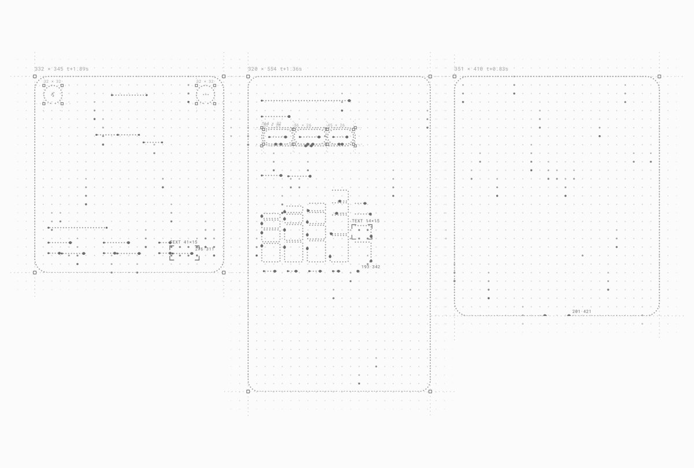

# Created a new skill for UI generation skeleton effect, something I’ve been using in my UI videos.
> Source: https://x.com/Jakubantalik/status/2109671433521815772
> Author: Jakub Antalik (@Jakubantalik)
> Posted: 2026-10-12T15:44:00+00:00
> Captured: 2026-10-15T09:02:28+00:00
> Stats at capture: 178,704 views · 3,992 likes · 69 replies · 202 reposts · 5,545 bookmarks · 30 quotes

## Post

Created a new skill for UI generation skeleton effect, something I’ve been using in my UI videos.

These UI examples are built with https://transitions.dev UI Agent.

## Media

[Post media 1](media/video-01.mp4) — Source media: https://video.twimg.com/amplify_video/2109652229980315648/vid/avc1/1066x720/BIsgKP3t0sQc3oOY.mp4?tag=29
 — Post media 1 thumbnail. Source media: https://pbs.twimg.com/amplify_video_thumb/2109652229980315648/img/KFUUdBAT-dZlfP2g.jpg
[Reply 2109681035831124076 media 1](media/video-02.mp4) — Source media: https://video.twimg.com/amplify_video/2109680986246008832/vid/avc1/2000x1500/ymp_zetRnNspcll9.mp4?tag=29
[Reply 2110131611417403485 media 1](media/video-03.mp4) — Source media: https://video.twimg.com/amplify_video/2110131194218115073/vid/avc1/2560x1920/uKUjycoqvqSnXa3N.mp4?tag=29
[Reply 2109853894608310603 media 1](media/animation-01.mp4) — Source media: https://video.twimg.com/tweet_video/HUe07l2asAAgSJe.mp4

## Thread

### Jakub Antalik ([@Jakubantalik](https://x.com/Jakubantalik/status/2109671434276757950)) — 2026-10-12T15:44:00+00:00

https://t.co/dTttcl9Rgp
### Jakub Antalik ([@Jakubantalik](https://x.com/Jakubantalik/status/2109688305608712192)) — 2026-10-12T16:51:02+00:00

@yurygok Nice! :)
### Jakub Antalik ([@Jakubantalik](https://x.com/Jakubantalik/status/2109688527302869142)) — 2026-10-12T16:51:55+00:00

@Yur1freedom 🙏
### Jakub Antalik ([@Jakubantalik](https://x.com/Jakubantalik/status/2110120287312154939)) — 2026-10-13T21:27:35+00:00

@BDoma Yes you can use in a video but also in app or website, I'm using it on https://t.co/eSmFziLkHB homepage now
### Jakub Antalik ([@Jakubantalik](https://x.com/Jakubantalik/status/2110119295762178512)) — 2026-10-13T21:23:38+00:00

@1rudepx Just effect :)
### Jakub Antalik ([@Jakubantalik](https://x.com/Jakubantalik/status/2109956928914989108)) — 2026-10-13T10:38:27+00:00

@BuildsByBen 🙏🙏
### Jakub Antalik ([@Jakubantalik](https://x.com/Jakubantalik/status/2109956723893293119)) — 2026-10-13T10:37:38+00:00

@joulsounet Glad to hear! :)
### Jakub Antalik ([@Jakubantalik](https://x.com/Jakubantalik/status/2110119938207932721)) — 2026-10-13T21:26:12+00:00

@ZoomLevels 🙏
### Jakub Antalik ([@Jakubantalik](https://x.com/Jakubantalik/status/2109957133295087705)) — 2026-10-13T10:39:16+00:00

@mannupaaji 🙏🙏
### Jakub Antalik ([@Jakubantalik](https://x.com/Jakubantalik/status/2110119831613665710)) — 2026-10-13T21:25:46+00:00

@hao_yii You can use it as a skill with your coding agent like Claude Code or Cursor https://t.co/jkKP85Zasc
### Jakub Antalik ([@Jakubantalik](https://x.com/Jakubantalik/status/2109688369022419161)) — 2026-10-12T16:51:17+00:00

@beastydesign thanks Fred!
### Jakub Antalik ([@Jakubantalik](https://x.com/Jakubantalik/status/2109957056295776256)) — 2026-10-13T10:38:57+00:00

@28Priyanshu2001 Thanks!

## Comments

### Yuri Gokoryan ([@yurygok](https://x.com/yurygok/status/2109681035831124076)) — 2026-10-12T16:22:09+00:00

@Jakubantalik Nice one, thanks! https://t.co/8XK15bbNWn
 — Source media: https://video.twimg.com/amplify_video/2109680986246008832/vid/avc1/2000x1500/ymp_zetRnNspcll9.mp4?tag=29
### Yuri ([@Yur1freedom](https://x.com/Yur1freedom/status/2109678004045504741)) — 2026-10-12T16:10:06+00:00

@Jakubantalik So cool!
### COURT ([@BDoma](https://x.com/BDoma/status/2109957934327197794)) — 2026-10-13T10:42:27+00:00

@Jakubantalik This is like a skeleton placeholder component like I might find in shadcn, but specifically designed to use in code based video editors like hype or?

Does it work in codex?
### RCZ ([@1rudepx](https://x.com/1rudepx/status/2110028930497536371)) — 2026-10-13T15:24:34+00:00

@Jakubantalik Fire 🔥!

Is this supposed to be generative UI or mimic it?
### Builds By Ben ([@BuildsByBen](https://x.com/BuildsByBen/status/2109954980786438329)) — 2026-10-13T10:30:43+00:00

@Jakubantalik Damn that’s beautiful
### Joulse ([@joulsounet](https://x.com/joulsounet/status/2109684224131297742)) — 2026-10-12T16:34:49+00:00

@Jakubantalik I'm going to put this in a new project 👀
### George ([@ZoomLevels](https://x.com/ZoomLevels/status/2110068152226730215)) — 2026-10-13T18:00:25+00:00

@Jakubantalik Just cookin’ and cookin’
### Manu Arora ([@mannupaaji](https://x.com/mannupaaji/status/2109853184466559413)) — 2026-10-13T03:46:13+00:00

@Jakubantalik 🔥
### xyaox ([@hao_yii](https://x.com/hao_yii/status/2109957811321078008)) — 2026-10-13T10:41:57+00:00

@Jakubantalik hi Jakub, im one of your pro user, just wondering how can i create the same skeleton effect?
### ✦ Fred ([@beastydesign](https://x.com/beastydesign/status/2109675484833562791)) — 2026-10-12T16:00:06+00:00

@Jakubantalik Amazing !
### Priyanshu Gupta ([@28Priyanshu2001](https://x.com/28Priyanshu2001/status/2109882909083730162)) — 2026-10-13T05:44:19+00:00

@Jakubantalik Cool work bro 👊
### Nihan M ([@nihanmubashshir](https://x.com/nihanmubashshir/status/2109929341035618310)) — 2026-10-13T08:48:50+00:00

@Jakubantalik this looks like functional UI, really cool!
### Nick Checan ([@nickchecan](https://x.com/nickchecan/status/2109989481310748945)) — 2026-10-13T12:47:48+00:00

@Jakubantalik It looks great!
### Maximus Barbare ([@themaxjb](https://x.com/themaxjb/status/2110098262128468073)) — 2026-10-13T20:00:04+00:00

@Jakubantalik That. Is. Awesome.
### Gavin Jaynes ([@GavinJaynes](https://x.com/GavinJaynes/status/2109931237494374815)) — 2026-10-13T08:56:22+00:00

@Jakubantalik This in unreasonably awesome!
### AJ ([@__AJ__42](https://x.com/__AJ__42/status/2109847248402366804)) — 2026-10-13T03:22:37+00:00

@Jakubantalik Really cool transitions and animations!
### نور ([@nour_sharabash](https://x.com/nour_sharabash/status/2109840655585357828)) — 2026-10-13T02:56:25+00:00

@Jakubantalik this costs money?
### Juan Arreguin ([@JuanArreguin](https://x.com/JuanArreguin/status/2109692784164659296)) — 2026-10-12T17:08:50+00:00

@Jakubantalik Let’s goooo! I might just give it a try. Been thinking about rebuilding my stuff in three.js
### Pratik ([@maybepratikk](https://x.com/maybepratikk/status/2109698795743391839)) — 2026-10-12T17:32:43+00:00

@Jakubantalik this is so cool, thank you for sharing!🙇🏻‍♂️
### WebApoll ױ ([@WebApoll](https://x.com/WebApoll/status/2109684209107247126)) — 2026-10-12T16:34:46+00:00

@Jakubantalik This is AWESOME 👏
### ari ([@_wwweb](https://x.com/_wwweb/status/2109898394756129137)) — 2026-10-13T06:45:51+00:00

@Jakubantalik i think this looks neat because you are able to see its entirety doing the loading animation, and that there’s no resize once the actual data has been loaded. i wanna see it on an actual browser page, if the effect still lands the same.
### Sergey | AI Agent Tests ([@SergeForge](https://x.com/SergeForge/status/2110162509030453715)) — 2026-10-14T00:15:21+00:00

@Jakubantalik skeleton loaders are such a cheap way to make a generated ui feel real. does the skill pull the skeleton shapes from the final layout or are they fixed presets?
### E_genius ([@yevloop](https://x.com/yevloop/status/2109910458987950556)) — 2026-10-13T07:33:48+00:00

@Jakubantalik skeleton loaders done right make an app feel 2x faster even when it isnt lol

do you tune the shimmer speed per screen or one global value?
### Jimi Barkway ([@JimiBarkway](https://x.com/JimiBarkway/status/2110305540257808471)) — 2026-10-14T09:43:43+00:00

@Jakubantalik The best part is the tiny feedback loop: see the state, tweak the motion, ship it. That makes polish useful, not just pretty.
### Berkay Erdinç ([@berkayerdinc_](https://x.com/berkayerdinc_/status/2110131611417403485)) — 2026-10-13T22:12:35+00:00

@Jakubantalik Thanks for the inspiration. I’ll keep testing how much better this can get. https://t.co/1hYJiAT0if
 — Source media: https://video.twimg.com/amplify_video/2110131194218115073/vid/avc1/2560x1920/uKUjycoqvqSnXa3N.mp4?tag=29
### beth ([@beth__gil](https://x.com/beth__gil/status/2109693692374376957)) — 2026-10-12T17:12:27+00:00

@Jakubantalik this is suuuuper cool
### Brjan | AI Builder ([@MrBrjan](https://x.com/MrBrjan/status/2109805888018248162)) — 2026-10-13T00:38:16+00:00

@Jakubantalik if it speeds up your video creation, that's gotta be a huge win for you
### Rick ([@pan3sar](https://x.com/pan3sar/status/2109826766831284431)) — 2026-10-13T02:01:14+00:00

@Jakubantalik So sick!
### anish ([@justmetolife](https://x.com/justmetolife/status/2109683897831469335)) — 2026-10-12T16:33:31+00:00

@Jakubantalik skeleton loading effects are one of those details ai ui generation usually skips, packaging it as a reusable skill makes sense
### Alain Dimabuyo ([@alainpogihehe](https://x.com/alainpogihehe/status/2110170448000610745)) — 2026-10-14T00:46:54+00:00

@Jakubantalik that looks sick
### Jhoan ([@ByFindIt](https://x.com/ByFindIt/status/2110026277683929495)) — 2026-10-13T15:14:01+00:00

@Jakubantalik @RaillyHugo bro
### World-builder ([@wrldbldr_](https://x.com/wrldbldr_/status/2109983146297246152)) — 2026-10-13T12:22:38+00:00

@Jakubantalik This is sick, digital schematics communicates process and progress so effectively
### simon.exe ([@gan_simon](https://x.com/gan_simon/status/2110009559645577607)) — 2026-10-13T14:07:35+00:00

@Jakubantalik nice
### Rakesh ([@RakeshSangem8](https://x.com/RakeshSangem8/status/2109853894608310603)) — 2026-10-13T03:49:02+00:00

@Jakubantalik https://t.co/RsZlEc8wl1
 — Source media: https://video.twimg.com/tweet_video/HUe07l2asAAgSJe.mp4

## Other returned timeline records

> The CLI did not expose reply relationships. These records do not start with a reply mention and were authored by someone other than the saved-post author. They may include recommendations or promoted posts; they are retained as source context, not verified replies.

### Starlink ([@Starlink](https://x.com/Starlink/status/2098108930002133419)) — 2026-09-10T17:58:44+00:00

Starlink offers fast, reliable internet in the most rural and remote locations. Portable and easy to set up, Starlink works wherever you are.

Order online in minutes.
### Starlink ([@Starlink](https://x.com/Starlink/status/2068115197718593741)) — 2026-06-19T23:34:21+00:00

Get connected with fast, reliable internet for streaming, video calls, online gaming and more.

Order online in minutes.
### Starlink ([@Starlink](https://x.com/Starlink/status/2099964624766730251)) — 2026-09-15T20:52:36+00:00

Get fast, reliable home internet for seamless streaming, working from home, gaming, and more across multiple devices.

Order online in minutes.

## Links

- https://transitions.dev
