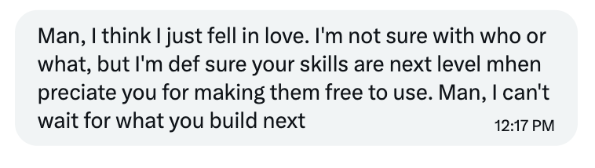
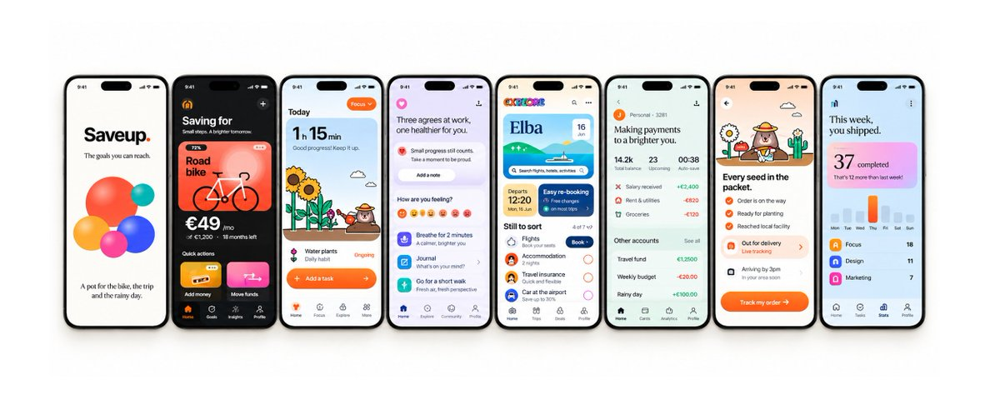

# How to Stop Making your Apps Look Like AI Slop 2.0
> Source: https://x.com/tobiadonadon_/status/2109681377280954407
> Author: Tobi (@tobiadonadon_)
> Posted: 2026-10-12T16:23:30+00:00
> Captured: 2026-10-15T09:02:28+00:00
> Stats at capture: 47,983 views · 174 likes · 9 replies · 13 reposts · 554 bookmarks · 2 quotes

## Post

https://x.com/i/article/2109678443839315971

## Article: How to Stop Making your Apps Look Like AI Slop 2.0

10 days ago i released a free Claude Code skill that fixes the generic, AI-generated look of apps.

it went extremely viral, and after seeing how many people actually used it and liked, i decided to build a much better version.

here are a few comments from people who used V1 (i have 30 more):

the original skill was good at one thing: making AI/template looking apps look like something a real designer had designed.

but it had limitations. it only worked with iPhone designs, couldn't produce animations, and didn't really help with the stuff you need when launching an app.

so i spent some time rebuilding it, and the result is App Designer Pro.

### What's Different in 2.0

the biggest change is that the skill now takes care of much more than just the interface.

here's what i added:

- iPhone + Android: designs both versions natively, instead of copying an iOS design onto Android.

- Animations: records your app screens in motion and exports MP4 videos you can use for content, demos, or marketing.

- Better copy: catches AI-sounding phrases, unnecessary text, and things a normal person would never say.

- Onboarding + paywalls: designs the screens that introduce your app and help you monetize it, following App Store and Play Store rules.

- Store assets: generates screenshots, icons, and other assets for both stores at the required dimensions.

- Much better design taste: more personality, bolder layouts, better illustrations, and a much stricter design critic.

and it still includes everything the first version did.

one thing i particularly wanted to improve was the design criticism (only 3 people were not happy). the original version was pretty good at making interfaces clean, but clean doesn't necessarily mean good.

you can have a perfectly organized app that still looks completely forgettable.

so i made the critic much harder to please. a design that looks tidy but has no personality won't get a good score anymore.

### How It Works

you download the skill, open Claude Code, and install it.

then you tell Claude what you're building.

it gives you three different design directions to choose from before starting, instead of immediately generating another generic interface.

once you pick one, it starts designing, reviewing, and improving the screens.

you can use it for an app you're building from scratch or one that already exists.

and you don't need to know anything about design. that's kind of the point.

the examples in this article were made using the skill, including the iPhone and Android versions, onboarding screens, paywalls, and store assets.

### Why I Made It

i've seen plenty of AI-built apps that work perfectly but look almost identical.

the same gradients, same cards, same fonts, same boring layouts (which always happens when designing with ai)

but with ai making development so much easier, i think design is becoming one of the few ways to actually stand out.

a year ago, building a functioning app was already impressive. now pretty much anyone can do it with the right tools, but making something people actually want to look at is a different story.

that's what i'm trying to solve with this skill

### Where To Get It

the original version is staying free. i'm not replacing it or removing anything (you can get it on my website)

but if you want the Android support, animations, better design reviews, paywalls, and everything else, i made Pro €5.

it's a one-time payment, no subscription.

i could probably charge considerably more for it, but i'd rather have more people using it and giving me feedback for the next updates (even though there’s not much to improve)

you can get it here:

[https://www.tobiadonadon.com/projects/construct/material/setups/app-designer-pro](https://www.tobiadonadon.com/projects/construct/material/setups/app-designer-pro)

## Media

 — Direct article media. Source media: https://pbs.twimg.com/media/HUcXeoCWwAA-TqG.jpg
 — Direct article media. Source media: https://pbs.twimg.com/media/HUcX1OqXoAEige_.png
 — Direct article media. Source media: https://pbs.twimg.com/media/HUcXvdbWgAAn1hw.png
 — Direct article media. Source media: https://pbs.twimg.com/media/HUcXyYDWMAAzarU.png
[Reply 2109978137794883621 media 1](media/video-01.mp4) — Source media: https://video.twimg.com/amplify_video/2109978042936287234/vid/avc1/1040x1760/kcjHzlW2EijkCj5j.mp4?tag=29
[Reply 2110375346046746649 media 1](media/video-02.mp4) — Source media: https://video.twimg.com/amplify_video/2110374180395098112/vid/avc1/576x1024/t-hXvst_5sBLVpTc.mp4?tag=29
[Reply 2110385721391366263 media 1](media/video-03.mp4) — Source media: https://video.twimg.com/amplify_video/2110385606014480384/vid/avc1/1920x1080/eKSiyJZ5o7itVk74.mp4?tag=29
[Reply 2110564814531797386 media 1](media/video-04.mp4) — Source media: https://video.twimg.com/amplify_video/2110564564559364096/vid/avc1/1920x1080/0IEKKVE3Qqpc4sEI.mp4?tag=29

## Thread

### Tobi ([@tobiadonadon_](https://x.com/tobiadonadon_/status/2109760086218531088)) — 2026-10-12T21:36:16+00:00

@talamanderrr Looking forward to that, and don't hesitate to reach out if you need any help.
### Tobi ([@tobiadonadon_](https://x.com/tobiadonadon_/status/2110015810282389951)) — 2026-10-13T14:32:26+00:00

@Beerded_Dad absolutely

## Comments

### talamander ([@talamanderrr](https://x.com/talamanderrr/status/2109758285448651095)) — 2026-10-12T21:29:07+00:00

@tobiadonadon_ just bought. will let you know what i think
### Paul ([@Beerded_Dad](https://x.com/Beerded_Dad/status/2110015460360311094)) — 2026-10-13T14:31:02+00:00

@tobiadonadon_ Is this Skill usable with Codex?
### Lee Wyatt Corp ([@LeeWyattCorp](https://x.com/LeeWyattCorp/status/2109848027464859931)) — 2026-10-13T03:25:43+00:00

@tobiadonadon_ A 2.0 for a Claude Code skill already.
### David Londoño ([@davidlondome](https://x.com/davidlondome/status/2109818783112086012)) — 2026-10-13T01:29:31+00:00

@tobiadonadon_ Will it work on a flutter app? I have my own UI design language
### amameetsworld ([@AmandaSartini](https://x.com/AmandaSartini/status/2109683591596679314)) — 2026-10-12T16:32:18+00:00

@tobiadonadon_ already got it! the first version was insane this version will be a game changer!

## Other returned timeline records

> The CLI did not expose reply relationships. These records do not start with a reply mention and were authored by someone other than the saved-post author. They may include recommendations or promoted posts; they are retained as source context, not verified replies.

### Starlink ([@Starlink](https://x.com/Starlink/status/2068115197718593741)) — 2026-06-19T23:34:21+00:00

Get connected with fast, reliable internet for streaming, video calls, online gaming and more.

Order online in minutes.
### 0xProbability ([@0xProbabillity](https://x.com/0xProbabillity/status/2109978137794883621)) — 2026-10-13T12:02:44+00:00

Reverse engineered my IoT devices and vibe coded my whole apartment into the menu bar.

Click a lamp in the 3D model, the real one turns on. ACs too.

Why stop at one AC. https://t.co/RqEjlbJuuL
 — Source media: https://video.twimg.com/amplify_video/2109978042936287234/vid/avc1/1040x1760/kcjHzlW2EijkCj5j.mp4?tag=29
### Steven Cheng ([@stevencheng](https://x.com/stevencheng/status/2110375346046746649)) — 2026-10-14T14:21:06+00:00

Behold, the ESP32 ball. https://t.co/yx3PvWK7jb
 — Source media: https://video.twimg.com/amplify_video/2110374180395098112/vid/avc1/576x1024/t-hXvst_5sBLVpTc.mp4?tag=29
### Hassan ([@nutlope](https://x.com/nutlope/status/2110385721391366263)) — 2026-10-14T15:02:19+00:00

Introducing Gloss!

A beautiful new way to save, read, and interact with articles.

→ Save articles, PDFs, and X bookmarks
→ Highlight and get instant answers with AI
→ Build a personal library you'll actually use

Free and open source! https://t.co/Uc5nU5nLym
 — Source media: https://video.twimg.com/amplify_video/2110385606014480384/vid/avc1/1920x1080/eKSiyJZ5o7itVk74.mp4?tag=29
### Luneri ([@itsluneri](https://x.com/itsluneri/status/2110564814531797386)) — 2026-10-15T02:53:58+00:00

Opus 5.5 with and without TasteSkill v2, same prompt on both.

Details, and my opinion about TasteSkill below! :) https://t.co/vq9mZnWLvl
 — Source media: https://video.twimg.com/amplify_video/2110564564559364096/vid/avc1/1920x1080/0IEKKVE3Qqpc4sEI.mp4?tag=29

## Links

- https://x.com/i/article/2109678443839315971
- https://www.tobiadonadon.com/projects/construct/material/setups/app-designer-pro
