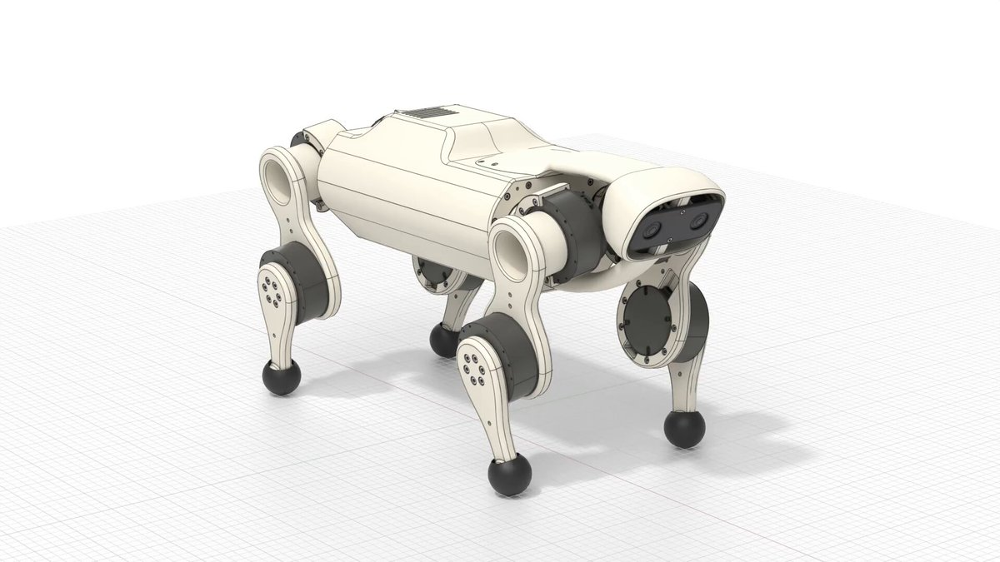
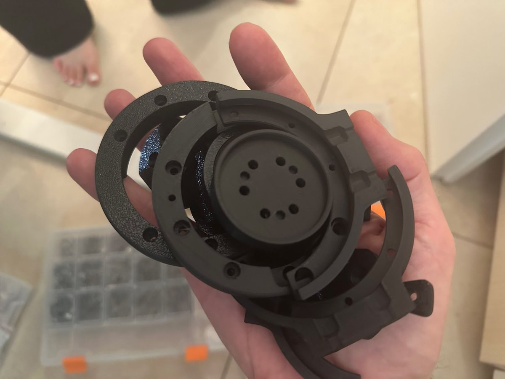

# Tips for agentic CAD: tell your agent to add these checkers and run them after every model update (mine is written in Python using build123d).
> Source: https://x.com/observie/status/2109707995919606136
> Author: David Bar (@observie)
> Posted: 2026-10-12T18:09:17+00:00
> Captured: 2026-10-15T09:02:28+00:00
> Stats at capture: 16,115 views · 363 likes · 17 replies · 30 reposts · 435 bookmarks · 3 quotes

## Post

Tips for agentic CAD: tell your agent to add these checkers and run them after every model update (mine is written in Python using build123d).

1. Spec check: measure the important dimensions of the parts and make sure they reasonably agree with your spec (I maintain a YAML with all high level design/decisions).

2. Motion check: move each joint through its full range in hundreds of positions and make sure no moving part touches another part. Use simple shapes and skip pairs whose bounding boxes do not touch so the check stays fast.

3. Geometry check: find very thin faces, very small faces, very short edges, and walls that are too thin. Make sure a symmetric part is really symmetric. Measure wall thickness by casting rays through the part.

4. Edge check: make sure each edge has a radius. If an edge must stay sharp, write it in a list of permitted sharp edges.

5. Manufacturability check: for machining, make sure a cutting tool can reach all surfaces, find inside corners that are too sharp for the tool, and find walls that are too thin. For printing, measure the minimum wall thickness and the area that needs support. For powder printing, find closed spaces that trap powder.

6. Fastener check: use standard screws and inserts from a library (i use bd_warehouse, the parts library for build123d). Make sure each fastener goes through its hole with clearance, aligns with a threaded hole, and engages the thread to the correct depth.

7. Hole check: make sure each hole has a fastener in it. If a hole has no fastener, write the reason for the hole.

8. Picture check: make pictures and sections of the part after each change. Tell the agent to examine the pictures before it says the work is complete.

9. Accepted problems: give each accepted problem a name and a small area. A large area can hide new problems after the shape changes.

10. Test the checkers: give each checker a part with a known error. Use the checker only after it finds the error.

## Media

[Post media 1](media/video-01.mp4) — Source media: https://video.twimg.com/amplify_video/2109707860686835712/vid/avc1/1280x720/rDiLaQiL6JGeNWYp.mp4?tag=29
 — Post media 1 thumbnail. Source media: https://pbs.twimg.com/amplify_video_thumb/2109707860686835712/img/ICfSNroGjOF1OyNf.jpg
 — Reply 2110343704099856764 media 1. Source media: https://pbs.twimg.com/media/HUlyR6GW4AAoC2X.jpg
[Reply 2110356122737475927 media 1](media/video-02.mp4) — Source media: https://video.twimg.com/amplify_video/2110355949445664768/vid/avc1/1920x1080/VcJs0YpMz6Sp0Zme.mp4?tag=16
[Reply 2110399984680210450 media 1](media/video-03.mp4) — Source media: https://video.twimg.com/amplify_video/2110391573771108352/vid/avc1/1920x1080/_Qmk-fNOYaSg0YdA.mp4?tag=29
[Reply 2110402797581533292 media 1](media/video-04.mp4) — Source media: https://video.twimg.com/amplify_video/2110400521915805698/vid/avc1/1920x1080/Ry5ZvgAI-7DcK1-e.mp4?tag=29

## Thread

### David Bar ([@observie](https://x.com/observie/status/2110304573323665717)) — 2026-10-14T09:39:52+00:00

Agentic CAD Rule #11: Assembly checker. Tell your agent to verify, after every model update, that each part can move along its assembly path in small steps without touching other parts. This catches designs that fit perfectly in the final position but cannot actually be assembled.
### David Bar ([@observie](https://x.com/observie/status/2110343704099856764)) — 2026-10-14T12:15:22+00:00

Agentic CAD Rule #12: Test coupons. Print a small coupon of each critical interface before you print or machine the full part. The coupon must have the same holes, bores and seats as the real part. Fit the real motors, dowels, pins and screws into the coupon https://t.co/kIVNTDePBB
 — Source media: https://pbs.twimg.com/media/HUlyR6GW4AAoC2X.jpg

## Comments

### Blair Hayes ([@BlairHayesAi](https://x.com/BlairHayesAi/status/2110647319930749105)) — 2026-10-15T08:21:49+00:00

@observie This is gold — especially #9 accepted problems with small area, and testing the checkers themselves. #2 bounding box skip for motion checks is the perf trick that makes it actually runnable every iteration.
### Alex Ai | Tools & Updates ([@AlexWithAi_](https://x.com/AlexWithAi_/status/2110350948958671195)) — 2026-10-14T12:44:09+00:00

@observie Automated CAD checkers after every model update is brilliant workflow
### DₐrKS ([@LitDarks](https://x.com/LitDarks/status/2109803016878768143)) — 2026-10-13T00:26:52+00:00

@observie Also keep a file of design rules for each manufacturing process and material. SLA SLS FDM CNC, alu PLA ABS etc.

Then get your exporter to require the process and material be specified so that things like tapping diameters, internal radii etc. adjust automatically.
### Henry ([@HongheWu](https://x.com/HongheWu/status/2109991962413863315)) — 2026-10-13T12:57:40+00:00

@observie great, looking forward to the open-source code
### Toolbox für LLMs ([@llmtoolboxde](https://x.com/llmtoolboxde/status/2110063060060639716)) — 2026-10-13T17:40:11+00:00

@observie spec check as a YAML dimension table is such a simple idea and i never thought of it. does it flag violations or does the agent get to 'reason' its way out of a failed measurement?
### Serge Kadjo ([@swkkadjo](https://x.com/swkkadjo/status/2109842971474477299)) — 2026-10-13T03:05:38+00:00

@observie Nice list. One addition from our side: freeze the spec file the checkers read from. An agent that can edit the model and the YAML will quietly fix the test instead of the part. Checkers on a read-only spec catch that.
### Imre ([@Endreshazam](https://x.com/Endreshazam/status/2109747908698337770)) — 2026-10-12T20:47:53+00:00

@observie Sounds good!   Looks like you have taken the "hard" out of hardware design 😁.   Guard these new insights and knowledge well, for in a few years it will be SI (aka AI) 😂
### Skippy ([@allig8or_dundee](https://x.com/allig8or_dundee/status/2110026647705403440)) — 2026-10-13T15:15:29+00:00

@observie @bot add this
### Noah N ([@Noahsarc1000](https://x.com/Noahsarc1000/status/2109781768274624616)) — 2026-10-12T23:02:26+00:00

@observie good tips
### Allowistic Artist ([@allowistic](https://x.com/allowistic/status/2109740460864659764)) — 2026-10-12T20:18:17+00:00

@observie @bot check this out for the crew

## Other returned timeline records

> The CLI did not expose reply relationships. These records do not start with a reply mention and were authored by someone other than the saved-post author. They may include recommendations or promoted posts; they are retained as source context, not verified replies.

### Starlink ([@Starlink](https://x.com/Starlink/status/2068115197718593741)) — 2026-06-19T23:34:21+00:00

Get connected with fast, reliable internet for streaming, video calls, online gaming and more.

Order online in minutes.
### Formlabs ([@formlabs](https://x.com/formlabs/status/2110356122737475927)) — 2026-10-14T13:04:42+00:00

Introducing Form Studio 1 - a professional resin 3D printer, starting at $699. Discover Form Studio 1 https://t.co/1E6Rw4aohO 

Form Studio 1 is fast, safe, detailed, reliable, and open. 
⚡️ Fast - Print most parts in under 2 hours 
👩‍🔬 Safe - The world’s safest resin 3D printing ecosystem & the only resin printing ecosystem to be UL GREENGUARD Gold Certified
🔎 Detailed - Smooth surfaces, sharp details, accurate assemblies
💪 Reliable - Alpha Resins have a print success rate of 99%
👐 Open - Print with any materials, Formlabs or third-party resins

We took 15 years of engineering and packed it into the world's most affordable professional resin 3D printer. 

With a limited Founder’s Edition in aqua, teal, and violet colorways, available while supplies last.
 — Source media: https://video.twimg.com/amplify_video/2110355949445664768/vid/avc1/1920x1080/VcJs0YpMz6Sp0Zme.mp4?tag=16
### Chris Paxton ([@chris_j_paxton](https://x.com/chris_j_paxton/status/2110395990570086619)) — 2026-10-14T15:43:08+00:00

2.5k per arm. Everything will be robots
### RoboParty ([@RoboParty_DEV](https://x.com/RoboParty_DEV/status/2110399984680210450)) — 2026-10-14T15:59:00+00:00

🚀RP1 is officially here.

🌍Putting control of robotics back in developers’ hands.
Introducing RP1 (ROBOTO 01) by RoboParty—a high-performance, fully open-source humanoid robotics platform for frontier robotics research and embodied AI model development.

🤖 Open across the full hardware and software stack:

• Robot platform: mechanical CAD, bill of materials, and assembly documentation
• Actuators: in-house ROMOMO joint designs and related technical resources
• Control: electrical systems, firmware, low-level drivers, and motion control implementations
• Development: simulation models, SDKs, data processing tools, and training tools
• Engineering foundations: technical documentation and research materials

Open the black box.
Understand the system.
Make it your own.

A deviation in motion can originate in the model, control policy, actuator response, or mechanical structure.
RP1 opens up the design and implementation of these layers so developers can trace problems, modify the system, and validate changes on real hardware.

Open-source algorithms for advanced motion control
RP1 has demonstrated continuous walking, recovery from disturbances, getting back up after a fall, and human motion tracking.

UFO and MimicLite connect motion learning, control policies, and execution on real hardware.

The open toolchain connects data collection, simulation training, hardware deployment, and experimental validation—supporting joint iteration across models, control, and hardware.

From RPO to RP1, we’re turning one team’s engineering experience into a starting point for many more.

Opening the future of embodied AI to everyone ready to explore it.

🔗RP1 on GitHub:
https://t.co/kMqFLi3eJ3
#RoboParty #RP1 #OpenSourceRobotics #EmbodiedAI
 — Source media: https://video.twimg.com/amplify_video/2110391573771108352/vid/avc1/1920x1080/_Qmk-fNOYaSg0YdA.mp4?tag=29
### Antoine Pirrone ([@antoinepirrone](https://x.com/antoinepirrone/status/2110402797581533292)) — 2026-10-14T16:10:10+00:00

Testing Microduck's SLAM!

It runs fully onboard, with just its leg odometry and the 8×8 ToF sensor in its head, 64 pixels of depth. Carry it across the room and it finds itself again after a few steps.

The ArUco tags are only there for ground truth: a fixed camera tracks the one on its head, and the duck never uses them. Against that ground truth, its position at each stop is off by 4.8 cm on median, and 94% of the time it claims to know where it is, it's within 15 cm. In this session it relocalized after a 1.5 m carry (2 cm off), a seated 1.5 m carry (11 cm) and a fall (3 cm), and across our benchmark sessions it never relocalized to the wrong place.
 — Source media: https://video.twimg.com/amplify_video/2110400521915805698/vid/avc1/1920x1080/Ry5ZvgAI-7DcK1-e.mp4?tag=29
