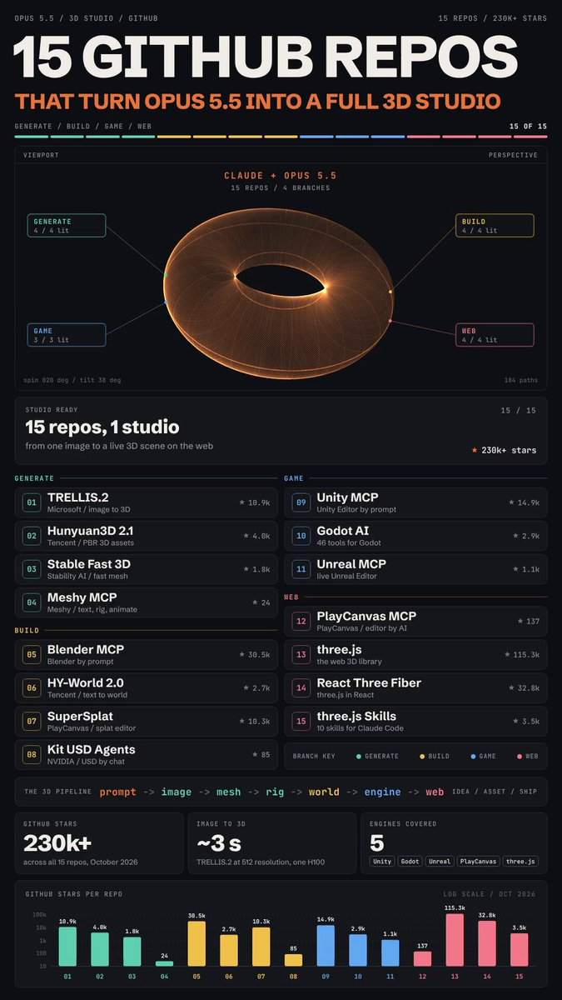

# is it legal?
> Source: https://x.com/Mnilax/status/2109716261160538324
> Author: Mnimiy (@Mnilax)
> Posted: 2026-10-12T18:42:07+00:00
> Captured: 2026-10-15T09:02:28+00:00
> Stats at capture: 193,708 views · 891 likes · 18 replies · 90 reposts · 2,027 bookmarks · 7 quotes

## Post

is it legal?

NVIDIA and Microsoft just open-sourced the pieces of a full 3D studio for Opus 5.5

15 github repos, sorted by what you want to make:

GENERATE 3D ASSETS

01. TRELLIS.2 by Microsoft:
http://github.com/microsoft/TRELLIS.2
-> one image in, a fully textured 3D asset out, about 3 seconds on an H100

02. Hunyuan3D-2.1 by Tencent:
http://github.com/Tencent-Hunyuan/Hunyuan3D-2.1
-> production-ready 3D assets with PBR textures

03. stable-fast-3d by Stability AI:
http://github.com/Stability-AI/stable-fast-3d
-> one photo to a clean UV-unwrapped mesh, built for speed

04. meshy-mcp-server by Meshy:
http://github.com/meshy-dev/meshy-mcp-server
-> text or image to 3D, then remesh, retexture, rig and animate from your agent

BUILD SCENES AND WORLDS

05. mcp-for-blender:
http://github.com/ahujasid/mcp-for-blender
-> prompt-driven modeling, scene building and edits in a live Blender

06. HY-World-2.0 by Tencent:
http://github.com/Tencent-Hunyuan/HY-World-2.0
-> text or a single image to a navigable 3D world

07. supersplat by PlayCanvas:
http://github.com/playcanvas/supersplat
-> inspect, edit, optimize and publish 3D Gaussian splats in the browser

08. kit-usd-agents by NVIDIA:
http://github.com/NVIDIA-Omniverse/kit-usd-agents
-> edit Omniverse USD scenes in plain English, plus MCP servers for Kit and Isaac Sim

MAKE A GAME

09. unity-mcp:
http://github.com/CoplayDev/unity-mcp
-> run the Unity Editor in plain English: scenes, C# scripts, assets, tests, builds

10. godot-ai:
http://github.com/hi-godot/godot-ai
-> 46 tools for a live Godot editor: scenes, scripts, signals, UI, particles

11. unreal-engine-mcp:
http://github.com/flopperam/unreal-engine-mcp
-> drive a live Unreal Editor: actors, world building, Blueprints

3D ON THE WEB

12. editor-mcp-server by PlayCanvas:
http://github.com/playcanvas/editor-mcp-server
-> your agent builds PlayCanvas scenes and checks they actually run

13. three.js:
http://github.com/mrdoob/three.js
-> the JavaScript 3D library itself, 115k stars on GitHub

14. react-three-fiber:
http://github.com/pmndrs/react-three-fiber
-> build three.js scenes as reusable React components

15. threejs-skills:
http://github.com/CloudAI-X/threejs-skills
-> 10 three.js skills for Claude Code, from shaders to post-processing

a full 3D pipeline, and every piece of it lives on github

> Quoted post by Mnimiy ([@Mnilax](https://x.com/Mnilax/status/2109314840057565345)):
>
> it's absolutely gold
>
> ex-Figma Design Lead dropped a list of 15 github repos that turn Opus 5.5 into a full motion design studio
>
> SHIP A LAUNCH VIDEO
>
> 01. product-launch-motion:
> http://github.com/AbubakrChan/product-launch-motion
> -> point it at your product, get script, voiceover, camera moves and film grade
>
> 02. motion-graphics-skills:
> http://github.com/charlie947/motion-graphics-skills
> -> 15 skills for launch videos, animated charts and reels, zero After Effects
>
> 03. claude-motion-design:
> http://github.com/howseen-ai/claude-motion-design
> -> every cut lands on the beat, its demo film took 5 iterations on Opus 5.5
>
> EDIT YOUR OWN FOOTAGE
>
> 04. hyperframes-student-kit:
> http://github.com/nateherkai/hyperframes-student-kit
> -> drop in your footage, it cuts dead air and mistakes, then adds motion graphics
>
> 05. motion-graphics:
> http://github.com/Barty-Bart/motion-graphics
> -> motion B-roll timed to your words, and it cuts you out of the background
>
> MAKE ANIMATED SHORTS
>
> 06. animate:
> http://github.com/cth9191/animate
> -> explainers in 7 styles, cut paper to riso to pixel art, storyboard first
>
> 07. claude-motion:
> http://github.com/whaleyxbt/claude-motion
> -> teaches Claude taste, makes it check its own frames, adds a sound engine
>
> 08. claude-remotion-skill:
> http://github.com/haidrrrry/claude-remotion-skill
> -> fixes the flat fades and stiff motion most AI videos ship with
>
> ANIMATE YOUR SITE
>
> 09. motion:
> http://github.com/motiondivision/motion
> -> buttons, cards and page transitions for React, Vue and plain JS
>
> 10. motion-dev-animations-skill:
> http://github.com/199-biotechnologies/motion-dev-animations-skill
> -> one sentence and Claude Code animates your site
>
> OFFICIAL BUILDING BLOCKS
>
> 11. hyperframes:
> http://github.com/heygen-com/hyperframes
> -> your agent writes HTML, HyperFrames renders it as video
>
> 12. remotion:
> http://github.com/remotion-dev/remotion
> -> turn an idea into a video straight from your coding agent
>
> 13. remotion skills:
> http://github.com/remotion-dev/skills
> -> Remotion's official best practices for Claude Code, Codex and Cursor
>
> 14. gsap-skills:
> http://github.com/greensock/gsap-skills
> -> official GSAP skills, the engine under the launch and editing kits above
>
> 15. motion-design-skill by LottieFiles:
> http://github.com/LottieFiles/motion-design-skill
> -> Disney's 12 animation principles, rewritten for AI agents
>
> the map picks your first install in 3 questions

## Media

[Post media 1](media/video-01.mp4) — Source media: https://video.twimg.com/amplify_video/2109714871826702336/vid/avc1/720x1280/oho22mMSyj8UY9et.mp4?tag=29
 — Post media 1 thumbnail. Source media: https://pbs.twimg.com/amplify_video_thumb/2109714871826702336/img/6DS5SlfAyKFz3EVI.jpg

## Thread

### Mnimiy ([@Mnilax](https://x.com/Mnilax/status/2109732043353682405)) — 2026-10-12T19:44:50+00:00

@Alex_Vainshtein i think we'll see the pipeline about u said very soon
### Mnimiy ([@Mnilax](https://x.com/Mnilax/status/2109781454540705885)) — 2026-10-12T23:01:11+00:00

@lennonhtyziw what do you mean, my friend? xd

## Comments

### Lennon ([@lennonhtyziw](https://x.com/lennonhtyziw/status/2109780100241838123)) — 2026-10-12T22:55:48+00:00

@Mnilax So, another tool in the mix? I’ll believe it when I see it. Looks like rain's coming in.
### Shane Brumback ([@ShaneBrumback](https://x.com/ShaneBrumback/status/2110014276811333817)) — 2026-10-13T14:26:20+00:00

@Mnilax Solid list. meshy-mcp-server plus three.js covers most of a browser game pipeline. The rig-and-animate step is where agents surprised me most. I wrote up the full flow for a 19-bone, 10-clip soldier GLB: https://t.co/kYZdspHP9R
### Ken Greenwood ([@KenThatGuy](https://x.com/KenThatGuy/status/2109811350230704614)) — 2026-10-13T00:59:58+00:00

@Mnilax Trellis has its limits of practicality
### Heba AI ([@SubarcticRec](https://x.com/SubarcticRec/status/2109925535090672122)) — 2026-10-13T08:33:42+00:00

@Mnilax What this had to with Nvidia? Its a list of old repos in github.
### Web制作出身のAI・Webアプリ開発者 ([@Rachel_hkz](https://x.com/Rachel_hkz/status/2109954993529004425)) — 2026-10-13T10:30:46+00:00

@Mnilax 3D生成からエディタ操作、Web表示まで一通り揃うのは面白いですね。実際に制作へ組み込むなら、各ツールのライセンスや出力形式、工程間の受け渡しがどこまで噛み合うかも見てみたいです。
### Osiris2025 ([@ta2025](https://x.com/ta2025/status/2109938025958690881)) — 2026-10-13T09:23:20+00:00

@Mnilax Why wouldn’t it be legal?
### Blum ([@Blum_OG](https://x.com/Blum_OG/status/2110091175747301483)) — 2026-10-13T19:31:54+00:00

@Mnilax Lots of useful repos here, I already use some of them and will check out the rest too
### infinity-online.net ([@Infinity__Live](https://x.com/Infinity__Live/status/2109996384157888979)) — 2026-10-13T13:15:14+00:00

@Mnilax 3d on a web page isn't 3d web, it's a dead end.
### Harry Tandy ([@HarryTandy](https://x.com/HarryTandy/status/2109983026776248384)) — 2026-10-13T12:22:09+00:00

@Mnilax open source is making 3d creation insanely accessible
### CloudDog ([@CloudDogx](https://x.com/CloudDogx/status/2110012195203580263)) — 2026-10-13T14:18:04+00:00

@Mnilax NVIDIA and Microsoft open-sourcing 3D studio pieces is a big deal for anyone building product demos. One image in, fully textured 3D asset out — that completely changes the economics of having real 3D content instead of stock renders.
### KayneEast ([@KunHTZ](https://x.com/KunHTZ/status/2109994442535149814)) — 2026-10-13T13:07:31+00:00

@Mnilax one image to a textured asset in 3 seconds. the bottleneck moves to taste pretty fast
### Moysha ([@mmoyshaa](https://x.com/mmoyshaa/status/2109722615052960073)) — 2026-10-12T19:07:22+00:00

@Mnilax Very interesting information, thank you for sharing
### txboy ([@txboy_hunter](https://x.com/txboy_hunter/status/2110057938979258451)) — 2026-10-13T17:19:50+00:00

@Mnilax The gate keeping is over. We are pushing humanity forward
### Caleb Kennedy ([@calebkennedyi](https://x.com/calebkennedyi/status/2110045601240957222)) — 2026-10-13T16:30:48+00:00

@Mnilax @MainframeAgent
### SD House Mafia ([@KrosusC](https://x.com/KrosusC/status/2110020849730244936)) — 2026-10-13T14:52:27+00:00

@Mnilax The fuck are you talking about??

## Other returned timeline records

> The CLI did not expose reply relationships. These records do not start with a reply mention and were authored by someone other than the saved-post author. They may include recommendations or promoted posts; they are retained as source context, not verified replies.

### Alex Vainshtein ([@Alex_Vainshtein](https://x.com/Alex_Vainshtein/status/2109727089599340560)) — 2026-10-12T19:25:09+00:00

The missing piece for production game assets is usually what happens after generation. I've been working with agent-driven 3D workflows, and getting an initial model is often easier than fixing geometry, materials, animations and integration issues.

A reliable generate → inspect → repair pipeline would be a much bigger breakthrough than another one-shot asset demo.
### Alice Games ([@alice_game77056](https://x.com/alice_game77056/status/2072319807165542839)) — 2026-07-01T14:01:58+00:00

One wrong tooth.
Immediate unemployment.
### Kube DC ([@Kube_DC](https://x.com/Kube_DC/status/2092265878276427952)) — 2026-08-25T15:00:32+00:00

Stop Overpaying for Kubernetes — Launch Your Cluster for €19/Month

## Links

- https://github.com/microsoft/TRELLIS.2
- http://github.com/microsoft/TRELLIS.2
- http://github.com/Tencent-Hunyuan/Hunyuan3D-2.1
- http://github.com/Stability-AI/stable-fast-3d
- http://github.com/meshy-dev/meshy-mcp-server
- http://github.com/ahujasid/mcp-for-blender
- http://github.com/Tencent-Hunyuan/HY-World-2.0
- http://github.com/playcanvas/supersplat
- http://github.com/NVIDIA-Omniverse/kit-usd-agents
- http://github.com/CoplayDev/unity-mcp
- http://github.com/hi-godot/godot-ai
- http://github.com/flopperam/unreal-engine-mcp
- http://github.com/playcanvas/editor-mcp-server
- http://github.com/mrdoob/three.js
- http://github.com/pmndrs/react-three-fiber
- http://github.com/CloudAI-X/threejs-skills
