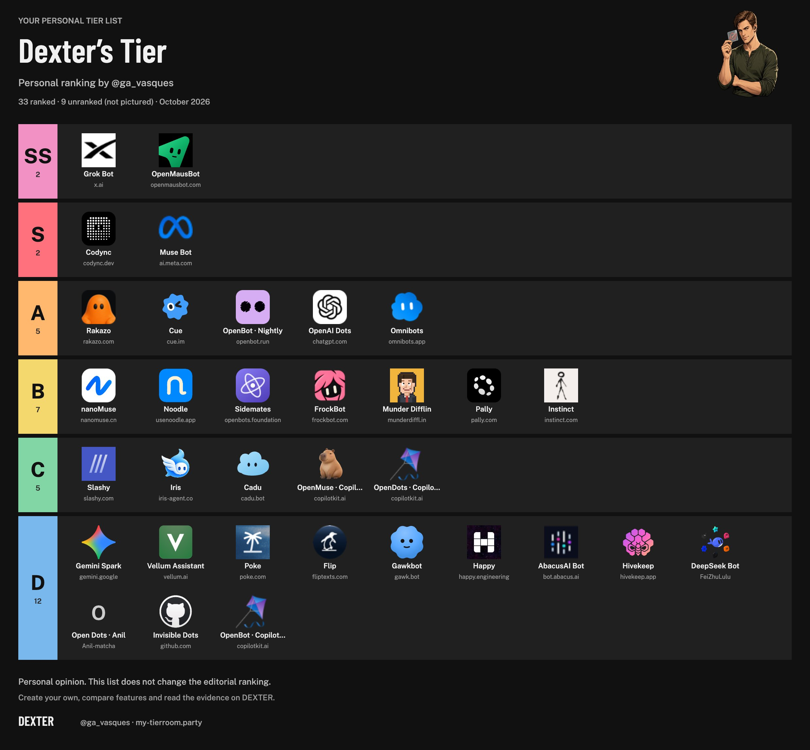
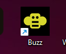
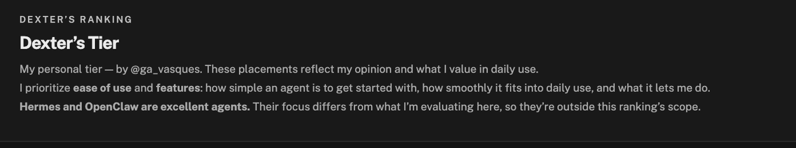

# My personal AI agent tier list.
> Source: https://x.com/Ga_Vasques/status/2109719615324496137
> Author: Guilherme Vasques (@Ga_Vasques)
> Posted: 2026-10-12T18:55:27+00:00
> Captured: 2026-10-15T09:02:28+00:00
> Stats at capture: 188,710 views · 631 likes · 110 replies · 40 reposts · 948 bookmarks · 11 quotes

## Post

My personal AI agent tier list.

I think Grok is top-notch, but the model and the subscription price are deal-breakers. The $20 plan doesn't really give you much usage.

Mausbot is great, I use it with Claude 5.5, and I’ve been testing Codync; it’s been a pleasant surprise.

Vote on the models and create your own tier list.https://my-tierroom.party/

All have your page, detailed informations. All Day Updated.

## Media

 — Post media 1. Source media: https://pbs.twimg.com/media/HUc6OKmWIAArtZ0.jpg?name=orig
[Reply 2109621674752795019 media 1](media/video-01.mp4) — Source media: https://video.twimg.com/amplify_video/2109297386300583938/vid/avc1/720x1280/sPcWgWoxXmgbbNcr.mp4?tag=29
 — Reply 2109763018703696145 media 1. Source media: https://pbs.twimg.com/media/HUdiJB3WMAAbgjh.png
 — Reply 2109763018703696145 media 2. Source media: https://pbs.twimg.com/media/HUdiP5hXIAAGQJx.png
 — Reply 2109763469637820580 media 1. Source media: https://pbs.twimg.com/media/HUdipkWX0AAnBBx.png

## Thread

### Guilherme Vasques ([@Ga_Vasques](https://x.com/Ga_Vasques/status/2109826371270947323)) — 2026-10-13T01:59:40+00:00

https://t.co/ne3iFcBhCi Dont forget do Vote, all are welcome to contribute.
### Guilherme Vasques ([@Ga_Vasques](https://x.com/Ga_Vasques/status/2109785357378089440)) — 2026-10-12T23:16:41+00:00

@jacorn01 @hey__fo Will check,
### Guilherme Vasques ([@Ga_Vasques](https://x.com/Ga_Vasques/status/2109795114336112871)) — 2026-10-12T23:55:28+00:00

@mablesjoseph @NousResearch Enter on site, vote in Hermes. Hermes is One the best harness ever made. But not easy to use ai assistent. 

This is why i made this, non tecnical people
### Guilherme Vasques ([@Ga_Vasques](https://x.com/Ga_Vasques/status/2109720568664629310)) — 2026-10-12T18:59:14+00:00

@lbki34064963 its very good. really.
### Guilherme Vasques ([@Ga_Vasques](https://x.com/Ga_Vasques/status/2109819457556136227)) — 2026-10-13T01:32:11+00:00

@an0ym0u5 @Figure_robot Added to the list; let's see soon how it fares in the voting. Are welcome to vote https://t.co/ne3iFcAJMK
### Guilherme Vasques ([@Ga_Vasques](https://x.com/Ga_Vasques/status/2109825984014762179)) — 2026-10-13T01:58:07+00:00

@Dr_Zikk yep, i already get new sub model
### Guilherme Vasques ([@Ga_Vasques](https://x.com/Ga_Vasques/status/2109783605555949776)) — 2026-10-12T23:09:44+00:00

@Ringo92_AI Not in my tier, you can vote in community tier or make your.

Hermes its One of the best harness, but not user friendly for everyone non dev
### Guilherme Vasques ([@Ga_Vasques](https://x.com/Ga_Vasques/status/2109818451095400899)) — 2026-10-13T01:28:11+00:00

@savvyhua but it is for Slax only, not?
### Guilherme Vasques ([@Ga_Vasques](https://x.com/Ga_Vasques/status/2109819582878011736)) — 2026-10-13T01:32:41+00:00

@wcblessing @hark_labs I dont test, i add now on the list, and you are welcome to vote https://t.co/ne3iFcBhCi
### Guilherme Vasques ([@Ga_Vasques](https://x.com/Ga_Vasques/status/2109734806347030528)) — 2026-10-12T19:55:49+00:00

@Urke70933420 Noodle make is good, Manus CUE, the best with Group Chat, but i dont know the future of Manus.
### Guilherme Vasques ([@Ga_Vasques](https://x.com/Ga_Vasques/status/2109793457585745944)) — 2026-10-12T23:48:53+00:00

Público não dev, não tech adopter. Hermes é harness top, genérico, o foco dele é outro. O @Teknium deixou claro isso. 

Usei muito Hermes. Muito mesmo. Mas a facilidade que outros trazem agora, mesmo sem funções “extras” são animais. 

O público é geral, com menos conhecimento técnico.
### Guilherme Vasques ([@Ga_Vasques](https://x.com/Ga_Vasques/status/2110118710052798872)) — 2026-10-13T21:21:19+00:00

@Urke70933420 yep. just a moment.
### Guilherme Vasques ([@Ga_Vasques](https://x.com/Ga_Vasques/status/2109797725742969165)) — 2026-10-13T00:05:50+00:00

@davis_milhausen At this moment, geo limited. I cant use atm. People talk to good, but i cant check
### Guilherme Vasques ([@Ga_Vasques](https://x.com/Ga_Vasques/status/2109783194702885070)) — 2026-10-12T23:08:06+00:00

@AlexMontas I use a lot, usage its not problem for me.
### Guilherme Vasques ([@Ga_Vasques](https://x.com/Ga_Vasques/status/2109818142436327753)) — 2026-10-13T01:26:58+00:00

@KullAxel I didn't test all of them,I tested a good number of them, and for the others, I based my assessment on information from the repository and website, as well as reviews and preliminary analysis.

All are welcome to vote https://t.co/ne3iFcAJMK
### Guilherme Vasques ([@Ga_Vasques](https://x.com/Ga_Vasques/status/2109819996075442187)) — 2026-10-13T01:34:20+00:00

@marksagang @mausbot_ good, you are welcome to vote https://t.co/ne3iFcAJMK
### Guilherme Vasques ([@Ga_Vasques](https://x.com/Ga_Vasques/status/2109818925911568833)) — 2026-10-13T01:30:05+00:00

@yozakur66433785 You can votem to hermes if want, i love hermes, bot is not my choice for Personal AI Assistent. 

Its a better harness. Havent native APP, not easy setup and manage, 

You are welcome to vote https://t.co/ne3iFcBhCi
### Guilherme Vasques ([@Ga_Vasques](https://x.com/Ga_Vasques/status/2109765993572470898)) — 2026-10-12T21:59:45+00:00

@NOOROU I believe they are different products, the idea is a personal assistant tier.

Its another tier for me.
### Guilherme Vasques ([@Ga_Vasques](https://x.com/Ga_Vasques/status/2109793934184431754)) — 2026-10-12T23:50:46+00:00

@freddsster16 Enter on site, vote in Hermes. Hermes is One the best harness ever made. But not easy to use ai assistent. 

This is why i made this, non técnicas people
### Guilherme Vasques ([@Ga_Vasques](https://x.com/Ga_Vasques/status/2109763469637820580)) — 2026-10-12T21:49:43+00:00

@bman_turner its on my disclaimer on site, https://t.co/cl0ynWSdUx https://t.co/FR1Y4vayJh
 — Source media: https://pbs.twimg.com/media/HUdipkWX0AAnBBx.png
### Guilherme Vasques ([@Ga_Vasques](https://x.com/Ga_Vasques/status/2109793812700860644)) — 2026-10-12T23:50:17+00:00

@45Becomes47 Enter on site, vote in Hermes. Hermes is One the best harness ever made. But not easy to use ai assistent. 

This is why i made this, non técnicas people.
### Guilherme Vasques ([@Ga_Vasques](https://x.com/Ga_Vasques/status/2109818329573580995)) — 2026-10-13T01:27:42+00:00

I didn't test all of them,I tested a good number of them, and for the others, I based my assessment on information from the repository and website, as well as reviews and preliminary analysis.

All are welcome to vote https://t.co/vqaFjAHpa1

Dont need vote them all, only whats you know.

## Comments

### jaco ([@jacorn01](https://x.com/jacorn01/status/2109783764876624332)) — 2026-10-12T23:10:22+00:00

@Ga_Vasques What about @hey__fo ?
### Mable Joseph ([@mablesjoseph](https://x.com/mablesjoseph/status/2109794146877649298)) — 2026-10-12T23:51:37+00:00

@Ga_Vasques Interesting you don't have Hermes by @NousResearch in the SS tier. Its probably one of the best.
### kevinlee ([@lbki34064963](https://x.com/lbki34064963/status/2109720348350652837)) — 2026-10-12T18:58:22+00:00

@Ga_Vasques Thanks for putting Codync on tier S!
### Anonymous ([@an0ym0u5](https://x.com/an0ym0u5/status/2109793594039275861)) — 2026-10-12T23:49:25+00:00

@Ga_Vasques What about Hark from @Figure_robot
### Zikk ([@Dr_Zikk](https://x.com/Dr_Zikk/status/2109822784365072513)) — 2026-10-13T01:45:25+00:00

@Ga_Vasques Serendipitous, they just changed their subscription model.
### Ringo AI ([@Ringo92_AI](https://x.com/Ringo92_AI/status/2109776371857899667)) — 2026-10-12T22:40:59+00:00

@Ga_Vasques Where is Hermes?
### AI Night Shift ([@savvyhua](https://x.com/savvyhua/status/2109811354609840182)) — 2026-10-13T00:59:59+00:00

@Ga_Vasques Has no one ever used Claude Tag???
### William ([@wcblessing](https://x.com/wcblessing/status/2109790291125502461)) — 2026-10-12T23:36:18+00:00

@Ga_Vasques Have you tried @hark_labs ?
### Urke ([@Urke70933420](https://x.com/Urke70933420/status/2109726998545432751)) — 2026-10-12T19:24:47+00:00

@Ga_Vasques Damn, thanks for making the list 🔥. I love trying these bots. Have you tested any group chats? A lot of them struggle with coordination in them it seems.
### Gato da Redbull ([@gatoredbull](https://x.com/gatoredbull/status/2109791469917880327)) — 2026-10-12T23:40:59+00:00

@Ga_Vasques O hermes agora tem uma função de bots só pra deixar claro

Qual apelo do GrokBot e do OpenMaus?? Por que alguém trocaria o Hermes pra usar ele? Qual o público alvo disso?
### Urke ([@Urke70933420](https://x.com/Urke70933420/status/2110114011849363829)) — 2026-10-13T21:02:39+00:00

@Ga_Vasques So many people asking for Hermes just to end up on Tier A 😭 can you make the number of votes visible on the site @Ga_Vasques ?
### Davis Milhausen ([@davis_milhausen](https://x.com/davis_milhausen/status/2109796480211107866)) — 2026-10-13T00:00:53+00:00

@Ga_Vasques From your experience what makes Grok bot better than Muse? I haven’t used Grok bot yet
### Alex Montas ([@AlexMontas](https://x.com/AlexMontas/status/2109777125733711899)) — 2026-10-12T22:43:59+00:00

@Ga_Vasques Isn’t it super expensive to use Claude with open Maus?
### Alexandru Fartade ([@KullAxel](https://x.com/KullAxel/status/2109817024377675950)) — 2026-10-13T01:22:31+00:00

@Ga_Vasques How did you personally tested them all?
### Mark ([@marksagang](https://x.com/marksagang/status/2109773104238977385)) — 2026-10-12T22:28:00+00:00

@Ga_Vasques i've been using @mausbot_ too and setting up skills is quite helpful before doing anything.
### yozakura ([@yozakur66433785](https://x.com/yozakur66433785/status/2109801846240157998)) — 2026-10-13T00:22:13+00:00

@Ga_Vasques no Hermes？
### Nour Eddine Hamaidi ([@NOOROU](https://x.com/NOOROU/status/2109763018703696145)) — 2026-10-12T21:47:55+00:00

@Ga_Vasques Add BUZZ and Agenr https://t.co/H76u1jVmWx https://t.co/v3am2gZ2Jl
 — Source media: https://pbs.twimg.com/media/HUdiJB3WMAAbgjh.png
 — Source media: https://pbs.twimg.com/media/HUdiP5hXIAAGQJx.png
### Freddy ([@freddsster16](https://x.com/freddsster16/status/2109787678447448311)) — 2026-10-12T23:25:55+00:00

@Ga_Vasques Hermes?
### Beeman ([@bman_turner](https://x.com/bman_turner/status/2109759271600791831)) — 2026-10-12T21:33:02+00:00

@Ga_Vasques Can't trust a list without Hermes on it.
### We'reSoBack ([@45Becomes47](https://x.com/45Becomes47/status/2109790419282547090)) — 2026-10-12T23:36:48+00:00

@Ga_Vasques No Hermes on this list? Sorry, doubting your credibility...
### Marcolino PsyBR ([@marcopsAibtc](https://x.com/marcopsAibtc/status/2109814561180405827)) — 2026-10-13T01:12:44+00:00

@Ga_Vasques Esse ties list é só sobre UX de Onboard? Pq é impossível testar todos esses Bots de verdade

## Other returned timeline records

> The CLI did not expose reply relationships. These records do not start with a reply mention and were authored by someone other than the saved-post author. They may include recommendations or promoted posts; they are retained as source context, not verified replies.

### Quant AI ([@tryquantio](https://x.com/tryquantio/status/2105946762640843099)) — 2026-10-02T09:03:29+00:00

Trade smarter. Automate faster. Stay ahead - without switching tools.
Start trading smarter. Join Quant.
### Harlenaq ([@Harlenaq](https://x.com/Harlenaq/status/2109621674752795019)) — 2026-10-12T12:26:16+00:00

Shop now: https://t.co/DokMfdmBU0
Taking out the trash, checking the garden, then heading back inside? Slip into lightweight clogs with a cushioned feel for those little trips throughout your day. https://t.co/woYdllPMLL
 — Source media: https://video.twimg.com/amplify_video/2109297386300583938/vid/avc1/720x1280/sPcWgWoxXmgbbNcr.mp4?tag=29
### Itemfort ([@itemfortcom](https://x.com/itemfortcom/status/2110112351550616037)) — 2026-10-13T20:56:03+00:00

You will not find cheaper TF2 keys. (Cash & Crypto)
### Luo ([@luoapp](https://x.com/luoapp/status/2108182913590460423)) — 2026-10-08T13:09:09+00:00

Describe what your team needs. Luo builds it, connects your tools, and runs the work
### Gabriae ([@Gabriae_store](https://x.com/Gabriae_store/status/2104433992019984649)) — 2026-09-28T04:52:16+00:00

Upgrade your everyday carry. This smart pop-up wallet is designed for front-pocket use, slim as a fingertip. With one-click card access for fast, stylish payments and built-in RFID protection, it’s a must-have.
### Daniel G Bright ([@Danielgbright](https://x.com/Danielgbright/status/2108119033937895497)) — 2026-10-08T08:55:19+00:00

I’ve worked with 100+ career clients, with collaborations including Lovable, https://t.co/f4xB35Wdur, Contra and Hypernative.

Still explaining your product after a website visit?

Get my free guide: a BrightStudios homepage walkthrough and worksheet for your site.

## Links

- https://my-tierroom.party/
