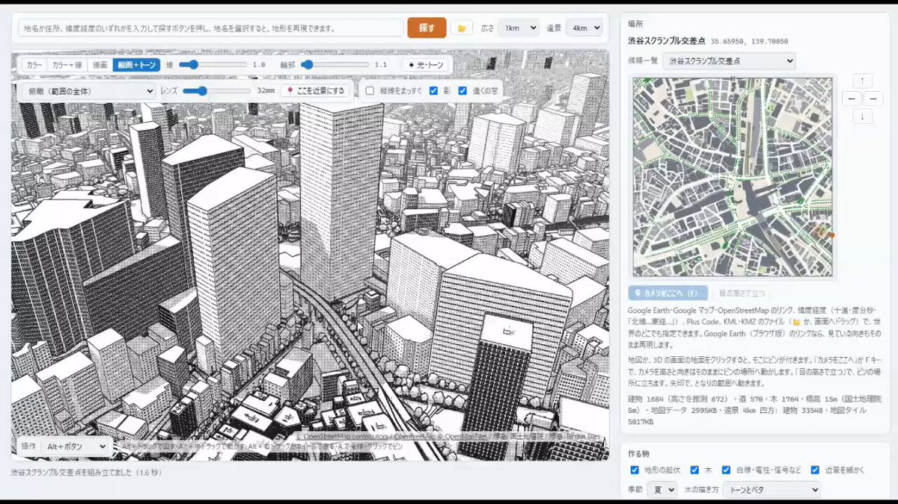
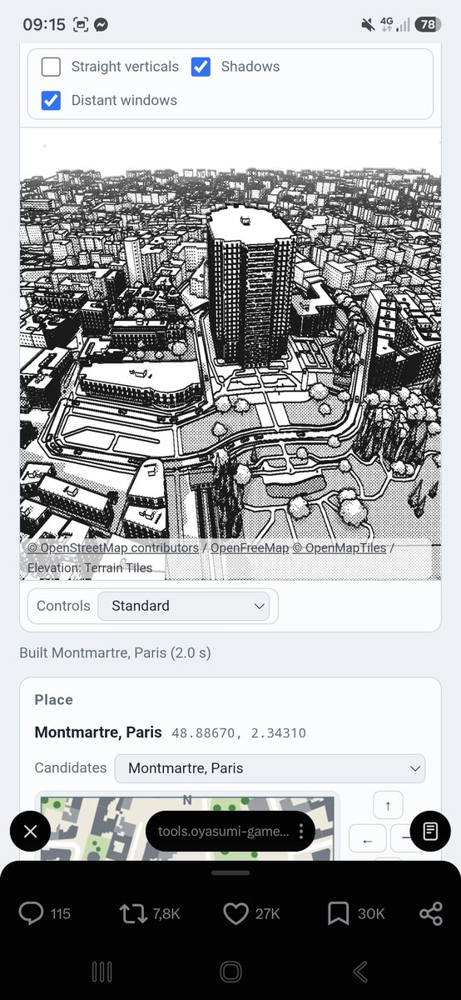
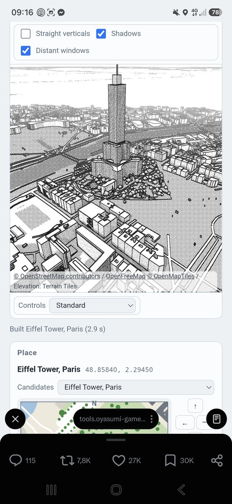
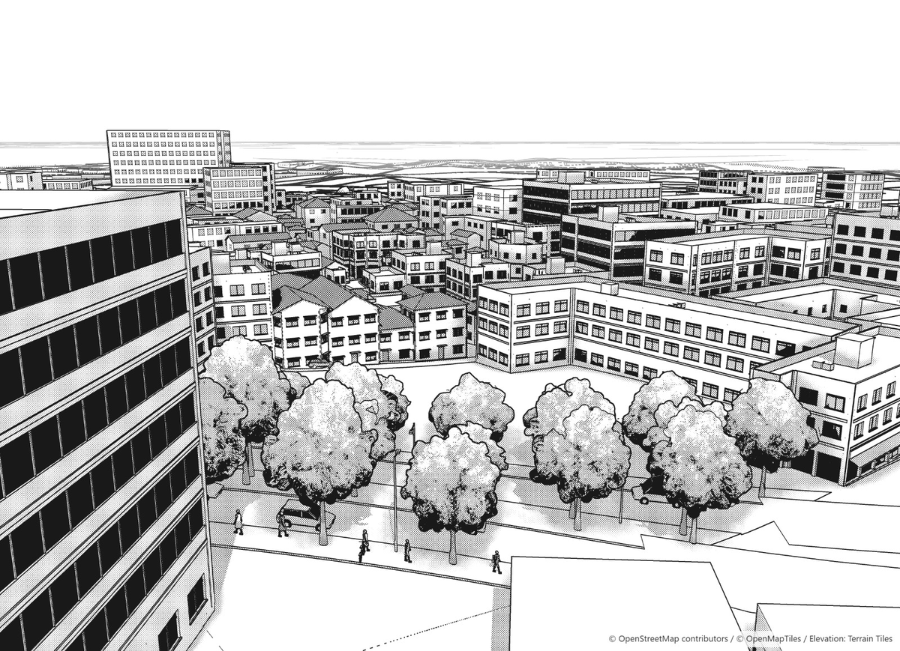
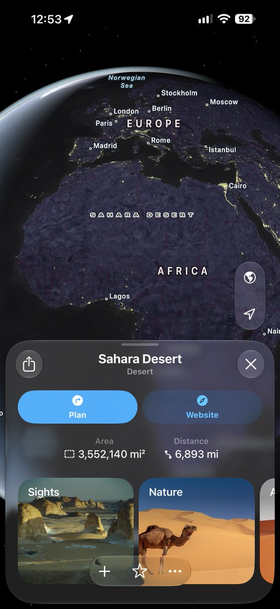

# 地図情報から漫画背景を作成できるツールを作成しました。地名や座標を入力すれば地球のどこでも再現可能です。無料で使えるので、ぜひ使ってみてください！
> Source: https://x.com/sharp_maker/status/2109834006703292423
> Author: ++++ (@sharp_maker)
> Posted: Tue Oct 13 02:30:00 +0000 2026
> Captured: 2026-10-15T09:02:28+00:00
> Stats at capture: 4,445,409 views · 80,972 likes · 400 replies · 19,270 reposts · 88,929 bookmarks · 2,033 quotes

## Post

地図情報から漫画背景を作成できるツールを作成しました。地名や座標を入力すれば地球のどこでも再現可能です。無料で使えるので、ぜひ使ってみてください！
https://tools.oyasumi-gamedev.com/rokehan/

> Quoted post by ++++ ([@sharp_maker](https://x.com/sharp_maker/status/2109077243779842502)):
>
> プロットに合わせて漫画のネームを作れるツールを公開しました。
> ガチャで色々試したり、ポーズやカメラ、演出を指定できます！無料なので、ぜひ使ってみてください！ https://tools.oyasumi-gamedev.com/comicalizer/

## Media

[Post media 1](media/video-01.mp4) — Source media: https://video.twimg.com/amplify_video/2109815111548575744/vid/avc1/1280x720/qmz5EclDGX8dcgZV.mp4?tag=29
 — Post media 1 thumbnail. Source media: https://pbs.twimg.com/amplify_video_thumb/2109815111548575744/img/UpqMct-o275hul0N.jpg
 — Reply 2109906368480030826 media 1. Source media: https://pbs.twimg.com/media/HUfkpRTXAAE6L9d.jpg
 — Reply 2109906368480030826 media 2. Source media: https://pbs.twimg.com/media/HUfkp1eXgAEmrqc.jpg
 — Reply 2110199705712157154 media 1. Source media: https://pbs.twimg.com/media/HUjvINuXsAA4PQU.png
[Reply 2110244461313732613 media 1](media/animation-01.mp4) — Source media: https://video.twimg.com/tweet_video/HUkYJbEXQAARL27.mp4
 — Reply 2110459181388255588 media 1. Source media: https://pbs.twimg.com/media/HUnbcPsaIAAtT5i.jpg
[Reply 2109885949073297617 media 1](media/animation-02.mp4) — Source media: https://video.twimg.com/tweet_video/HUfSEIQa4AAg1QC.mp4

## Thread

### ++++ ([@sharp_maker](https://x.com/sharp_maker/status/2109837328374255709)) — 2026-10-13T02:43:12+00:00

すみません。実際に使ってみると、地図の取得にメチャクチャ時間がかかっています。サーバーの通信規制かも。原因調査中です。
### ++++ ([@sharp_maker](https://x.com/sharp_maker/status/2109865291056640218)) — 2026-10-13T04:34:19+00:00

検索機能に制限をかけてしまいました。すみません。アクセス数が多すぎて対処しきれなくなったので、渋谷とかは引き続きご利用いただけます。
### ++++ ([@sharp_maker](https://x.com/sharp_maker/status/2110461389106253970)) — 2026-10-14T20:03:00+00:00

@mares_eng Spain, right! I'll try to add it within two months.
### ++++ ([@sharp_maker](https://x.com/sharp_maker/status/2109915259364606206)) — 2026-10-13T07:52:52+00:00

@giseokseu Since we use a service called OpenStreetMap, we need to include OpenStreetMap in the credits.
### ++++ ([@sharp_maker](https://x.com/sharp_maker/status/2109915759862526271)) — 2026-10-13T07:54:52+00:00

@eonanda47 I'm sorry I haven't been able to create it yet. It's scheduled to be implemented soon.
### ++++ ([@sharp_maker](https://x.com/sharp_maker/status/2109935334675099719)) — 2026-10-13T09:12:39+00:00

@RFArtsfr Since this tool was coded by claudecode, it is indeed an AI-generated tool. No other AI (such as image-generating AI) was used.
### ++++ ([@sharp_maker](https://x.com/sharp_maker/status/2109904048648577232)) — 2026-10-13T07:08:19+00:00

@spaint8154 이 도구는 무리이므로 다른 도구를 만들고 있습니다.
### ++++ ([@sharp_maker](https://x.com/sharp_maker/status/2110073014448734251)) — 2026-10-13T18:19:44+00:00

@yoyopanzer I use Fable 5 for panel layout. For everything else, I use Opus 5.5.
### ++++ ([@sharp_maker](https://x.com/sharp_maker/status/2109914598451425283)) — 2026-10-13T07:50:15+00:00

@JoeyFantana Thank you. Basically, we plan to focus on fixing the appearance in future updates.
### ++++ ([@sharp_maker](https://x.com/sharp_maker/status/2110413506357129312)) — 2026-10-14T16:52:44+00:00

@HuwJ_Turdartist Thank you. Since directly recreating the building would violate copyright law, I've programmed the algorithm to create something different. However, I do intend to match the type of building.
### ++++ ([@sharp_maker](https://x.com/sharp_maker/status/2110024012869112009)) — 2026-10-13T15:05:01+00:00

@_blackplaster It won't be open source, but it's free to use.
### ++++ ([@sharp_maker](https://x.com/sharp_maker/status/2110149929314459757)) — 2026-10-13T23:25:22+00:00

@suama_kk はじめまして！商用利用可能ですが、地図データのクレジット表記が入ります。
### ++++ ([@sharp_maker](https://x.com/sharp_maker/status/2110102875645059265)) — 2026-10-13T20:18:24+00:00

@hone_sns HONEBITOさん、ありがとうございます！
是非、活用してくださいね！
### ++++ ([@sharp_maker](https://x.com/sharp_maker/status/2110027329485537471)) — 2026-10-13T15:18:12+00:00

@firstone ありがとうございます。ベクター保存と電線が引っ張られている件は修正を頑張ります！！
### ++++ ([@sharp_maker](https://x.com/sharp_maker/status/2109836954389119174)) — 2026-10-13T02:41:43+00:00

@AiLAB_2023 らぼちゃん、ありがとう！！
体調大丈夫かい？

私の方は漫画制作に必要な機能をひたすら順番に追加していってるだけなのだｗｗ
### ++++ ([@sharp_maker](https://x.com/sharp_maker/status/2109933589307830779)) — 2026-10-13T09:05:43+00:00

@woody_ch01 タイの地図用意できていなくてすみません。近いうちに用意いたします。
### ++++ ([@sharp_maker](https://x.com/sharp_maker/status/2109840607334298081)) — 2026-10-13T02:56:14+00:00

@DPTheWolf1 Thank you! I made way too much!
### ++++ ([@sharp_maker](https://x.com/sharp_maker/status/2109939330177454205)) — 2026-10-13T09:28:31+00:00

@shironeko_zxc お疲れ様です。ソフトを作る段階（コーディング）でclaudecodeが使われています。LLMってやつです。

ソフトを使う段階では生成AIは一切使用されていません。
### ++++ ([@sharp_maker](https://x.com/sharp_maker/status/2110069475987095905)) — 2026-10-13T18:05:40+00:00

@servicelloo It is programmed using Claudecode.
### ++++ ([@sharp_maker](https://x.com/sharp_maker/status/2109840827837251631)) — 2026-10-13T02:57:06+00:00

@bassan_DG バッサン様、おはようございます！！
(  ˶¯꒳¯˵)(  ˶¯꒳¯˵)✨✨
せっかくなのでツール作りまくってます。。
美少女絵あげれてなくてごめんです。。

今日も良い一日になりますように！！

## Comments

### Mares Engineering ([@mares_eng](https://x.com/mares_eng/status/2110460583145574876)) — 2026-10-14T19:59:48+00:00

@sharp_maker Could you please add the City of Arts and Sciences in Valencia, Spain? Very cool work!
### 🍊 🏳️‍🌈 ([@giseokseu](https://x.com/giseokseu/status/2109908164670026150)) — 2026-10-13T07:24:41+00:00

@sharp_maker this is amazing! thank you so much! do u require credits or will there be copyright on this?
### starman ([@eonanda47](https://x.com/eonanda47/status/2109906368480030826)) — 2026-10-13T07:17:33+00:00

@sharp_maker Pas fou sur les monuments, montmartre et la tour eiffel 😅 https://t.co/JiRYxfUbqp
 — Source media: https://pbs.twimg.com/media/HUfkpRTXAAE6L9d.jpg
 — Source media: https://pbs.twimg.com/media/HUfkp1eXgAEmrqc.jpg
### RFArts 🔞NSFW (Comms always open) ([@RFArtsfr](https://x.com/RFArtsfr/status/2109918575062610141)) — 2026-10-13T08:06:03+00:00

@sharp_maker Is this made with AI? Just wanted to watch out.
### 스페인트 ([@spaint8154](https://x.com/spaint8154/status/2109887198556524856)) — 2026-10-13T06:01:22+00:00

@sharp_maker 스케치업처럼 실제 장소가 아닌 3d배경도 여기서 사용 가능한가요?
### Yoyopanzer ([@yoyopanzer](https://x.com/yoyopanzer/status/2110071207152476598)) — 2026-10-13T18:12:33+00:00

@sharp_maker so cool! did you use claude fable 5?
### Joey Fantana ([@JoeyFantana](https://x.com/JoeyFantana/status/2109908531746894001)) — 2026-10-13T07:26:08+00:00

@sharp_maker Amazing tool! Is the intention to build in key buildiing details in time or wireframe only? Thanks
### HuwJ ([@HuwJ_Turdartist](https://x.com/HuwJ_Turdartist/status/2110409095585144902)) — 2026-10-14T16:35:12+00:00

@sharp_maker sorry dude. the generator is creating generic images that are NOT the areas requested even in the two Suggested regions Japan / Italy    it was putting High rises in Kyoto / Kitayama. Where no such Buildings exist.
### Joey D ([@_blackplaster](https://x.com/_blackplaster/status/2110020940818190420)) — 2026-10-13T14:52:49+00:00

@sharp_maker Will you open-source?
### すあま ([@suama_kk](https://x.com/suama_kk/status/2110149051538952364)) — 2026-10-13T23:21:53+00:00

@sharp_maker はじめまして。
こちら商用利用可能でしょうか？
### HONEBITO（映像クリエイター / 生成AI） ([@hone_sns](https://x.com/hone_sns/status/2109982544628511017)) — 2026-10-13T12:20:14+00:00

@sharp_maker 最近シャープさん、漫画関連のスゴイツール色々作ってるなー。と思ってポスト見させていただいていたんですが…。
今日の地図連携したツールはその中でもとりわけスゴイですね…！
漫画に限らず色々なところで活用できそうで、シャープさんの制作センスの良さを改めて感じました！
### 黒須嗣載🍖 ([@firstone](https://x.com/firstone/status/2110012681864478789)) — 2026-10-13T14:20:00+00:00

@sharp_maker これはありがたいツール…！

気になる点として電柱が道のド真ん中に出来てしまうことがあるのが。大通りに電柱が並んで電線が張られたりしていたのでちょっとシュールでした。
あと線画の保存をビットマップ以外にベクターでも出力できると嬉しいです。
### らぼたろ ~Rabotaro~ by 永依藍LAB ([@AiLAB_2023](https://x.com/AiLAB_2023/status/2109835111810371896)) — 2026-10-13T02:34:24+00:00

@sharp_maker す、す、すごすぎるよ！！
次から次へと…この無限のアイデアどこからでてくるのっ！？
### WOODYCH FANBOX(COMMISSION OPEN) ([@woody_ch01](https://x.com/woody_ch01/status/2109924243454697651)) — 2026-10-13T08:28:34+00:00

@sharp_maker 本当に素晴らしいです。ありがとうございます。
将来、タイの地図もできるといいですね。あはは。
このような素晴らしいツールを作成していただき、本当にありがとうございます。
### 💙Cindy The Hedgehog #CoMPaS💜 ([@DPTheWolf1](https://x.com/DPTheWolf1/status/2109838288857219111)) — 2026-10-13T02:47:01+00:00

@sharp_maker It's too much for me 🥲🥲🥲🥲... 

It's great 💖💖💖💖
### 白猫 ([@shironeko_zxc](https://x.com/shironeko_zxc/status/2109936008796008545)) — 2026-10-13T09:15:19+00:00

@sharp_maker すみません、ちょっとお尋ねなんですがコレの生成にはAIが使われてたりしますか？
いろいろと今は生成AIの使用はシビアなのでちょっと気になりました。
### チェロ | Cello ([@servicelloo](https://x.com/servicelloo/status/2110067672419590339)) — 2026-10-13T17:58:30+00:00

@sharp_maker does this use AI?
### バッサン ([@bassan_DG](https://x.com/bassan_DG/status/2109837603432530213)) — 2026-10-13T02:44:18+00:00

@sharp_maker シャープちゃんが色々すごいツール作っててる！
すごいなぁ✨
### Ali_ch ([@Crimson_Wizard7](https://x.com/Crimson_Wizard7/status/2110199705712157154)) — 2026-10-14T02:43:10+00:00

@sharp_maker This is awesome! My only pet peeve with it is that it sets houses to have gable roofs, while in Iraq (and most of the Arab world if I am not mistaken) we don't have this typa roofs. https://t.co/uNlCGjXuYh
 — Source media: https://pbs.twimg.com/media/HUjvINuXsAA4PQU.png
### Ataraxia Crevecoeur ([@AtaraxiaCrev](https://x.com/AtaraxiaCrev/status/2110244461313732613)) — 2026-10-14T05:41:00+00:00

@sharp_maker You are a gift from God https://t.co/nQqJWMAMda
 — Source media: https://video.twimg.com/tweet_video/HUkYJbEXQAARL27.mp4
### Adam Rolfson ([@Rolf_of_the_Son](https://x.com/Rolf_of_the_Son/status/2110459181388255588)) — 2026-10-14T19:54:13+00:00

@sharp_maker Anywhere you say? https://t.co/xBXzYlRTac
 — Source media: https://pbs.twimg.com/media/HUnbcPsaIAAtT5i.jpg
### culturedcontentresearch ([@Culturedcontres](https://x.com/Culturedcontres/status/2109874138345320712)) — 2026-10-13T05:09:28+00:00

@sharp_maker WOW! Mr.+++++ This is so cool! I'm having fun just looking around the city. Is there anyway to move with the arrow keys or wasd? I think that would be a neat feature! Another Great tool! So cool! Thank you!
### klokkish ([@klokkish](https://x.com/klokkish/status/2109986859430674744)) — 2026-10-13T12:37:23+00:00

@sharp_maker Looks so cool! I struggle with finding good backgrounds and with this you could even accurately draw someone going down the same street irl
### ekoioi ([@ekortreex](https://x.com/ekortreex/status/2109885949073297617)) — 2026-10-13T05:56:24+00:00

@sharp_maker Humanity is become a lot better thanks to your invention https://t.co/5I0ZCFKVCY
 — Source media: https://video.twimg.com/tweet_video/HUfSEIQa4AAg1QC.mp4

## Other returned timeline records

> The CLI did not expose reply relationships. These records do not start with a reply mention and were authored by someone other than the saved-post author. They may include recommendations or promoted posts; they are retained as source context, not verified replies.

### Starlink ([@Starlink](https://x.com/Starlink/status/2098108930060865671)) — 2026-09-10T17:58:44+00:00

Starlink offers fast, reliable internet in the most rural and remote locations. Portable and easy to set up, Starlink works wherever you are.

Order online in minutes.
### Starlink ([@Starlink](https://x.com/Starlink/status/2068115197718593741)) — 2026-06-19T23:34:21+00:00

Get connected with fast, reliable internet for streaming, video calls, online gaming and more.

Order online in minutes.
### QVAC ([@qvac](https://x.com/qvac/status/2102790422762569772)) — 2026-09-23T16:01:19+00:00

Not your AI, not your intelligence.

Follow @qvac for local-first AI that runs on your own device. Open-source, no cloud, free.
### MegaTable_For_Airports ([@Table4Airports](https://x.com/Table4Airports/status/2039706082466267275)) — 2026-04-02T14:06:40+00:00

It is time to decommission monotonously rectangular boards for airport arrivals and departures, and reshape airport experience powered by MegaTable for billions of passengers globally per year.
### otie ([@otie9237](https://x.com/otie9237/status/2110379290164383771)) — 2026-10-14T14:36:46+00:00

Bruh that is cool as frick.

ATST, at the same time, the RAM cost shot mine from 5.2GB used passively running my warez to 15.5/18 or so, before it'd move smoothly.

Network optimization, or piece by piece loading?

Tbqh, I'm not a pro-ahh programmatic mf, I did a diceroller for friendlies' lowkey Pokemon tourney 4-5 years ago.

But I can point to the idea of stuff  🤣🤣

Idk if site itself tryna use everything a person got to maximize how it runs, or if network is indiscriminate of people's resources, and it just takes what it can / gives what it can.

So idk if like wifi ahh code, or if code for the thing itself instructing chunks to load, like Google Maps ahh would be beneficial or detrimental. Could pre-rendering or pre-loading work? 😇🙏 I imagine it would do VERY well for corporate tho! If you got a Lite one working publicly, you could likely lease a private, full one to like..... Shuueisha, Toei, or many animation studios / manga publishers as a corporate software tool kinda deal. 

(I would start smaller then go upward, rather than big downward. Starting big probably will get you exclusivity deals to fend off competition, more money short term, but the tool gets hidden from many professionals. Small gets you more honest yes / no, then upward as more say yes. You will get paid, but by more places. Tho tbf small chance anyone will try to do reverse engineering, to themselves get paid... hmm.)

Years ago we'd have all screamed in glee for such a tool, worldwide -- screenshots of street view, w/ style?  :3

Now it's more careful consideration of what it do 😊
GL GL dude!

## Links

- https://tools.oyasumi-gamedev.com/rokehan/
