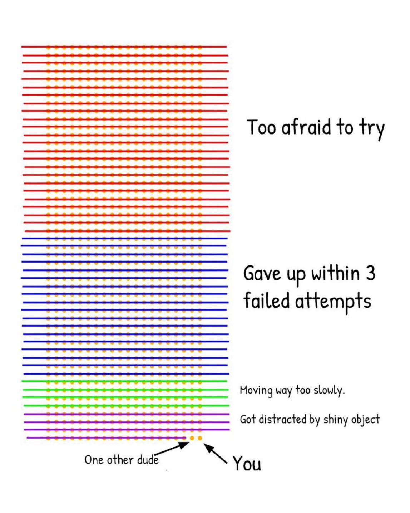

# part of the reason why we discontinued "Company brain" and some of our personal knowledge stuff was because it was truly shiny object syndrome (on my part)
> Source: https://x.com/DhravyaShah/status/2109895882573562197
> Author: Dhravya Shah (@DhravyaShah)
> Posted: Tue Oct 13 06:35:53 +0000 2026
> Captured: 2026-10-15T09:02:28+00:00
> Stats at capture: 14,215 views · 211 likes · 20 replies · 4 reposts · 65 bookmarks · 0 quotes

## Post

part of the reason why we discontinued "Company brain" and some of our personal knowledge stuff was because it was truly shiny object syndrome (on my part)

Now, I no longer see anyone talking about it on the timeline.

## Media

 — Post media 1. Source media: https://pbs.twimg.com/media/HUfbH5bbgAAhD5D.jpg?name=orig

## Thread

### Dhravya Shah ([@DhravyaShah](https://x.com/DhravyaShah/status/2109926402271355335)) — 2026-10-13T08:37:09+00:00

@theo honestly should just listen to you every time 😭🫡

## Comments

### Theo - t3.gg ([@theo](https://x.com/theo/status/2109925589268509134)) — 2026-10-13T08:33:55+00:00

@DhravyaShah Called it
### dave ([@dave8172](https://x.com/dave8172/status/2109905781885997271)) — 2026-10-13T07:15:13+00:00

@DhravyaShah building parts of the brain is where it becomes less shiny
### Andrey ([@Andrey__HQ](https://x.com/Andrey__HQ/status/2110004544394400070)) — 2026-10-13T13:47:40+00:00

@DhravyaShah shiny object syndrome the most real out there
### Rohan ([@proxy_vector](https://x.com/proxy_vector/status/2109917822830911893)) — 2026-10-13T08:03:03+00:00

@DhravyaShah Did usage drop along with the timeline chatter?
### Gary Alexander Devenay ([@GaryDevenay](https://x.com/GaryDevenay/status/2109963113961328803)) — 2026-10-13T11:03:02+00:00

@DhravyaShah Do you still think the problem space is real?
### Igor Zalutski ([@IgorZIJ](https://x.com/IgorZIJ/status/2110051938310267177)) — 2026-10-13T16:55:59+00:00

@DhravyaShah software factories next?
### Omar Da'ajneh ([@Odaajna](https://x.com/Odaajna/status/2109948561056276673)) — 2026-10-13T10:05:12+00:00

@DhravyaShah that's me the purple ones
### Sanket Sahu ([@sanketsahu](https://x.com/sanketsahu/status/2110173802802139348)) — 2026-10-14T01:00:14+00:00

@DhravyaShah what exactly is it now?
### Keith Brisson ([@keithbrisson](https://x.com/keithbrisson/status/2109903505423266114)) — 2026-10-13T07:06:10+00:00

@DhravyaShah Do you feel there is still a market need and it’s just the hype that died? And are you referring to context layer or things like the slack bot you open sourced?
### bshaan ([@Ishaanbansal77](https://x.com/Ishaanbansal77/status/2110148148312285199)) — 2026-10-13T23:18:17+00:00

@DhravyaShah still relevant, but needs to be approached one layer down. literally today ramp glass and scuba are on timeline. it is company brain just smaller cuts of the pie
### Sachin ([@sachintwtss](https://x.com/sachintwtss/status/2109986491967610946)) — 2026-10-13T12:35:55+00:00

@DhravyaShah Shiny object syndrome kills more roadmaps than bad code.
### rohan chaudhari ([@rohan1chaudhari](https://x.com/rohan1chaudhari/status/2110054168727564777)) — 2026-10-13T17:04:51+00:00

@DhravyaShah Still a useful concept imo, maybe just not a good business potential or maybe you were too early
### Akshat Dhamija ([@akshatdhamija_](https://x.com/akshatdhamija_/status/2110269179886789063)) — 2026-10-14T07:19:14+00:00

@DhravyaShah Thoughts on glass by ramp
### Yash ([@dewyashtwts](https://x.com/dewyashtwts/status/2109984264066666724)) — 2026-10-13T12:27:04+00:00

@DhravyaShah what i've released with company brain works very well when:

 1. you have enough amount of respect company's data 
2. you have a big number of companies relying on you for data
### Ilyas ([@ilyesm](https://x.com/ilyesm/status/2110038676214599709)) — 2026-10-13T16:03:17+00:00

@DhravyaShah To be honest nobody cracked the true company brain yet. IMO that’s why it’s not on the timeline.
### Rehan Momin ([@RehanMonline](https://x.com/RehanMonline/status/2109900572296106461)) — 2026-10-13T06:54:31+00:00

@DhravyaShah I wanna talk about something, If we could chat>

## Other returned timeline records

> The CLI did not expose reply relationships. These records do not start with a reply mention and were authored by someone other than the saved-post author. They may include recommendations or promoted posts; they are retained as source context, not verified replies.

### Starlink ([@Starlink](https://x.com/Starlink/status/2068115197718593741)) — 2026-06-19T23:34:21+00:00

Get connected with fast, reliable internet for streaming, video calls, online gaming and more.

Order online in minutes.
### Starlink ([@Starlink](https://x.com/Starlink/status/2092706810310619298)) — 2026-08-26T20:12:38+00:00

Starlink offers fast, reliable internet in the most rural and remote locations. Portable and easy to set up, Starlink Mini works wherever you are.

Order online in minutes.
