# MCP gives AI agents superpowers.
> Source: https://x.com/hridoyreh/status/2109897254849101986
> Author: Hridoy Reh (@hridoyreh)
> Posted: Tue Oct 13 06:41:20 +0000 2026
> Captured: 2026-10-15T09:02:28+00:00
> Stats at capture: 6,234 views · 53 likes · 5 replies · 9 reposts · 86 bookmarks · 1 quotes

## Post

MCP gives AI agents superpowers.

You too can leverage this to grow traffic.

10 best SEO MCP servers:

## Media

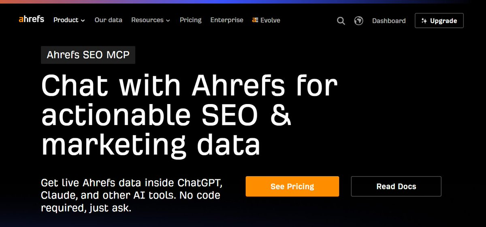 — Reply 2109897258141647308 media 1. Source media: https://pbs.twimg.com/media/HUfbwldakAAgVSW.jpg
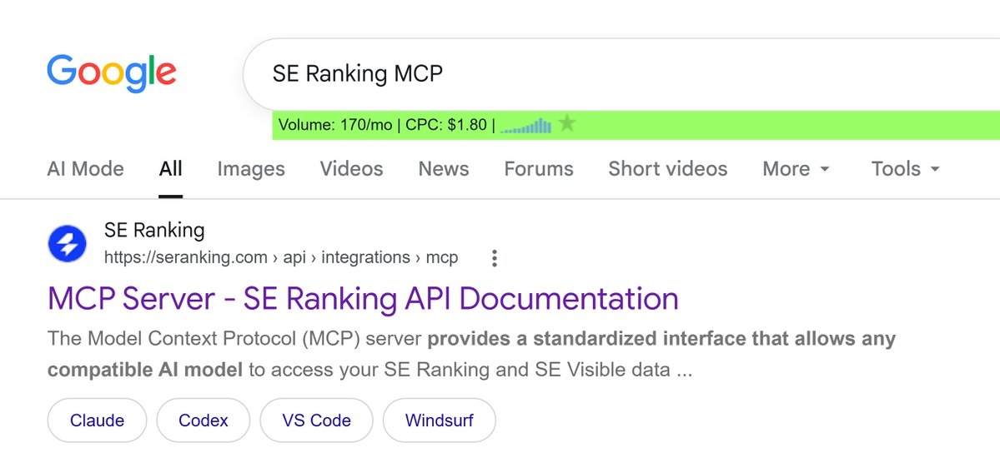 — Reply 2109897261786497367 media 1. Source media: https://pbs.twimg.com/media/HUfb0ddbAAAyuzX.jpg
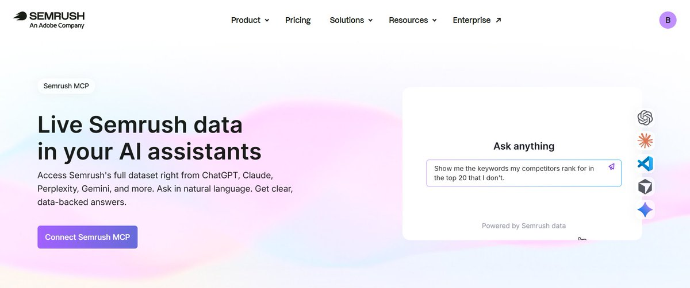 — Reply 2109897265771102420 media 1. Source media: https://pbs.twimg.com/media/HUfb7SoaEAAvG4Z.jpg
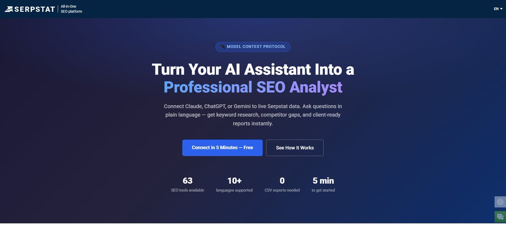 — Reply 2109897269407629381 media 1. Source media: https://pbs.twimg.com/media/HUfb_cHasAA4Ot4.jpg
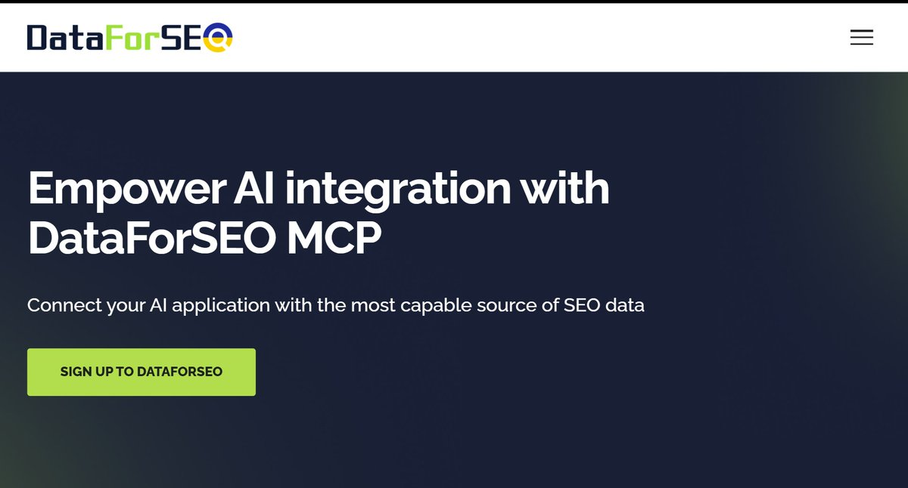 — Reply 2109897273199174043 media 1. Source media: https://pbs.twimg.com/media/HUfcDI3aMAIgLbk.jpg
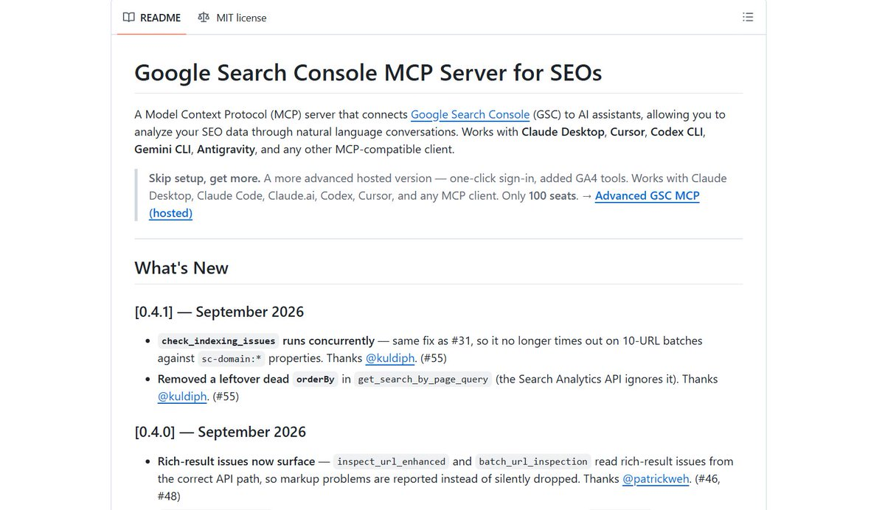 — Reply 2109897276894445860 media 1. Source media: https://pbs.twimg.com/media/HUfcGx2bkAAHREb.jpg
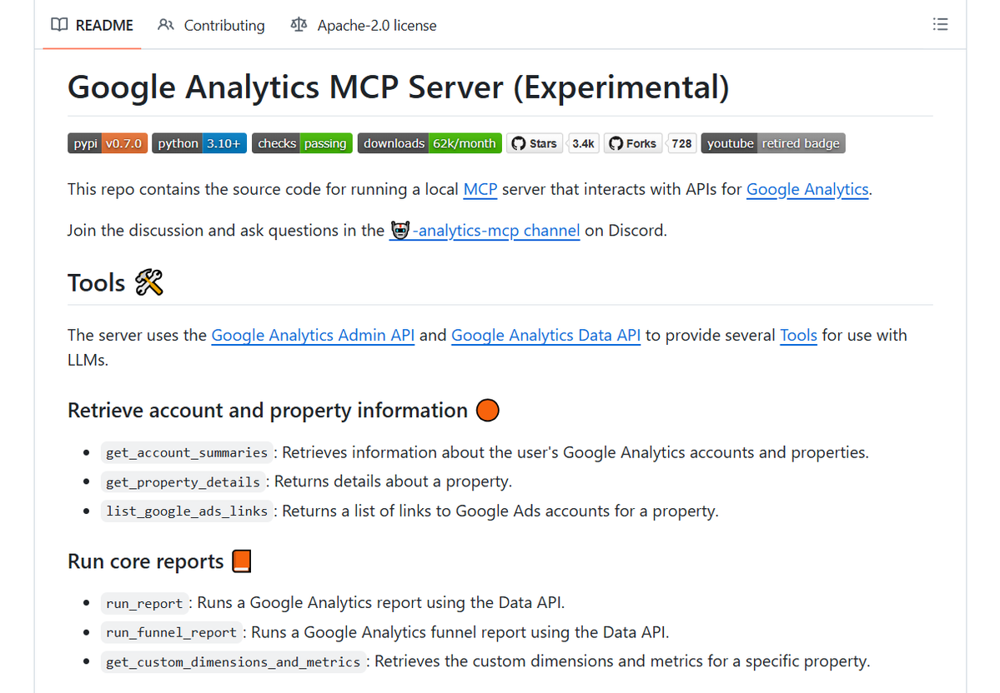 — Reply 2109897280778342896 media 1. Source media: https://pbs.twimg.com/media/HUfcKtxa8AAHLo7.png
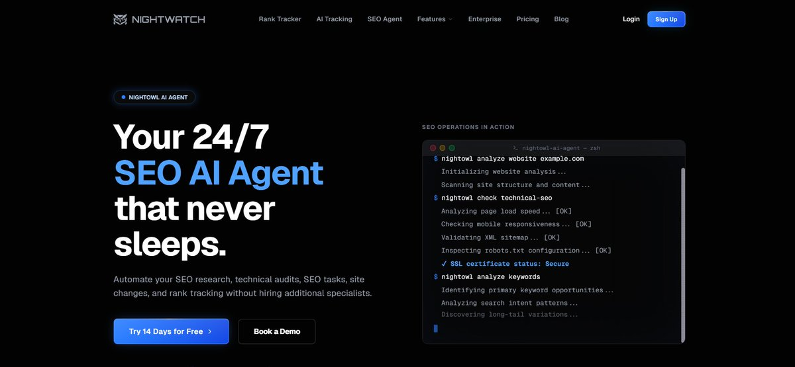 — Reply 2109897284871958902 media 1. Source media: https://pbs.twimg.com/media/HUfcN6DasAAqW8G.jpg
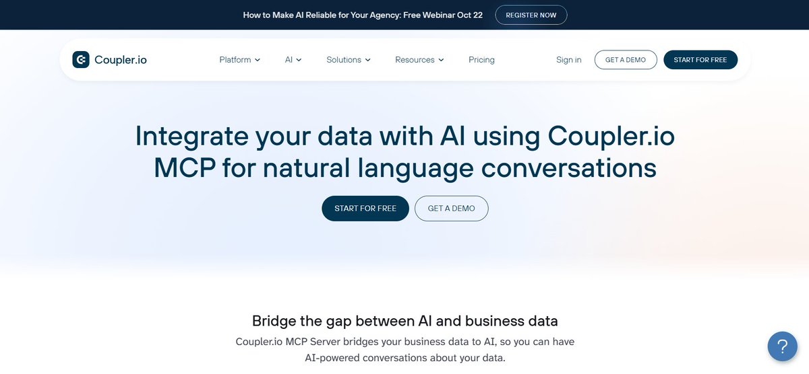 — Reply 2109897288827175153 media 1. Source media: https://pbs.twimg.com/media/HUfcQ9uaMAAQICq.jpg
[Reply 2109897291742196122 media 1](media/video-01.mp4) — Source media: https://video.twimg.com/amplify_video/2006730388006461440/vid/avc1/1280x720/6FFoNPM8DdSOm8AK.mp4?tag=21
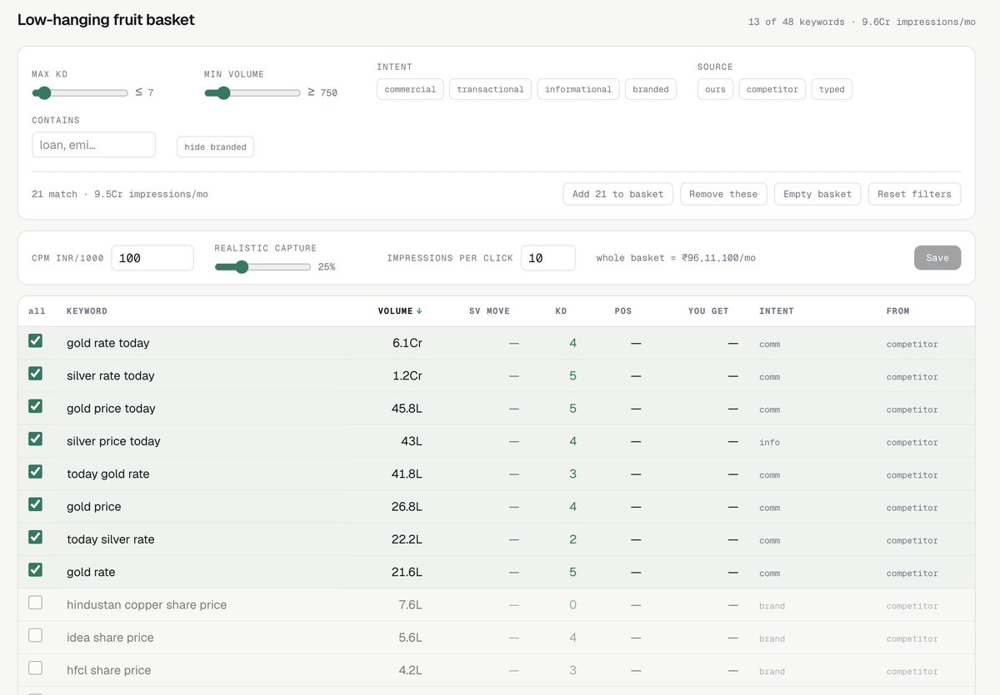 — Reply 2109907818006602228 media 1. Source media: https://pbs.twimg.com/media/HUflq-5bwAA066v.jpg
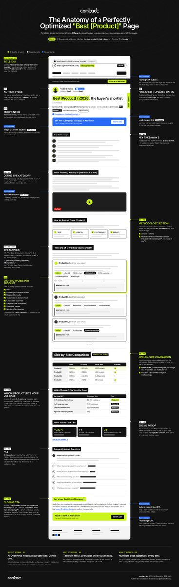 — Reply 2110363829553037791 media 1. Source media: https://pbs.twimg.com/media/HUmEo15WkAAgCzk.jpg
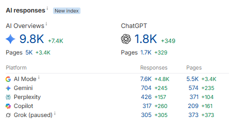 — Reply 2110401032035709427 media 1. Source media: https://pbs.twimg.com/media/HUmmjF7bAAAz2qq.png

## Thread

### Hridoy Reh ([@hridoyreh](https://x.com/hridoyreh/status/2109897258141647308)) — 2026-10-13T06:41:20+00:00

1. Ahrefs MCP

An official remote MCP server that brings keyword metrics and deep backlink data directly into your Claude or ChatGPT. https://t.co/Kb0guvDk3i
 — Source media: https://pbs.twimg.com/media/HUfbwldakAAgVSW.jpg
### Hridoy Reh ([@hridoyreh](https://x.com/hridoyreh/status/2109897261786497367)) — 2026-10-13T06:41:21+00:00

2. SE Ranking MCP

The most tools behind one MCP URL, with 160+ specialized tools for keyword gaps, backlinks, management, and rank tracking. https://t.co/hevpuIf9RR
 — Source media: https://pbs.twimg.com/media/HUfb0ddbAAAyuzX.jpg
### Hridoy Reh ([@hridoyreh](https://x.com/hridoyreh/status/2109897265771102420)) — 2026-10-13T06:41:22+00:00

3. SEMrush MCP

An official connector that imports industry-standard competitor benchmarking and organic search market share data. https://t.co/dmgBm3aYVv
 — Source media: https://pbs.twimg.com/media/HUfb7SoaEAAvG4Z.jpg
### Hridoy Reh ([@hridoyreh](https://x.com/hridoyreh/status/2109897269407629381)) — 2026-10-13T06:41:23+00:00

4. Serpstat MCP

Connect Claude, ChatGPT, or Gemini to get keyword research, competitor gaps, and client-ready reports instantly. https://t.co/Lh1H7XEiae
 — Source media: https://pbs.twimg.com/media/HUfb_cHasAA4Ot4.jpg
### Hridoy Reh ([@hridoyreh](https://x.com/hridoyreh/status/2109897273199174043)) — 2026-10-13T06:41:24+00:00

5. DataForSEO MCP Server

A cost-effective, pay-per-call SEO data infrastructure for large-scale SERP pulls, powering many customer-facing SEO tools. https://t.co/YmkWhrJIJs
 — Source media: https://pbs.twimg.com/media/HUfcDI3aMAIgLbk.jpg
### Hridoy Reh ([@hridoyreh](https://x.com/hridoyreh/status/2109897276894445860)) — 2026-10-13T06:41:25+00:00

6. MCP GSC by AminForou

An MCP server that connects Google Search Console to AI assistants, allowing you to analyze your SEO data. https://t.co/wpPtagPBEc
 — Source media: https://pbs.twimg.com/media/HUfcGx2bkAAHREb.jpg
### Hridoy Reh ([@hridoyreh](https://x.com/hridoyreh/status/2109897280778342896)) — 2026-10-13T06:41:26+00:00

7. Google Analytics MCP

Google's official MCP that lets your AI agent pull down-funnel traffic, session trends, conversion rates, and referral metrics. https://t.co/dWThCrS2tT
 — Source media: https://pbs.twimg.com/media/HUfcKtxa8AAHLo7.png
### Hridoy Reh ([@hridoyreh](https://x.com/hridoyreh/status/2109897284871958902)) — 2026-10-13T06:41:27+00:00

8. Nightwatch MCP

Built on MCP, this SEO AI agent is designed to automate the most time-consuming tasks in SEO monitoring. https://t.co/90MUhoCslo
 — Source media: https://pbs.twimg.com/media/HUfcN6DasAAqW8G.jpg
### Hridoy Reh ([@hridoyreh](https://x.com/hridoyreh/status/2109897288827175153)) — 2026-10-13T06:41:28+00:00

9. Coupler MCP

It is a no-code data integration platform that connects 400+ business apps, including Search Console, Analytics, etc. https://t.co/ISJNXqKWDg
 — Source media: https://pbs.twimg.com/media/HUfcQ9uaMAAQICq.jpg
### Hridoy Reh ([@hridoyreh](https://x.com/hridoyreh/status/2109897291742196122)) — 2026-10-13T06:41:29+00:00

10. SEO Wins

Not an MCP server.

However, it includes 150+ SEO / AI SEO strategies that you can use to grow your website visitors and revenue faster.

https://t.co/gwTd9szY2s
 — Source media: https://video.twimg.com/amplify_video/2006730388006461440/vid/avc1/1280x720/6FFoNPM8DdSOm8AK.mp4?tag=21
### Hridoy Reh ([@hridoyreh](https://x.com/hridoyreh/status/2109897294250397909)) — 2026-10-13T06:41:29+00:00

That's the end of the thread.

However, I can help you in 3 ways:

🔸 SEO Wins Database
🔸 1 on 1 Consultation Call
🔸 AI SEO / SEO Services

View Bio/Pin Post to get help...
### Hridoy Reh ([@hridoyreh](https://x.com/hridoyreh/status/2109911108874383455)) — 2026-10-13T07:36:23+00:00

@growthdesign_sd That's awesome...
### Hridoy Reh ([@hridoyreh](https://x.com/hridoyreh/status/2109909890210955489)) — 2026-10-13T07:31:32+00:00

@floraoliviaa Yeap...

## Comments

### Sahil Deep ([@growthdesign_sd](https://x.com/growthdesign_sd/status/2109907818006602228)) — 2026-10-13T07:23:18+00:00

@hridoyreh Fully with you on research. I've been using the Ahrefs MCP/API and my favourite bit is testing permutations: different seeds, filters and competitors in one conversation instead of five CSV exports. The traffic part still comes down to what we publish, though.

For a Client site: https://t.co/uNCIyInM6i
 — Source media: https://pbs.twimg.com/media/HUflq-5bwAA066v.jpg
### Flora Olivia ([@floraoliviaa](https://x.com/floraoliviaa/status/2109904797772169290)) — 2026-10-13T07:11:18+00:00

@hridoyreh everyone should use mcp servers

## Other returned timeline records

> The CLI did not expose reply relationships. These records do not start with a reply mention and were authored by someone other than the saved-post author. They may include recommendations or promoted posts; they are retained as source context, not verified replies.

### Rob Hoffman ([@RobHoffman_](https://x.com/RobHoffman_/status/2110363829553037791)) — 2026-10-14T13:35:20+00:00

one of the highest-converting SEO/AEO pages of all time 👇

(from 7 years of doing Search for tech companies like beehiiv, kajabi, shopify, etc.)

leaking our exact internal SOP: https://t.co/mRB6CFGJXE https://t.co/WpizwBjRYC
 — Source media: https://pbs.twimg.com/media/HUmEo15WkAAgCzk.jpg
### Emre Elbeyoglu ([@elbeyoglu](https://x.com/elbeyoglu/status/2110453299082149895)) — 2026-10-14T19:30:51+00:00

wtf this is crazy for SEO
### Ross Simmonds ([@TheCoolestCool](https://x.com/TheCoolestCool/status/2110385270852133221)) — 2026-10-14T15:00:32+00:00

Best SEO content format for every funnel stage for B2B SaaS:

TOF:

- Free tools
- Checklists
- Templates
- Glossaries
- How-to guides
- Statistics pages
- Beginner guides
- Original research
- “What is X?” pages

MOF:
- Best X for Y
- Case studies
- Buyer guides
- Industry pages
- Use-case pages
- Integration pages
- Comparison pages
- Product-led guides

BOF:
- Demo pages
- Review pages
- Pricing pages
- Product pages
- ROI calculators
- Migration pages
- Implementation guides
- [Brand] vs [Competitor]
### Alex Groberman ([@alexgroberman](https://x.com/alexgroberman/status/2110401032035709427)) — 2026-10-14T16:03:10+00:00

A brand followed the advice in this article and generated more than $50,000 from ChatGPT, Google and Perplexity-driven traffic. https://t.co/D3hYyN6fXA
 — Source media: https://pbs.twimg.com/media/HUmmjF7bAAAz2qq.png
