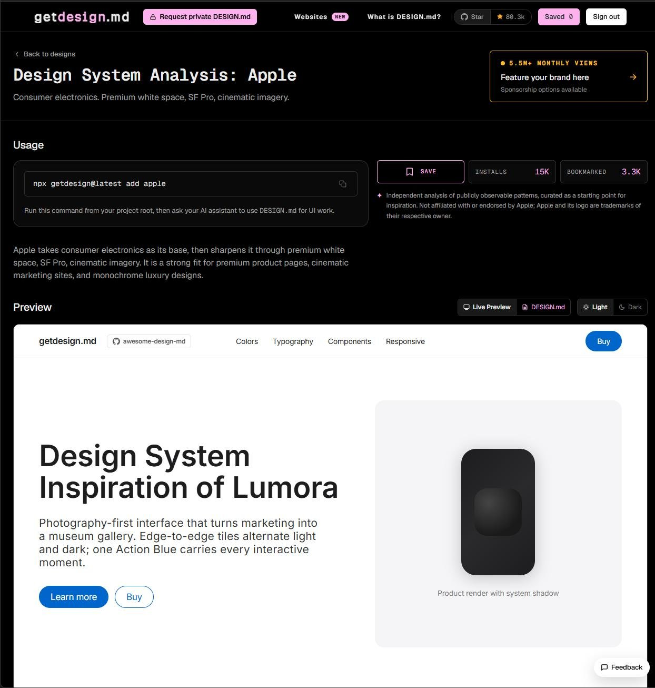
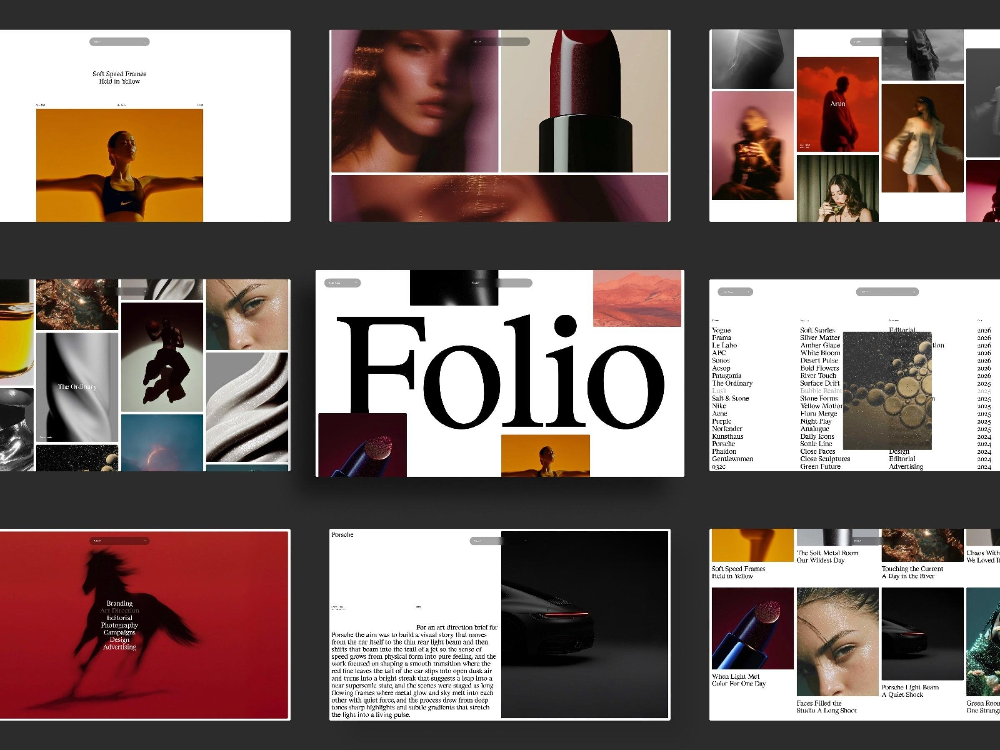
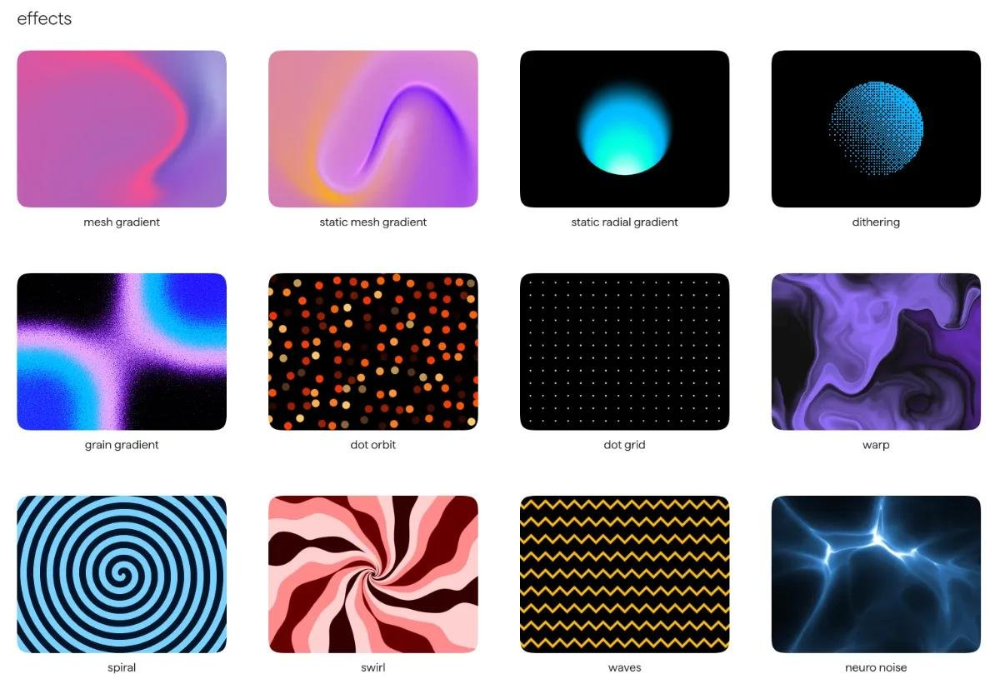
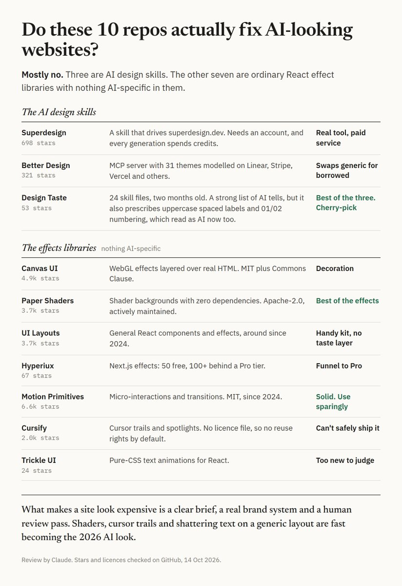

# Github is hiding the cure for ugly AI-generated websites.
> Source: https://x.com/heyrimsha/status/2109944361408659650
> Author: Rimsha Bhardwaj (@heyrimsha)
> Posted: Tue Oct 13 09:48:31 +0000 2026
> Captured: 2026-10-15T09:02:28+00:00
> Stats at capture: 53,083 views · 639 likes · 31 replies · 64 reposts · 1,728 bookmarks · 3 quotes

## Post

Github is hiding the cure for ugly AI-generated websites.

Claude Code and Codex keep making the same boring, generic UIs.

These repos change EVERYTHING.

10 GitHub repos that make AI build websites that look like they cost $20,000:

1. Superdesign Skill

Give Claude Code and Codex a design canvas to explore multiple UI directions before writing code.

https://github.com/superdesigndev/superdesign-skill

2. Better Design

31 design systems inspired by Apple, Stripe, Linear, and Vercel. Real design tokens and rules for AI agents.

https://github.com/marvkr/better-design

3. Design Taste

24 AI design skills covering typography, colors, layouts, and visual styles like quiet luxury and Japanese minimalism.

https://github.com/madebymustafa/design-taste

4. Canvas UI

GPU-powered effects: liquid distortions, glass shattering, particles, and interactive 3D scenes.

https://github.com/DavidHDev/canvas-ui

5. Paper Shaders

Animated mesh gradients, fluid backgrounds, and stunning shader effects for premium landing pages.

https://github.com/paper-design/shaders

6. UI Layouts

Creative React components with image ripples, 3D blobs, draggable elements, and animated reveals.

https://github.com/ui-layouts/uilayouts

7. Hyperiux Components

50+ free visual effects, including image trails, cinematic navigation, and WebGL animations.

https://github.com/Hyperiux-Immersion-Labs/hyperiux-components

8. Motion Primitives

Beautiful micro-interactions, morphing dialogs, text animations, and smooth transitions.

https://github.com/ibelick/motion-primitives

9. Cursify

Turn boring mouse cursors into interactive experiences with spotlights, trails, bubbles, and spring animations.

https://github.com/ui-layouts/cursify

10. Trickle UI Kit

47 text animation effects, including pixel reveals, character shatters, typing effects, and cinematic headlines.

https://github.com/akaieuan/trickle-UI-kit

Which one are you trying first?

## Media

 — Post media 1. Source media: https://pbs.twimg.com/media/HUgHNSBaYAAeGMs.jpg?name=orig
 — Post media 2. Source media: https://pbs.twimg.com/media/HUgHNgAbEAAPUzl.jpg?name=orig
 — Post media 3. Source media: https://pbs.twimg.com/media/HUgHNxHbcAAsnL0.jpg?name=orig
 — Reply 2110423427874001237 media 1. Source media: https://pbs.twimg.com/media/HUm6wvxXwAAXw3d.jpg

## Comments

### Allan Kerr ([@AIIanKerr](https://x.com/AIIanKerr/status/2110423427874001237)) — 2026-10-14T17:32:09+00:00

@heyrimsha oh, if only it were true! https://t.co/ZGBZKc8SaE
 — Source media: https://pbs.twimg.com/media/HUm6wvxXwAAXw3d.jpg
### Colin Michael Pace ([@cmicpace](https://x.com/cmicpace/status/2110241353678586146)) — 2026-10-14T05:28:39+00:00

@heyrimsha Shhhh don’t tell anyone. Now we’ll just see the same 10-looking websites over and over.
### Alex Ai | Tools & Updates ([@AlexWithAi_](https://x.com/AlexWithAi_/status/2109980694143443367)) — 2026-10-13T12:12:53+00:00

@heyrimsha These repos are gold for AI UI
### An$h ([@eth_ansh](https://x.com/eth_ansh/status/2109992457156878486)) — 2026-10-13T12:59:38+00:00

@heyrimsha taste is the last moat
### Alex Veremeyenko ([@alex_verem](https://x.com/alex_verem/status/2110271370198397326)) — 2026-10-14T07:27:56+00:00

@heyrimsha Web designers are cooked
### 安叫兽|Bird🕊️ 🔶 BNB ([@ajs6888](https://x.com/ajs6888/status/2109984069769724302)) — 2026-10-13T12:26:18+00:00

@heyrimsha 换套设计素材有用，但不写清需求还是一股模板味
### 睿慈 Raise ([@ThreeAAOfficial](https://x.com/ThreeAAOfficial/status/2110251127455551561)) — 2026-10-14T06:07:30+00:00

@heyrimsha The real culprit is everyone shipping the same default stack: shadcn + purple gradient + rounded cards. Design skills help, until everyone installs the same skill and we get a brand-new samey look.
### DEV ([@aiceodev](https://x.com/aiceodev/status/2110012565677871615)) — 2026-10-13T14:19:32+00:00

@heyrimsha These repos could seriously up the game for AI-driven design. Ugly UIs are a real turn-off for users. Can't wait to see how these tools shake things up in the web design world.
### catman ([@catmanyau](https://x.com/catmanyau/status/2109972070486483092)) — 2026-10-13T11:38:37+00:00

@heyrimsha Design systems are the recipe; animation libraries are the garnish. Give the model tokens and layout rules first, then add effects where they serve the page.
### DollarBill ([@box_trades](https://x.com/box_trades/status/2110289503969849737)) — 2026-10-14T08:39:59+00:00

@heyrimsha https://t.co/qKi5jDhDrY has a huge catalog of design systems and design tokens.
### Noam Naumovsky ([@NNaumovsky](https://x.com/NNaumovsky/status/2110112542911533368)) — 2026-10-13T20:56:48+00:00

@heyrimsha Effects libraries fix the generic look, but the real tell of AI sites is that agents use every effect at once. A design system with rules (like #2) matters more than shaders. Has anyone found one that makes the agent say no to an effect?
### jsnode ([@thejsnode](https://x.com/thejsnode/status/2110164494424977781)) — 2026-10-14T00:23:15+00:00

@heyrimsha Rimsha, the design systems one (Better Design) seems like the fix for generic UIs. Real tokens give the agent rules to follow, and shader effects on top of a weak layout still look generic.
### Rosa Synthesiz ([@Rosasynthesiz](https://x.com/Rosasynthesiz/status/2109973923135955439)) — 2026-10-13T11:45:59+00:00

@heyrimsha one thing that works for me: give the agent a screenshot of a site you like and ask it to write the design rules first, then build. the rules file ends up more reusable than any component pack
### NotDonaldTrump ([@woxiangripittr](https://x.com/woxiangripittr/status/2110200891408036322)) — 2026-10-14T02:47:52+00:00

@heyrimsha of the 10, which ones actually change design taste vs just help Claude ship the same Inter + purple gradient "AI look" faster?
### Akanksha Singh ([@akankshs4](https://x.com/akankshs4/status/2110362756486779083)) — 2026-10-14T13:31:04+00:00

@heyrimsha Yay! You've open-sourced taste for all Xd
### 睿慈 Raise ([@ThreeAAOfficial](https://x.com/ThreeAAOfficial/status/2110251224591368607)) — 2026-10-14T06:07:53+00:00

@heyrimsha You can spot an AI-built landing page from orbit: purple gradient, "Get Started" button, three cards with emoji icons. I've shipped like five of 'em and I'm not proud.
### Hakimi Eiqbal ([@hakimieiqbal](https://x.com/hakimieiqbal/status/2109945792387829883)) — 2026-10-13T09:54:12+00:00

@heyrimsha These repos are the missing design layer for AI coding tools
### Osc🔺r ([@OscarLai](https://x.com/OscarLai/status/2110231165865193951)) — 2026-10-14T04:48:10+00:00

@heyrimsha Can’t wait to try these
### jack ([@jakkuwang](https://x.com/jakkuwang/status/2110259555334803504)) — 2026-10-14T06:40:59+00:00

@heyrimsha so many great tools out there 👀
### Moloy Goswami ([@themoloygoswami](https://x.com/themoloygoswami/status/2110084335294672910)) — 2026-10-13T19:04:43+00:00

@heyrimsha Useful info 👍
### Sunday Mba ([@DevSundayMba](https://x.com/DevSundayMba/status/2110362978080198780)) — 2026-10-14T13:31:57+00:00

@heyrimsha 👍🏻👍🏻👍🏻
### Aaliya ([@aaliya_va](https://x.com/aaliya_va/status/2109951636089032845)) — 2026-10-13T10:17:25+00:00

@heyrimsha These could really help make AI websites look better.
### TH33ORACL3 𝕏 ([@TH33ORACL3](https://x.com/TH33ORACL3/status/2109947460194070684)) — 2026-10-13T10:00:50+00:00

@heyrimsha the repos help, but someone still has to say no to the first "looks fine" version.
### Kroma ([@kromamcp](https://x.com/kromamcp/status/2110300460976312474)) — 2026-10-14T09:23:32+00:00

@heyrimsha just use Kroma

## Other returned timeline records

> The CLI did not expose reply relationships. These records do not start with a reply mention and were authored by someone other than the saved-post author. They may include recommendations or promoted posts; they are retained as source context, not verified replies.

### Starlink ([@Starlink](https://x.com/Starlink/status/2068115197718593741)) — 2026-06-19T23:34:21+00:00

Get connected with fast, reliable internet for streaming, video calls, online gaming and more.

Order online in minutes.
### Starlink ([@Starlink](https://x.com/Starlink/status/2092706810298069417)) — 2026-08-26T20:12:38+00:00

Starlink offers fast, reliable internet in the most rural and remote locations. Portable and easy to set up, Starlink Mini works wherever you are.

Order online in minutes.

## Links

- https://github.com/superdesigndev/superdesign-skill
- https://github.com/marvkr/better-design
- https://github.com/madebymustafa/design-taste
- https://github.com/DavidHDev/canvas-ui
- https://github.com/paper-design/shaders
- https://github.com/ui-layouts/uilayouts
- https://github.com/Hyperiux-Immersion-Labs/hyperiux-components
- https://github.com/ibelick/motion-primitives
- https://github.com/ui-layouts/cursify
- https://github.com/akaieuan/trickle-UI-kit
