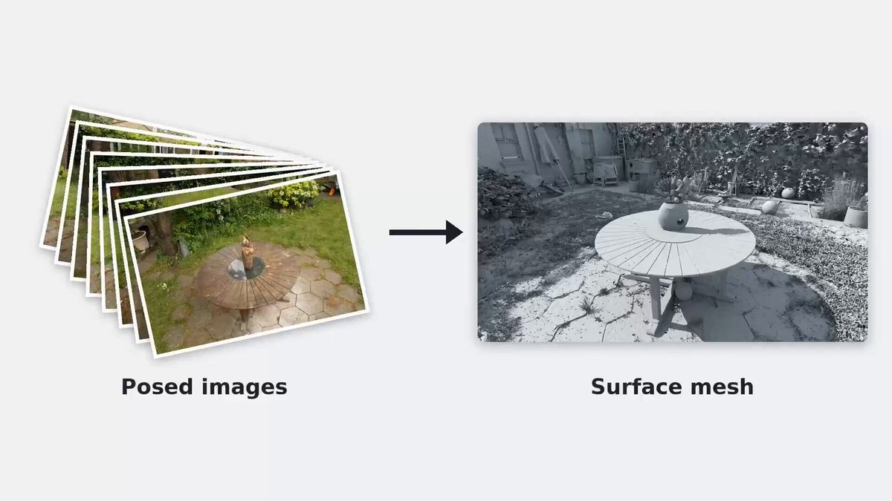

# Cool stuff - T3lescope. Turns photos into usable 3D meshes.
> Source: https://x.com/wildmindai/status/2109985501176340693
> Author: Wildminder (@wildmindai)
> Posted: Tue Oct 13 12:31:59 +0000 2026
> Captured: 2026-10-15T09:02:28+00:00
> Stats at capture: 9,412 views · 265 likes · 3 replies · 15 reposts · 277 bookmarks · 0 quotes

## Post

Cool stuff - T3lescope. Turns photos into usable 3D meshes.

- gens clean scene meshes without per-scene optimization  
- uses one 3D flow model across every scale, from a single pen to an 80m city block  
- handles glass, mirrors, occlusions (Gaussian Splatting fails here)
- no image re-encoding as you zoom in
- meshes are ready for games, 3D printing etc

https://pfnet-research.github.io/t3lescope/

## Media

[Post media 1](media/video-01.mp4) — Source media: https://video.twimg.com/amplify_video/2109984765663203328/vid/avc1/1280x720/KPmx7WoUIJThcH_X.mp4?tag=29
 — Post media 1 thumbnail. Source media: https://pbs.twimg.com/amplify_video_thumb/2109984765663203328/img/-1TV9i_aXYsQsSu-.jpg
[Reply 2110035917650137174 media 1](media/video-02.mp4) — Source media: https://video.twimg.com/amplify_video/2110035215187890177/vid/avc1/1200x800/FGNS9UcGMCrd69d0.mp4?tag=29
[Reply 2110298515402330175 media 1](media/video-03.mp4) — Source media: https://video.twimg.com/amplify_video/2110297776890204160/vid/avc1/960x432/pvdacrhf-cuX3Y84.mp4?tag=14
[Reply 2110415344388972865 media 1](media/video-04.mp4) — Source media: https://video.twimg.com/amplify_video/2110315456015818752/vid/avc1/1920x1080/kkfX-Ff0L9ZjCLzL.mp4?tag=29
[Reply 2110405142919119168 media 1](media/video-05.mp4) — Source media: https://video.twimg.com/amplify_video/2110403800473489409/vid/avc1/3840x2160/d0Vvyg144t3d76gS.mp4?tag=29
[Reply 2110405142919119168 media 2](media/video-06.mp4) — Source media: https://video.twimg.com/amplify_video/2110404995585806336/vid/avc1/3840x2160/lFQ_gGyicj4kEquV.mp4?tag=29

## Comments

### Tony Rick ([@TonyyRickk](https://x.com/TonyyRickk/status/2110270608831557829)) — 2026-10-14T07:24:54+00:00

@wildmindai it handles mirrors?? 🤯
### Kacper Gadomski (SF 1-30th Oct) ([@k4cperg](https://x.com/k4cperg/status/2110095356151402899)) — 2026-10-13T19:48:31+00:00

@wildmindai how accurate are the measurements of the reproduced 3d space?
### Austin Vaughn ([@austinvau9](https://x.com/austinvau9/status/2110315845474038197)) — 2026-10-14T10:24:39+00:00

@wildmindai this could make making 3d assets way less painful

## Other returned timeline records

> The CLI did not expose reply relationships. These records do not start with a reply mention and were authored by someone other than the saved-post author. They may include recommendations or promoted posts; they are retained as source context, not verified replies.

### Yuzhou Cheng ([@cheng_yuzh21715](https://x.com/cheng_yuzh21715/status/2110035917650137174)) — 2026-10-13T15:52:19+00:00

Our MLP-Splatting (ECCV 2026) code is out: https://t.co/wxnKZgFqa6.

We splat MLPs as light-field primitives instead of Gaussians: more expressive, fewer primitives, and better aligned with object semantics.

Give it a spin! https://t.co/ZZZGiMjhah
 — Source media: https://video.twimg.com/amplify_video/2110035215187890177/vid/avc1/1200x800/FGNS9UcGMCrd69d0.mp4?tag=29
### Alexandre Morgand ([@Almorgand](https://x.com/Almorgand/status/2110298515402330175)) — 2026-10-14T09:15:48+00:00

"DepthART: Scaling Foundation Monocular Depth to Tiny Models"

TLDR: brings foundation-model mono depth estimation to tiny networks through bias-resistant data sampling and camera-conditioned fine-tuning; robust relative+metric depth with realtime inference on small hardware. https://t.co/1pnspsxBav
 — Source media: https://video.twimg.com/amplify_video/2110297776890204160/vid/avc1/960x432/pvdacrhf-cuX3Y84.mp4?tag=14
### Gracia ([@gracia_hq](https://x.com/gracia_hq/status/2110415344388972865)) — 2026-10-14T17:00:02+00:00

Finally, we’re publicly introducing our World Reconstruction Model, built for Physical AI and for any application where hallucinations aren’t acceptable.

The same reconstruction engine covers:

• Real2Sim2Real, evals and benchmarks for robotics
• Free-viewpoint replays in near real time for sports broadcasting
• Real performances in full detail for VFX and film
• A self-service reconstruction suite for 4DGS

Ground-truth detail and sub-millimeter geometric accuracy carry across all of them.

Explore more at https://t.co/vBqgGX6mup
 — Source media: https://video.twimg.com/amplify_video/2110315456015818752/vid/avc1/1920x1080/kkfX-Ff0L9ZjCLzL.mp4?tag=29
### Andrey Volodin ([@s1ddok](https://x.com/s1ddok/status/2110405142919119168)) — 2026-10-14T16:19:30+00:00

team showed me first results from our world reconstruction model for basketball

they didn't have to go that hard with trajectory design though https://t.co/ohGh36BSe6
 — Source media: https://video.twimg.com/amplify_video/2110403800473489409/vid/avc1/3840x2160/d0Vvyg144t3d76gS.mp4?tag=29
 — Source media: https://video.twimg.com/amplify_video/2110404995585806336/vid/avc1/3840x2160/lFQ_gGyicj4kEquV.mp4?tag=29

## Links

- https://pfnet-research.github.io/t3lescope/
