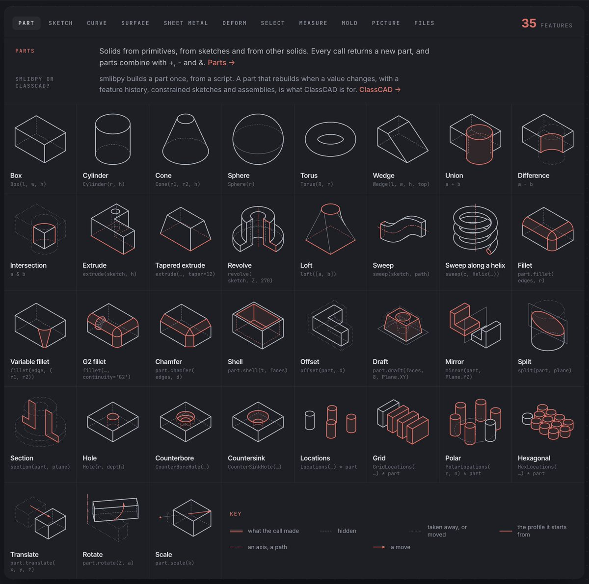
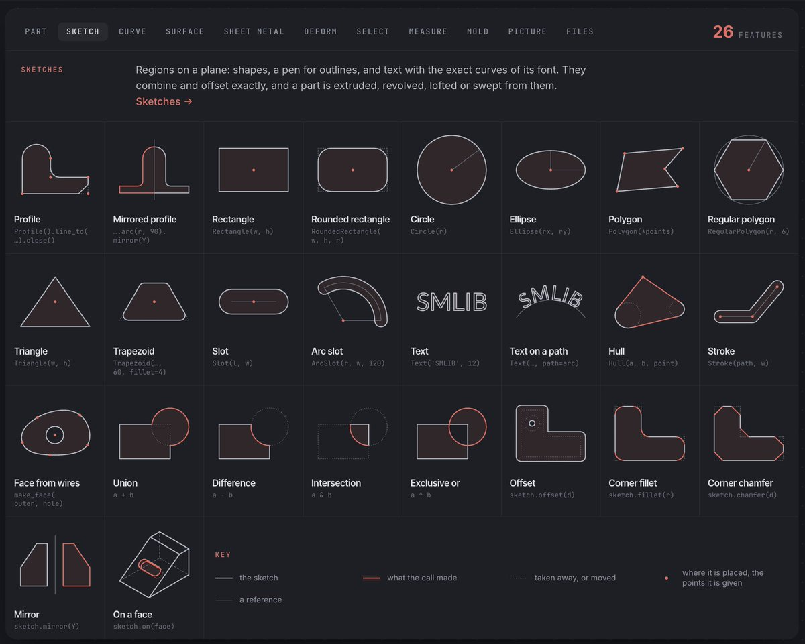
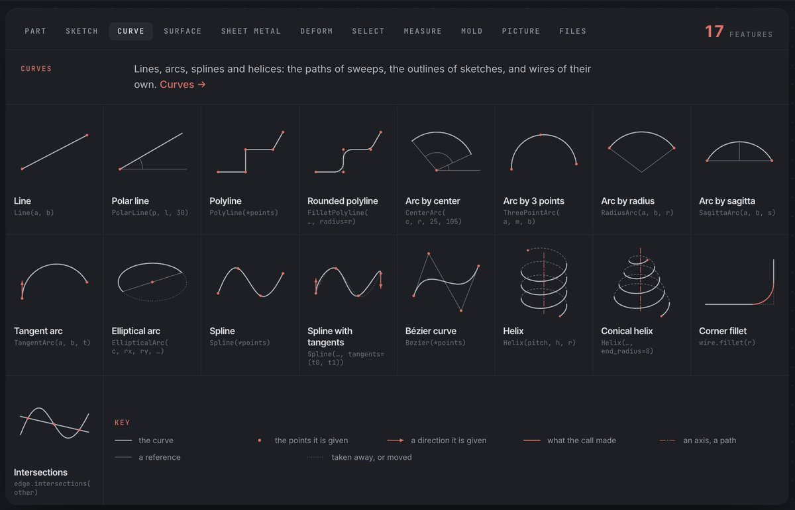
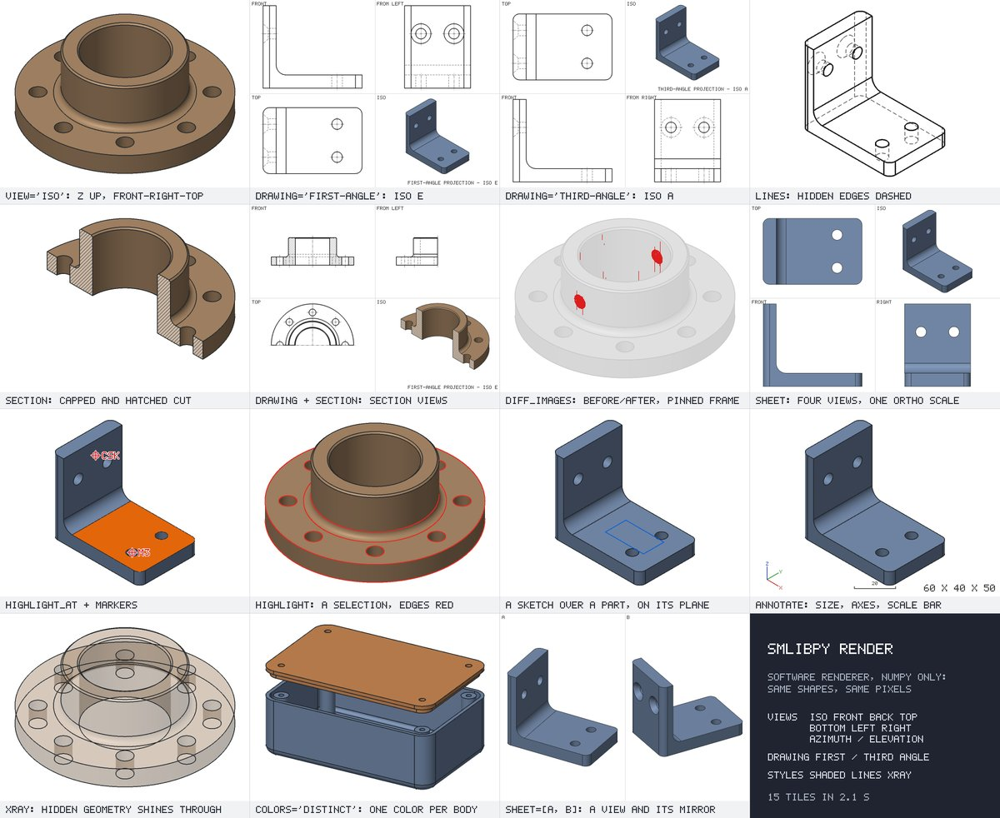

# We officially release smlibpy open source. A python API for the smlib nurbs kernel (inspired by cad-query, build123d & classcad). A wasm compile for javascript/ts (1.8mb dl/brotli 
> Source: https://x.com/0xca0a/status/2110022758729937313
> Author: ☄︎ (@0xca0a)
> Posted: Tue Oct 13 15:00:02 +0000 2026
> Captured: 2026-10-15T09:02:28+00:00
> Stats at capture: 24,950 views · 386 likes · 16 replies · 37 reposts · 405 bookmarks · 13 quotes

## Post

We officially release smlibpy open source. A python API for the smlib nurbs kernel (inspired by cad-query, build123d & classcad). A wasm compile for javascript/ts (1.8mb dl/brotli total). And a MCP for agents.
→ https://smlibpy.classcad.ch
→ https://github.com/awv-informatik/smlibpy

Thread ⤵

## Media

[Post media 1](media/video-01.mp4) — Source media: https://video.twimg.com/amplify_video/2110001806889615360/vid/avc1/1280x720/AeAzrIXp746ymXxv.mp4?tag=29
 — Post media 1 thumbnail. Source media: https://pbs.twimg.com/amplify_video_thumb/2110001806889615360/img/-KeR8JejIZ9bX1N6.jpg
 — Reply 2110022772650820025 media 1. Source media: https://pbs.twimg.com/media/HUhOhgiXUAAsxy4.jpg
 — Reply 2110022772650820025 media 2. Source media: https://pbs.twimg.com/media/HUhOhhaXoAAH4c8.jpg
 — Reply 2110022772650820025 media 3. Source media: https://pbs.twimg.com/media/HUhOhg5XMAArZEW.jpg
 — Reply 2110022785632493788 media 1. Source media: https://pbs.twimg.com/media/HUhOiQUWoAAg9Pt.jpg
[Reply 2110022790027809230 media 1](media/video-02.mp4) — Source media: https://video.twimg.com/amplify_video/2110019395103625216/vid/avc1/1920x1080/q9NTqPPlTppoMqG3.mp4?tag=29

## Thread

### ☄︎ ([@0xca0a](https://x.com/0xca0a/status/2110022772650820025)) — 2026-10-13T15:00:05+00:00

It packs the full feature-set of smlib. All modeling features, 2d primitives, curves & surfaces, deforms, sheet metal, simplification, measuring & checks. Plus: search queries, visualisation, and a bunch of helpers.
→ https://t.co/8eWBnVndtJ https://t.co/CFH1z7SDIC
 — Source media: https://pbs.twimg.com/media/HUhOhgiXUAAsxy4.jpg
 — Source media: https://pbs.twimg.com/media/HUhOhhaXoAAH4c8.jpg
 — Source media: https://pbs.twimg.com/media/HUhOhg5XMAArZEW.jpg
### ☄︎ ([@0xca0a](https://x.com/0xca0a/status/2110022785632493788)) — 2026-10-13T15:00:09+00:00

The mcp is inspired by https://t.co/LpWLT7ctSV. It uses real world training data (agents hammer the API with true & false input in order to learn about the results & combinations), 1-turn scripts, deterministic snapshotting/marking/sections, and iterative loops. https://t.co/v2R5qcLQ83
 — Source media: https://pbs.twimg.com/media/HUhOiQUWoAAg9Pt.jpg
### ☄︎ ([@0xca0a](https://x.com/0xca0a/status/2110022790027809230)) — 2026-10-13T15:00:10+00:00

When to use what:

https://t.co/QmL103a01J → you are scripting STEP or STL. models are solely based on code.

https://t.co/glvclQn1PV → constrained sketches, parametric, expression driven parts, feature history & refs, assembly constraints, PDM → watch the video. https://t.co/hKnA6qkhv6
 — Source media: https://video.twimg.com/amplify_video/2110019395103625216/vid/avc1/1920x1080/q9NTqPPlTppoMqG3.mp4?tag=29
### ☄︎ ([@0xca0a](https://x.com/0xca0a/status/2110027283407012087)) — 2026-10-13T15:18:01+00:00

@UnfilteredLogix Windows took a while to compile. There is one in the pipe as we speak with improved STEP reading. It gets some STEPs right that even OpenCascade cannot parse.
### ☄︎ ([@0xca0a](https://x.com/0xca0a/status/2110040067364311135)) — 2026-10-13T16:08:49+00:00

@michaltakac One thing for sure, AI's that try to solve programming/CAD tasks without a live system start to hallucinate and fail. I would consider a "one-shot" a loop that concludes successfully with a verified result.
### ☄︎ ([@0xca0a](https://x.com/0xca0a/status/2110041994496286933)) — 2026-10-13T16:16:28+00:00

@Marriavla it seems that's where it's going.
### ☄︎ ([@0xca0a](https://x.com/0xca0a/status/2110024796901654584)) — 2026-10-13T15:08:08+00:00

@HongheWu opus as the director, my script, and it's using our actual apps from the source directory. buerligons for instance for the last one - it's the apps UI and panels, the actual model assembly, when it spins that's not AI making stuff up, it's real.

## Comments

### Vickyy ([@UnfilteredLogix](https://x.com/UnfilteredLogix/status/2110025265330225476)) — 2026-10-13T15:10:00+00:00

@0xca0a hey we already started using it in https://t.co/ULCx2L8ykj 
. Thankyou for the windows one so fast . 😁
### Maria Vladi ([@Marriavla](https://x.com/Marriavla/status/2110026600037192109)) — 2026-10-13T15:15:18+00:00

@0xca0a On a partner call someone asked if Claude would sit inside our product. It goes the other way: you add our Mercado Livre connector inside Claude.
### Henry ([@HongheWu](https://x.com/HongheWu/status/2110023893901869275)) — 2026-10-13T15:04:33+00:00

@0xca0a What tools were used to make this video?
### Abijah Kajabika ([@abijahkaj](https://x.com/abijahkaj/status/2110036125125407063)) — 2026-10-13T15:53:09+00:00

@0xca0a nice animation, lib must be great too, will definitely give it a try
### Alice The Ai Expert ([@AliceInfoAi](https://x.com/AliceInfoAi/status/2110268971320848562)) — 2026-10-14T07:18:24+00:00

@0xca0a Huge release  open sourcing smlibpy with Python API, WASM, and MCP is an amazing gift to the CAD community!
### Tom Fletcher ([@rgbjoy](https://x.com/rgbjoy/status/2110027948862656627)) — 2026-10-13T15:20:40+00:00

@0xca0a This is so huge... like this might change my direction completely. I want to build real things...
### ZenithAi ([@ZenithAiLab](https://x.com/ZenithAiLab/status/2110296192018247680)) — 2026-10-14T09:06:34+00:00

@0xca0a Huge congrats on the launch amazing work across all platforms
### NOOR TECH ([@NoorTech0](https://x.com/NoorTech0/status/2110279648257171482)) — 2026-10-14T08:00:49+00:00

@0xca0a smlibpy open source brilliantly delivers Python API, lightweight WASM, and MCP support inspiring next-generation CAD innovation everywhere
### Fasil · AI, actually interesting ([@Fasil5255](https://x.com/Fasil5255/status/2110194000527303076)) — 2026-10-14T02:20:29+00:00

@0xca0a curious — is the MCP server the intended entry point for agents, or are you seeing people drive the Python API directly?
### Elise Tech Ai ([@EliseTechAi](https://x.com/EliseTechAi/status/2110271122042458309)) — 2026-10-14T07:26:57+00:00

@0xca0a Open sourcing smlibpy with Python API, WASM, and MCP support is awesome for CAD builders
### Javier Leandro Arancibia ([@javimosch](https://x.com/javimosch/status/2110042004424171662)) — 2026-10-13T16:16:31+00:00

@0xca0a a whole nurbs kernel in 1.8mb of wasm is impressive — and giving agents an mcp to drive it is a really fun unlock. congrats on the release

## Other returned timeline records

> The CLI did not expose reply relationships. These records do not start with a reply mention and were authored by someone other than the saved-post author. They may include recommendations or promoted posts; they are retained as source context, not verified replies.

### Starlink ([@Starlink](https://x.com/Starlink/status/2068115197718593741)) — 2026-06-19T23:34:21+00:00

Get connected with fast, reliable internet for streaming, video calls, online gaming and more.

Order online in minutes.
### Michal Takac ([@michaltakac](https://x.com/michaltakac/status/2110035689769214147)) — 2026-10-13T15:51:25+00:00

So technically we could work out a loop with PINNs / FNOs / MeshGraphNets / other Physics AI stuff that work with geometries and let it optimize the geometry based on physical constraint…

I think I can work out a nice example for this as I’m re-building Physics AI products for @TheDimensionLab

## Links

- https://smlibpy.classcad.ch
- https://github.com/awv-informatik/smlibpy
