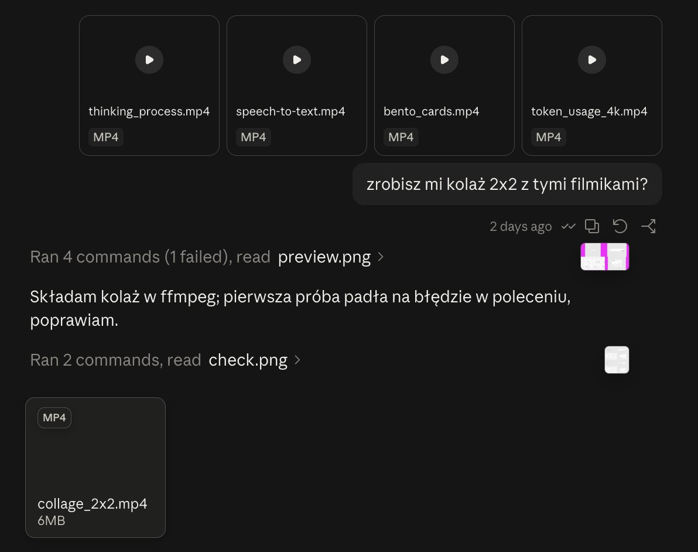
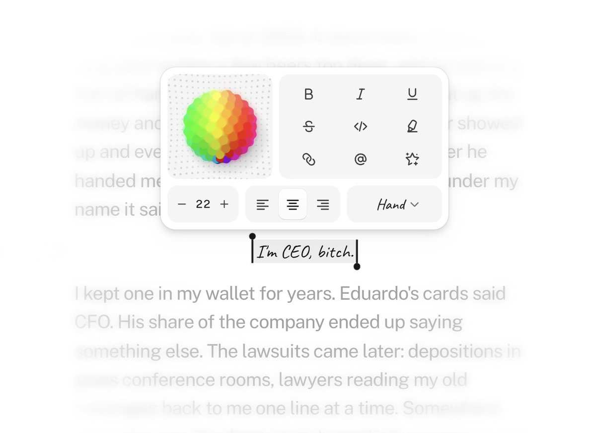

# These designs got over 50k views in ~2 days.
> Source: https://x.com/pitus_/status/2110059026818212244
> Author: Phil Pitus (@pitus_)
> Posted: Tue Oct 13 17:24:09 +0000 2026
> Captured: 2026-10-15T09:02:28+00:00
> Stats at capture: 46,089 views · 785 likes · 24 replies · 35 reposts · 1,487 bookmarks · 2 quotes

## Post

These designs got over 50k views in ~2 days.

Secret?

They were 100% AI generated.

Here's how I use AI to create designs that don't look vibe-coded: 🧵

## Media

[Post media 1](media/video-01.mp4) — Source media: https://video.twimg.com/amplify_video/2110054438408740864/vid/avc1/1280x720/O7udW4fhyZ7ReQn4.mp4?tag=29
 — Post media 1 thumbnail. Source media: https://pbs.twimg.com/amplify_video_thumb/2110054438408740864/img/LXSiWBZBNoIUUPH2.jpg
 — Reply 2110608193214959959 media 1. Source media: https://pbs.twimg.com/media/HUpiw_YW4AANXE7.jpg
[Reply 2110430533876658614 media 1](media/video-02.mp4) — Source media: https://video.twimg.com/amplify_video/2110430519343390720/vid/avc1/1440x1080/r7Z7_pIBieS9YV-V.mp4?tag=16
 — Reply 2110512054851526682 media 1. Source media: https://pbs.twimg.com/media/HUoK4fLboAAo1fo.jpg
 — Reply 2110283670917677400 media 1. Source media: https://pbs.twimg.com/media/HUk6dVEbkAAGlGb.jpg
 — Reply 2110283670917677400 media 2. Source media: https://pbs.twimg.com/media/HUk7yb3aEAASBj0.jpg
[Reply 2110016199543410741 media 1](media/video-03.mp4) — Source media: https://video.twimg.com/amplify_video/2110016065396994049/vid/avc1/3102x2160/7XYikiKQPKe-DWje.mp4?tag=29

## Thread

### Phil Pitus ([@pitus_](https://x.com/pitus_/status/2110059030182044150)) — 2026-10-13T17:24:10+00:00

1/
I never start with a prompt. I use references first.

I often use tools and platforms like Mobbin, Pinterest, Dribbble and X to find 3–5 things that feel right, and then I give AI all the screenshots.

+ detailed instructions on what I like (and don't like) about each one.
### Phil Pitus ([@pitus_](https://x.com/pitus_/status/2110059032467673597)) — 2026-10-13T17:24:10+00:00

2/
I describe the action, not style or visuals.

I never ask AI to "make it look nice and clean".
It never works.

The best outcomes always came from prompts like "users wait here ~20 seconds for an agent, what could we show them here, so that they don't get bored and leave?"
### Phil Pitus ([@pitus_](https://x.com/pitus_/status/2110059035383009433)) — 2026-10-13T17:24:11+00:00

3/
I ask AI to help with decision making.

You might have noticed that in the example above, but I genuinely try to ask AI for direction.

AI is really good at brainstorming interesting solutions for problems. Sometimes that's all it takes to make your product truly great.
### Phil Pitus ([@pitus_](https://x.com/pitus_/status/2110059037391781985)) — 2026-10-13T17:24:12+00:00

4/
AI's first version is usually off.

The usual problems:
- spacing all over the place
- gradients... (don't get me started)
- hierarchy is bad, everything is the same size

So, I fix those by hand, or tell it exactly what to change. Sometimes with another set of references.
### Phil Pitus ([@pitus_](https://x.com/pitus_/status/2110059040248299973)) — 2026-10-13T17:24:12+00:00

5/
Then I go after the details AI can easily overlook:

- loading states
- empty states
- interactions
- animations

The job here is to predict the most absurd edge cases, and handle them.

The devil is in the details. That's what made the thinking-process clip feel so polished.
### Phil Pitus ([@pitus_](https://x.com/pitus_/status/2110059042596945931)) — 2026-10-13T17:24:13+00:00

6/
Remember: AI gets you 80% of the way, fast.

But if you stop at that, your product ends up looking unfinished.

The last 20% boils down to taste, ideas, experience and iteration.

That's what makes you look like a billion dollar company.

🫶
### Phil Pitus ([@pitus_](https://x.com/pitus_/status/2110608193214959959)) — 2026-10-15T05:46:21+00:00

@Boakeston Opus 5.5

just realized I prompted it in my native language, but it literally says

"can you do me a 2x2 collage with these videos?" https://t.co/OqcGediiff
 — Source media: https://pbs.twimg.com/media/HUpiw_YW4AANXE7.jpg
### Phil Pitus ([@pitus_](https://x.com/pitus_/status/2110654925575528938)) — 2026-10-15T08:52:02+00:00

@alabaccari0 https://t.co/XFM9bbSEs4
### Phil Pitus ([@pitus_](https://x.com/pitus_/status/2110317234438418685)) — 2026-10-14T10:30:11+00:00

@DeckardBuilds 100%

It just need a tiny bit of direction
### Phil Pitus ([@pitus_](https://x.com/pitus_/status/2110405459878248763)) — 2026-10-14T16:20:45+00:00

@faizintifada_ Glad you like them! How’s that workflow working for you?
### Phil Pitus ([@pitus_](https://x.com/pitus_/status/2110298627570593856)) — 2026-10-14T09:16:14+00:00

@bitares 100%, that’s what feedback is for
### Phil Pitus ([@pitus_](https://x.com/pitus_/status/2110298732474605691)) — 2026-10-14T09:16:39+00:00

@bennyschudel References are key
### Phil Pitus ([@pitus_](https://x.com/pitus_/status/2110323912596767023)) — 2026-10-14T10:56:43+00:00

@samtwtss No worries! Will share more later today ;)
### Phil Pitus ([@pitus_](https://x.com/pitus_/status/2110345795430154678)) — 2026-10-14T12:23:40+00:00

@MirazUlKab092 Magic 👀 (and a bit too much coffee)
### Phil Pitus ([@pitus_](https://x.com/pitus_/status/2110345654627442886)) — 2026-10-14T12:23:07+00:00

@lamaandesign Yes, Opus 5.5

More on that later today ;) stay tuned
### Phil Pitus ([@pitus_](https://x.com/pitus_/status/2110298552459280656)) — 2026-10-14T09:15:57+00:00

@mhmudalii Thank you so much!
### Phil Pitus ([@pitus_](https://x.com/pitus_/status/2110298785830051981)) — 2026-10-14T09:16:52+00:00

@zia_webdev I’ll think about that
### Phil Pitus ([@pitus_](https://x.com/pitus_/status/2110073340945940552)) — 2026-10-13T18:21:02+00:00

@inigo_xyz No problem! Still have more to share :)
### Phil Pitus ([@pitus_](https://x.com/pitus_/status/2110405394875167129)) — 2026-10-14T16:20:30+00:00

@KshtjBhardwaj18 Thank you so much 🫶
### Phil Pitus ([@pitus_](https://x.com/pitus_/status/2110092658140205092)) — 2026-10-13T19:37:47+00:00

@asifalihunzai Thank you so much 💪
### Phil Pitus ([@pitus_](https://x.com/pitus_/status/2110062848395411689)) — 2026-10-13T17:39:20+00:00

@timothymaarv Thank you so much Tim! Means a lot 🫶

## Comments

### boakeston ([@Boakeston](https://x.com/Boakeston/status/2110602330898895338)) — 2026-10-15T05:23:03+00:00

@pitus_ How did you put the video in this post together? As in putting four separate screen recordings into one video?

It looks so clean and smooth too!
### Ala Baccari ([@alabaccari0](https://x.com/alabaccari0/status/2110625932532711811)) — 2026-10-15T06:56:50+00:00

@pitus_ the 4th component source ?
### Deckard ([@DeckardBuilds](https://x.com/DeckardBuilds/status/2110307958303477956)) — 2026-10-14T09:53:19+00:00

@pitus_ Crazy how good AI has gotten with interactions like these
### Faiz Intifada ([@faizintifada_](https://x.com/faizintifada_/status/2110400490702004373)) — 2026-10-14T16:01:00+00:00

@pitus_ love the steps, i’m glad had implemented all of ur steps on my AI design workflows
### BitAres ([@bitares](https://x.com/bitares/status/2110132501159284996)) — 2026-10-13T22:16:07+00:00

@pitus_ Showing the agent’s progress during that 20-second wait would give me a reason to stay. I’d know the app was still working and what it was working on.
### Benny Schudel ([@bennyschudel](https://x.com/bennyschudel/status/2110109032950190429)) — 2026-10-13T20:42:52+00:00

@pitus_ Yep, references are the way to go. Best is to build your own library and just point it to a project. Every project can have an art direction description.
### Sameer ([@samtwtss](https://x.com/samtwtss/status/2110323442029588679)) — 2026-10-14T10:54:51+00:00

@pitus_ Crazy, ty for sharing!
### Miraz Ul Kabir ([@MirazUlKab092](https://x.com/MirazUlKab092/status/2110340970789392648)) — 2026-10-14T12:04:30+00:00

@pitus_ Wow!! How??
### Lam’aan ([@lamaandesign](https://x.com/lamaandesign/status/2110345289928438129)) — 2026-10-14T12:21:40+00:00

@pitus_ beautiful. using Claude?
### Mahmood Ali ([@mhmudalii](https://x.com/mhmudalii/status/2110263244409512103)) — 2026-10-14T06:55:38+00:00

@pitus_ Wow, incredible work!! 🔥
### Zia Ur Rehman Khan ([@zia_webdev](https://x.com/zia_webdev/status/2110245894323048887)) — 2026-10-14T05:46:42+00:00

@pitus_ Awesome read. Thanks!!!

If you could share on of the process in a detailed article, I’d appreciate that
### Iñigo 🔺 ([@inigo_xyz](https://x.com/inigo_xyz/status/2110072003268866515)) — 2026-10-13T18:15:43+00:00

@pitus_ Thanks for sharing !
### Bhardwaj ([@KshtjBhardwaj18](https://x.com/KshtjBhardwaj18/status/2110374050203848742)) — 2026-10-14T14:15:57+00:00

@pitus_ Good insights sir 🫡
### Asif Ali | Video Editor ([@asifalihunzai](https://x.com/asifalihunzai/status/2110092127208353964)) — 2026-10-13T19:35:41+00:00

@pitus_ Good work
### Timothy M. ([@timothymaarv](https://x.com/timothymaarv/status/2110062703352111166)) — 2026-10-13T17:38:46+00:00

@pitus_ Awesome read!! Thanks for sharing 🙏🏽
### Divyendra Singh ([@Divten7](https://x.com/Divten7/status/2110322593794531619)) — 2026-10-14T10:51:28+00:00

@pitus_ The gradients always give it away lol
### Neatpixels ([@_neatpixels](https://x.com/_neatpixels/status/2110490468719218861)) — 2026-10-14T21:58:33+00:00

@pitus_ Love the isometric illustrations
### Varun ([@im_daedalus](https://x.com/im_daedalus/status/2110303203820744717)) — 2026-10-14T09:34:25+00:00

@pitus_ the 80/20 split is real. ai gets the layout fast but the spacing and hierarchy is where it always looks off.
i always ask ai to make it look nice. Fucker never works
### Eg0r0k ([@Kroge220410](https://x.com/Kroge220410/status/2110511540226908356)) — 2026-10-14T23:22:17+00:00

@pitus_ Where is design?
 1. Basic "thinking" in any AI app, deepseek/GPT. 
2. Simple Input Group with "audio" wow insane, i don't see it in anywhere (sarcasm)
3. New skill from X 
4. SIMPLE Chart LOL
### Fasil · AI, actually interesting ([@Fasil5255](https://x.com/Fasil5255/status/2110265497790910830)) — 2026-10-14T07:04:36+00:00

@pitus_ Real question: what's the tell that makes AI designs look vibe-coded to you? For me it's always the same indigo accent color and cards with identical rounded corners everywhere. Curious what you watch for.
### vaibhav nilkhan ([@NilkhanVaibhav](https://x.com/NilkhanVaibhav/status/2110318473570386031)) — 2026-10-14T10:35:06+00:00

@pitus_ Good insight

## Other returned timeline records

> The CLI did not expose reply relationships. These records do not start with a reply mention and were authored by someone other than the saved-post author. They may include recommendations or promoted posts; they are retained as source context, not verified replies.

### Starlink ([@Starlink](https://x.com/Starlink/status/2068115197718593741)) — 2026-06-19T23:34:21+00:00

Get connected with fast, reliable internet for streaming, video calls, online gaming and more.

Order online in minutes.
### Starlink ([@Starlink](https://x.com/Starlink/status/2098108930027331836)) — 2026-09-10T17:58:44+00:00

Starlink offers fast, reliable internet in the most rural and remote locations. Portable and easy to set up, Starlink works wherever you are.

Order online in minutes.
### TechLead Conference ([@TheTechLeadConf](https://x.com/TheTechLeadConf/status/2089315288621654313)) — 2026-08-17T11:35:57+00:00

🎤 Straight from the stage: how top engineering leaders are rolling out AI inside real orgs. TechLead Conf hits London on October 23 — first speakers announced.
### Michael Nowak ([@mnowakdesign](https://x.com/mnowakdesign/status/2110430533876658614)) — 2026-10-14T18:00:23+00:00

tiny microinteractions 🤏🏻 https://t.co/IDD4ug936y
 — Source media: https://video.twimg.com/amplify_video/2110430519343390720/vid/avc1/1440x1080/r7Z7_pIBieS9YV-V.mp4?tag=16
### shawn. ([@zzzzshawn](https://x.com/zzzzshawn/status/2110512054851526682)) — 2026-10-14T23:24:19+00:00

text toolbar concept https://t.co/2vVtwUVfHv
 — Source media: https://pbs.twimg.com/media/HUoK4fLboAAo1fo.jpg
### Lynel ([@LynelDesign](https://x.com/LynelDesign/status/2110283670917677400)) — 2026-10-14T08:16:48+00:00

Designs. https://t.co/rpWgvxNHSw
 — Source media: https://pbs.twimg.com/media/HUk6dVEbkAAGlGb.jpg
 — Source media: https://pbs.twimg.com/media/HUk7yb3aEAASBj0.jpg
### Basit A. Khan ([@basit_designs](https://x.com/basit_designs/status/2110016199543410741)) — 2026-10-13T14:33:58+00:00

More Visuals, more aesthetics ❤️ https://t.co/PwbDHDE2YK
 — Source media: https://video.twimg.com/amplify_video/2110016065396994049/vid/avc1/3102x2160/7XYikiKQPKe-DWje.mp4?tag=29
