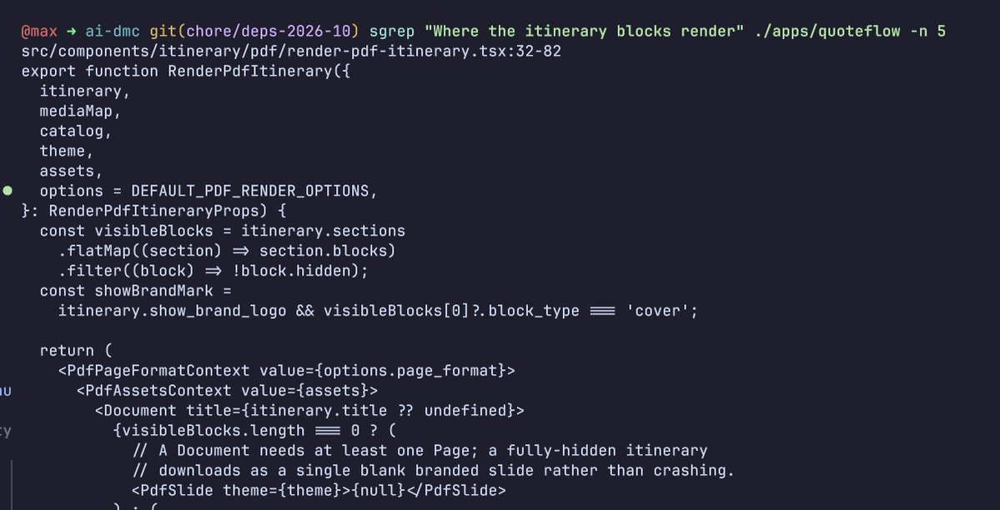

# Meet sgrep, a fast, fully local ripgrep extension built to make agents cheaper and more accurate.
> Source: https://x.com/getcontextdev/status/2110070862972158174
> Author: Context.dev (@getcontextdev)
> Posted: Tue Oct 13 18:11:11 +0000 2026
> Captured: 2026-10-15T09:02:28+00:00
> Stats at capture: 79,155 views · 556 likes · 34 replies · 29 reposts · 780 bookmarks · 14 quotes

## Post

Meet sgrep, a fast, fully local ripgrep extension built to make agents cheaper and more accurate.

on our SWE-bench Verified eval, sgrep reduced LLM API cost by 21.3% versus ripgrep, solving 70 of 100 attempts versus 68.

## Media

[Post media 1](media/video-01.mp4) — Source media: https://video.twimg.com/amplify_video/2110070817480740864/vid/avc1/1280x720/RBDmlxFVWvrvo0V6.mp4?tag=16
 — Post media 1 thumbnail. Source media: https://pbs.twimg.com/amplify_video_thumb/2110070817480740864/img/UyJWsuMRvMtYF1d0.jpg
 — Reply 2110472242182365273 media 1. Source media: https://pbs.twimg.com/media/HUnnSujWwAADD0-.jpg
[Reply 2080545464298897709 media 1](media/video-02.mp4) — Source media: https://video.twimg.com/amplify_video/2071850142970380288/vid/avc1/720x720/yNxa0Asr76cYcEyL.mp4?tag=14

## Thread

### Context.dev ([@getcontextdev](https://x.com/getcontextdev/status/2110070874850447705)) — 2026-10-13T18:11:14+00:00

Ripgrep is great at finding matches, but it has no understanding of which results are actually relevant.

The result is agents get a lot of junk in their context, or even worse never see the most important code snippet.

sgrep fixes this by using static embeddings to rerank search results by relevance. Everything happens locally, with a lightweight index built on the fly at query time, so there's no persistent index to maintain or rebuild as your codebase changes.
### Context.dev ([@getcontextdev](https://x.com/getcontextdev/status/2110070886883876935)) — 2026-10-13T18:11:17+00:00

We built sgrep in Rust and optimized the entire pipeline to the point where it performs on par with search tools that rely on prebuilt indexes.

Tell your agent to try sgrep today:
https://t.co/RVFSzrrOJ6
### Context.dev ([@getcontextdev](https://x.com/getcontextdev/status/2110475145244520876)) — 2026-10-14T20:57:40+00:00

@maxlloydbuilds LFG!

## Comments

### Max Lloyd ([@maxlloydbuilds](https://x.com/maxlloydbuilds/status/2110472242182365273)) — 2026-10-14T20:46:07+00:00

@getcontextdev This is bloody awesome, using it already. https://t.co/myoiyzqYfr
 — Source media: https://pbs.twimg.com/media/HUnnSujWwAADD0-.jpg
### Nova Tech ([@Novatechinfo](https://x.com/Novatechinfo/status/2110128723743936665)) — 2026-10-13T22:01:06+00:00

@getcontextdev 21% cheaper and more accurate, nice
### aadi — e\acc ([@aadithyanr_](https://x.com/aadithyanr_/status/2110084598063669573)) — 2026-10-13T19:05:46+00:00

@getcontextdev good job on the launch video @michael_chomsky 🤭🤭🤭🤭🤭
### Mathew Pregasen ([@mathewpregasen](https://x.com/mathewpregasen/status/2110139999941464225)) — 2026-10-13T22:45:55+00:00

@getcontextdev "how is Yahia gonna compete with Firecrawl" they said
### Vantix AI Agency ([@VantixAgency](https://x.com/VantixAgency/status/2110353493940953335)) — 2026-10-14T12:54:16+00:00

@getcontextdev Fully local cheaper more accurate that's the holy trinity 21% cost cut while solving more is a no brainer win
### andrew schmitz ᵕ̈ ([@big_schmitz](https://x.com/big_schmitz/status/2110077512873398299)) — 2026-10-13T18:37:37+00:00

@getcontextdev PR otw
### Christian Genco ([@cgenco](https://x.com/cgenco/status/2110391724933534133)) — 2026-10-14T15:26:11+00:00

@getcontextdev @grok how does this work? Is this building and searching over an embedding?
### Alex Ai | Tools & Updates ([@AlexWithAi_](https://x.com/AlexWithAi_/status/2110253897898144228)) — 2026-10-14T06:18:30+00:00

@getcontextdev Local and cheaper with better accuracy wins
### Yash ([@dewyashtwts](https://x.com/dewyashtwts/status/2110071729418883501)) — 2026-10-13T18:14:38+00:00

@getcontextdev wow, would love to try this fs
### Saša Šijak ([@ssijak](https://x.com/ssijak/status/2110419984501682204)) — 2026-10-14T17:18:28+00:00

@getcontextdev What is the suggested way to configure harnesses to use it
### Amelia | AI & Tech ([@AmeliaonAI](https://x.com/AmeliaonAI/status/2110260753249005947)) — 2026-10-14T06:45:44+00:00

@getcontextdev Lower cost and better accuracy is exactly what agents need
### Jaume ([@jamalavedra](https://x.com/jamalavedra/status/2110611890984685598)) — 2026-10-15T06:01:02+00:00

@getcontextdev 70 vs 68 is the honest part
### RAZA | AI EXPLORER ([@razaaitech](https://x.com/razaaitech/status/2110082210741321964)) — 2026-10-13T18:56:17+00:00

@getcontextdev Impressive! Lower costs and better accuracy are a win for AI agents.
### Zara Tech & Tools ([@AskZaratech](https://x.com/AskZaratech/status/2110263242476093871)) — 2026-10-14T06:55:38+00:00

@getcontextdev Impressive efficiency gain with solid results
### TensorQuay ([@tensorquay](https://x.com/tensorquay/status/2110211045168238681)) — 2026-10-14T03:28:13+00:00

@getcontextdev on a local model the same saving shows up as time: if most of the 21% is input tokens, that's less prompt processing on every agent step. worth a run with a local model in the loop
### Cole Hollander ([@Colehollander10](https://x.com/Colehollander10/status/2110108897646379153)) — 2026-10-13T20:42:19+00:00

@getcontextdev @bot is this useful for me?
### Alice The Ai Expert ([@AliceInfoAi](https://x.com/AliceInfoAi/status/2110077867468210579)) — 2026-10-13T18:39:01+00:00

@getcontextdev Super impressive  cutting LLM costs by 21.3% while improving accuracy to 70/100 on SWE-bench Verified with a fully local tool is a huge win for agents!
### Jatin Garg ([@jatingargiitk](https://x.com/jatingargiitk/status/2110112695316078834)) — 2026-10-13T20:57:25+00:00

@getcontextdev how much does sgrep cut token costs in practice? the savings claim only holds if your codebase search is a big fraction of total context usage.
### Sani Ai Tech ([@SaniAiTech](https://x.com/SaniAiTech/status/2110149421648478535)) — 2026-10-13T23:23:21+00:00

@getcontextdev Smarter local search delivering real cost savings and improved agent performance
### Jimi Barkway ([@JimiBarkway](https://x.com/JimiBarkway/status/2110321323440271682)) — 2026-10-14T10:46:26+00:00

@getcontextdev Local search wins when it keeps the agent focused. Less noise, lower cost, and a better chance of finding the file that matters.
### NOOR TECH ([@NoorTech0](https://x.com/NoorTech0/status/2110104222964633929)) — 2026-10-13T20:23:45+00:00

@getcontextdev Context's sgrep brilliantly delivers faster fully local search, cutting costs twenty-one percent while improving accuracy impressively for agents
### limbozoom ([@dpshoul](https://x.com/dpshoul/status/2110302611236946242)) — 2026-10-14T09:32:04+00:00

@getcontextdev cost is precise to three decimals, accuracy is two coin flips
### Aina Ai | Tools & Updates ([@AinaAiTech](https://x.com/AinaAiTech/status/2110264930612174910)) — 2026-10-14T07:02:20+00:00

@getcontextdev Love it  cheaper smarter and local That's a real win
### Elara AI ([@ElaraAiLab](https://x.com/ElaraAiLab/status/2110234839081509114)) — 2026-10-14T05:02:46+00:00

@getcontextdev Cheaper and more accurate local ripgrep extension
### Manish Rana ([@ManishRaanaa](https://x.com/ManishRaanaa/status/2110078977461407770)) — 2026-10-13T18:43:26+00:00

@getcontextdev Gonna try this
### Giedrius Trump ([@Trumpyla](https://x.com/Trumpyla/status/2110235228019077338)) — 2026-10-14T05:04:19+00:00

@getcontextdev 🔥
### Elise Tech Ai ([@EliseTechAi](https://x.com/EliseTechAi/status/2110218791494037607)) — 2026-10-14T03:59:00+00:00

@getcontextdev Strong results great to see local tools improving both cost and accuracy
### tobias ([@tobiastornros](https://x.com/tobiastornros/status/2110272967179751796)) — 2026-10-14T07:34:17+00:00

@getcontextdev Nice work!!!!

## Other returned timeline records

> The CLI did not expose reply relationships. These records do not start with a reply mention and were authored by someone other than the saved-post author. They may include recommendations or promoted posts; they are retained as source context, not verified replies.

### Starlink ([@Starlink](https://x.com/Starlink/status/2099964624648958223)) — 2026-09-15T20:52:36+00:00

Get fast, reliable home internet for seamless streaming, working from home, gaming, and more across multiple devices.

Order online in minutes.
### Starlink ([@Starlink](https://x.com/Starlink/status/2068115197718593741)) — 2026-06-19T23:34:21+00:00

Get connected with fast, reliable internet for streaming, video calls, online gaming and more.

Order online in minutes.
### Occupy Wall Street ([@OccupyWallSt](https://x.com/OccupyWallSt/status/2091679500094275968)) — 2026-08-24T00:10:29+00:00

We believe Jewish Lives Matter.
### TP in Greece ([@wearetpingreece](https://x.com/wearetpingreece/status/2080545464298897709)) — 2026-07-24T06:47:48+00:00

Step into the circle! At TP in Greece, every language opens the door to new opportunities. As a multilingual hub, we bring together talented people from around the world to create meaningful connections every day. Where are you joining us from? Tell us in the comments! https://t.co/SiyrBHAPzu
 — Source media: https://video.twimg.com/amplify_video/2071850142970380288/vid/avc1/720x720/yNxa0Asr76cYcEyL.mp4?tag=14
