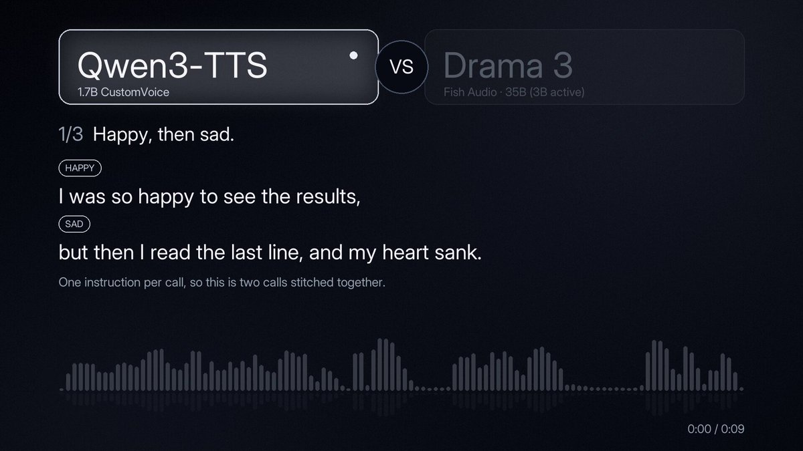

# 🚨 This is huge.
> Source: https://x.com/niklaslenz_ai/status/2110124406156722455
> Author: Niklas (@niklaslenz_ai)
> Posted: Tue Oct 13 21:43:57 +0000 2026
> Captured: 2026-10-15T09:02:28+00:00
> Stats at capture: 129,952 views · 1,785 likes · 52 replies · 125 reposts · 2,028 bookmarks · 11 quotes

## Post

🚨 This is huge. 

Fish Audio just opened the weights of Drama 3, and it's the first open TTS model that sounds close to perfect to me.

Other models can switch emotion mid-sentence. 
Drama 3 is the first one I've heard where it actually sounds right. 

Three tests against Qwen3-TTS, each on one DGX Spark at home: happy turning sad mid-sentence, a sad whisper, and pure excitement. Listen to where the mood drops.

I think this kills ElevenLabs for anyone who has their own compute.

The catch: it's a 35B model (3B active), a 41.5 GB download, and on the Spark it only just keeps up with real time: 10 s of audio take 9.7 s (Qwen3-TTS 7.6 s).

> Quoted post by Fish Audio ([@FishAudio](https://x.com/FishAudio/status/2110038429199450126)):
>
> $52M seed round. 15M+ users. But this is what we're most proud of yet.
>
> Introducing Drama 3: the most emotive and controllable TTS model in the world
>
> And yes, it's open-weight.
>
> You can now control how even a single word should sound, change its tone, and shift your voice mid-sentence.
>
> Uncle Roger was impressed too.
>
> Try it here:
>
> https://s.fish.audio/rqh0l8
>
> Comment “DRAMA” within the next 48 hours for 1 month free.
>
> If you're an enterprise your first month is on us:
>
> https://s.fish.audio/qz9r0t

## Media

[Post media 1](media/video-01.mp4) — Source media: https://video.twimg.com/amplify_video/2110124155735568384/vid/avc1/1280x720/e0K7TO5dXwPTmxJw.mp4?tag=29
 — Post media 1 thumbnail. Source media: https://pbs.twimg.com/amplify_video_thumb/2110124155735568384/img/PIHFHu805_LKRTSe.jpg

## Thread

### Niklas ([@niklaslenz_ai](https://x.com/niklaslenz_ai/status/2110325903297335761)) — 2026-10-14T11:04:37+00:00

Part 2 is out, this time with the heaviest hitters there are: 
https://t.co/r5hrh2kTEz
### Niklas ([@niklaslenz_ai](https://x.com/niklaslenz_ai/status/2110266162072412441)) — 2026-10-14T07:07:14+00:00

@FishAudio Very impressed with it. Thank you for releasing it as open-weights. You are awesome!
### Niklas ([@niklaslenz_ai](https://x.com/niklaslenz_ai/status/2110410022694097031)) — 2026-10-14T16:38:53+00:00

@Ivrqen We can only hope
### Niklas ([@niklaslenz_ai](https://x.com/niklaslenz_ai/status/2110248982400151583)) — 2026-10-14T05:58:58+00:00

@ArifiLabs 35B parameters, but only 3B active per token. The download is 41.5 GB.
### Niklas ([@niklaslenz_ai](https://x.com/niklaslenz_ai/status/2110249228635406657)) — 2026-10-14T05:59:57+00:00

@tuboshu321 Fair. To my ear the closed ones still sound a bit cleaner. The difference is this one runs at home.
### Niklas ([@niklaslenz_ai](https://x.com/niklaslenz_ai/status/2110250299822690750)) — 2026-10-14T06:04:12+00:00

@JeffSBennion Haven’t seen an MLX version yet.
### Niklas ([@niklaslenz_ai](https://x.com/niklaslenz_ai/status/2110409303089729705)) — 2026-10-14T16:36:02+00:00

@cryptosibbers Don't know yet, but I will definitely test the cloning capabilities soon. 

I want to have a high quality video pipeline that runs 100% locally. Something very similar to what @u1tra_instinct is building. Ideally completely hands-off.
### Niklas ([@niklaslenz_ai](https://x.com/niklaslenz_ai/status/2110250195607056645)) — 2026-10-14T06:03:47+00:00

@satgeze Fair, you can still hear it. But it’s the closest open model I’ve heard so far. And keep in mind, there are a lot of ways to fine tune a model. In this test I just gave it a prompt and showed you the first output I got.
### Niklas ([@niklaslenz_ai](https://x.com/niklaslenz_ai/status/2110250484951109919)) — 2026-10-14T06:04:56+00:00

@adyingdeath Right, 3B active is tiny next to the big LLMs. The Spark only just keeps up with real time though.
### Niklas ([@niklaslenz_ai](https://x.com/niklaslenz_ai/status/2110249370415239548)) — 2026-10-14T06:00:31+00:00

@naama_bpu Didn’t test a 4090. A community int4/int8 version ran clean on my 5090 though. The int4 weights alone are 25.9 GB, so 24 GB will be tight.
### Niklas ([@niklaslenz_ai](https://x.com/niklaslenz_ai/status/2110250749582012454)) — 2026-10-14T06:05:59+00:00

@guitaripod You would expect Drama to sound like this with that name lol
### Niklas ([@niklaslenz_ai](https://x.com/niklaslenz_ai/status/2110240416855736340)) — 2026-10-14T05:24:56+00:00

@ScottKatibian You can do a lot more with this modwl. This was not a showcase of it's full potential
### Niklas ([@niklaslenz_ai](https://x.com/niklaslenz_ai/status/2110409949230907893)) — 2026-10-14T16:38:36+00:00

@sebuzdugan Exactly right! This will be another test as well. But this seems exactly were it shines. Consistency.
### Niklas ([@niklaslenz_ai](https://x.com/niklaslenz_ai/status/2110254237947179299)) — 2026-10-14T06:19:51+00:00

@0x9212ce55 I get what you mean and you are not wrong. 

Biggest problem I have with Qwen is consistency. Generating a 90s clip where the voice stays the same is almost impossible. And you can probably tweek Drama a lot too.
### Niklas ([@niklaslenz_ai](https://x.com/niklaslenz_ai/status/2110409636759171391)) — 2026-10-14T16:37:21+00:00

@Behfar_I I couldn't believe it myself.
### Niklas ([@niklaslenz_ai](https://x.com/niklaslenz_ai/status/2110240170847195618)) — 2026-10-14T05:23:57+00:00

@BrianVia Lol, I wish! 😂
### Niklas ([@niklaslenz_ai](https://x.com/niklaslenz_ai/status/2110507811755176191)) — 2026-10-14T23:07:28+00:00

@re_skob I am not sure. They probably do
### Niklas ([@niklaslenz_ai](https://x.com/niklaslenz_ai/status/2110249828869394633)) — 2026-10-14T06:02:20+00:00

@rajpdus The model card lists 83 languages. I only tested English so far.
### Niklas ([@niklaslenz_ai](https://x.com/niklaslenz_ai/status/2110240933371682818)) — 2026-10-14T05:26:59+00:00

@nuvolore Was my go to TTS until now.
### Niklas ([@niklaslenz_ai](https://x.com/niklaslenz_ai/status/2110431400432124029)) — 2026-10-14T18:03:50+00:00

@darklig45208568 I haven't tested it myself. But you should. Once you have the cloned voice, you should be able to "manipulate" it the same way. The quality of the reference audio is key here
### Niklas ([@niklaslenz_ai](https://x.com/niklaslenz_ai/status/2110409544736379231)) — 2026-10-14T16:36:59+00:00

@PeopleLover5 35B but MOE with only 3b active
### Niklas ([@niklaslenz_ai](https://x.com/niklaslenz_ai/status/2110240490868064684)) — 2026-10-14T05:25:14+00:00

@TankeryChan Will come today probably

## Comments

### Fish Audio ([@FishAudio](https://x.com/FishAudio/status/2110264053839151413)) — 2026-10-14T06:58:51+00:00

@niklaslenz_ai Thank you for the tests! Drama 3 is still being fine-tuned, so there’s more to come 😺
### Ivrqen ([@Ivrqen](https://x.com/Ivrqen/status/2110316031466172820)) — 2026-10-14T10:25:24+00:00

@niklaslenz_ai ElevenLabs API margins are about to see the exact same collapse Whisper triggered.
### Arifi Labs ([@ArifiLabs](https://x.com/ArifiLabs/status/2110173464682287287)) — 2026-10-14T00:58:53+00:00

@niklaslenz_ai its really good the drama effect is nice, but i can still hear the synthesized digital voice in my ears. What's the model size im curious.
### ascdas ([@tuboshu321](https://x.com/tuboshu321/status/2110181314720903354)) — 2026-10-14T01:30:05+00:00

@niklaslenz_ai 直观听觉和Gemini 3.8 flash tts 、elevenlabs 还是有显著差距.
### The Amateur ([@JeffSBennion](https://x.com/JeffSBennion/status/2110195620413915149)) — 2026-10-14T02:26:56+00:00

@niklaslenz_ai There are a lot of use cases I have that don't require real time. So I'm hoping we get an apple mlx version.
### Frank ([@cryptosibbers](https://x.com/cryptosibbers/status/2110379400680308760)) — 2026-10-14T14:37:12+00:00

@niklaslenz_ai Nice. This stuff doesn't get the attention it deserves and its ace you've made the comparison available - thanks mate!  We need real voices, cloning AND emotion with accentuations. Until they can convincingly narrate an audiobook, they ain't ready. You think this is ready?
### Sat Grewal ([@satgeze](https://x.com/satgeze/status/2110173826848088389)) — 2026-10-14T01:00:20+00:00

@niklaslenz_ai Still, they both sounds like AI. Still seems long way to go for open weights AI to catch up. :)
### adyingdeath ([@adyingdeath](https://x.com/adyingdeath/status/2110207277076709392)) — 2026-10-14T03:13:15+00:00

@niklaslenz_ai Having DGX Spark at home and can run this model locally is so good. It's actually a little one compared to those beast language models.
### Naama ([@naama_bpu](https://x.com/naama_bpu/status/2110179707811426436)) — 2026-10-14T01:23:42+00:00

@niklaslenz_ai I need to be able to run it on my 4090. Otherwise I might as well use Eleven Labs
### ᛗᚨᚱᚴᚢᛋ ([@guitaripod](https://x.com/guitaripod/status/2110160769916543397)) — 2026-10-14T00:08:27+00:00

@niklaslenz_ai Qwen3-TTS sounds like a horny gay. Drama 3 sounds fine.
### Scott Katibian ([@ScottKatibian](https://x.com/ScottKatibian/status/2110211502292750821)) — 2026-10-14T03:30:02+00:00

@niklaslenz_ai Definitely not. I did three side by sides of my own and eleven labs sounds better.
### Sebastian Buzdugan ([@sebuzdugan](https://x.com/sebuzdugan/status/2110330948390895616)) — 2026-10-14T11:24:40+00:00

@niklaslenz_ai single-word control is impressive, but long-form prosody drift is what breaks production narration
### 0xprincess ([@0x9212ce55](https://x.com/0x9212ce55/status/2110252483453034520)) — 2026-10-14T06:12:53+00:00

@niklaslenz_ai In these examples I like Qwen more, the new model sounds too polished, not like AI but like a radio ad.
### Behfar ([@Behfar_I](https://x.com/Behfar_I/status/2110308312470171966)) — 2026-10-14T09:54:43+00:00

@niklaslenz_ai wait! I didnt know they open sourced it wtf
### Brian Via ([@BrianVia](https://x.com/BrianVia/status/2110181738538553624)) — 2026-10-14T01:31:46+00:00

@niklaslenz_ai How much did they pay you
### RE:Skob ([@re_skob](https://x.com/re_skob/status/2110503575449149813)) — 2026-10-14T22:50:38+00:00

@niklaslenz_ai are there any good inference providers for these?
### D.R. ([@rajpdus](https://x.com/rajpdus/status/2110185264023060848)) — 2026-10-14T01:45:46+00:00

@niklaslenz_ai Language support?
### Lorenzo Nuvoletta ([@nuvolore](https://x.com/nuvolore/status/2110201833201528868)) — 2026-10-14T02:51:37+00:00

@niklaslenz_ai Tbh Qwen at only 4gb doesn’t sound bad at all.
### darklight ([@darklig45208568](https://x.com/darklig45208568/status/2110413455651987563)) — 2026-10-14T16:52:32+00:00

@niklaslenz_ai Can it do voice cloning with emotions?
### ravioli ([@PeopleLover5](https://x.com/PeopleLover5/status/2110368809404207454)) — 2026-10-14T13:55:07+00:00

@niklaslenz_ai how many weights
### Tien McCurry ([@TankeryChan](https://x.com/TankeryChan/status/2110203940880969858)) — 2026-10-14T02:59:59+00:00

@niklaslenz_ai Okay but compare it vs breeze tts2
### Marby Core ([@MarbyCore](https://x.com/MarbyCore/status/2110463640705118552)) — 2026-10-14T20:11:57+00:00

@niklaslenz_ai you can't really compare a 1.7B model like Qwen3-TTS to a 35B giant like Drama 3.
### Fish Sandwich ([@ffishsandwich](https://x.com/ffishsandwich/status/2110554803982242133)) — 2026-10-15T02:14:12+00:00

@niklaslenz_ai Google been doing this for a couple years now. I been heavily prompting TTS for long time. these 2 models are just below average. there is no "this is hige" in this video.

## Other returned timeline records

> The CLI did not expose reply relationships. These records do not start with a reply mention and were authored by someone other than the saved-post author. They may include recommendations or promoted posts; they are retained as source context, not verified replies.

### Starlink ([@Starlink](https://x.com/Starlink/status/2098108930002202855)) — 2026-09-10T17:58:44+00:00

Starlink offers fast, reliable internet in the most rural and remote locations. Portable and easy to set up, Starlink works wherever you are.

Order online in minutes.
### Starlink ([@Starlink](https://x.com/Starlink/status/2068115197718593741)) — 2026-06-19T23:34:21+00:00

Get connected with fast, reliable internet for streaming, video calls, online gaming and more.

Order online in minutes.
### Rogue Duck Interactive ([@rogueducknet](https://x.com/rogueducknet/status/2107489312103395834)) — 2026-10-06T15:13:01+00:00

Build a planet-destroying fleet 🚀 Play Steam Next Fest demo
### Telegraph ([@Telegraphprotoc](https://x.com/Telegraphprotoc/status/2110055532073820539)) — 2026-10-13T17:10:16+00:00

Three ways to build. Supply the intelligence, evaluate how it performs, or build the agent that buys it.

Telegraph Hackathon Season II. Three tracks, fifteen commercial missions, free to enter and fully online, 1 Nov to 1 Dec.
