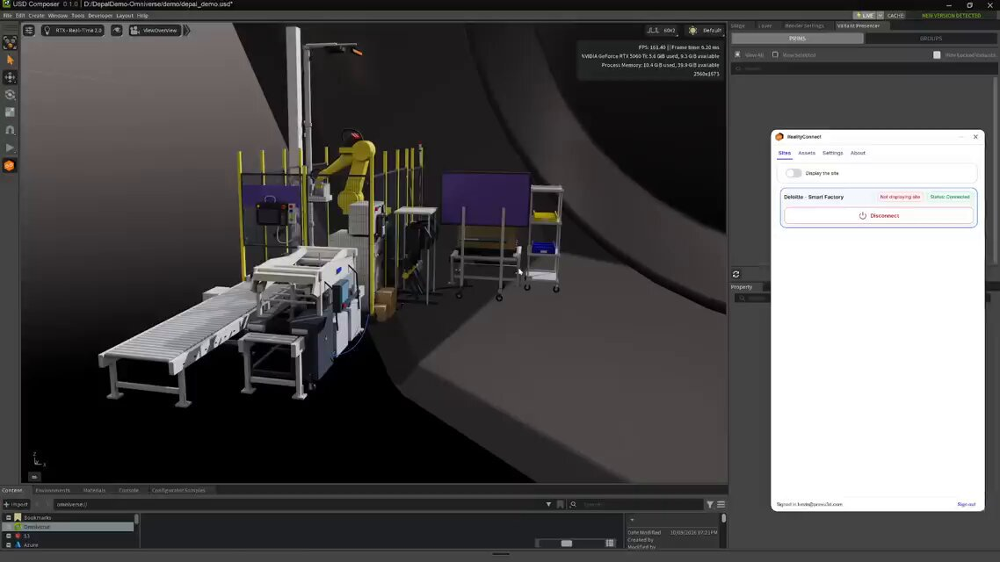
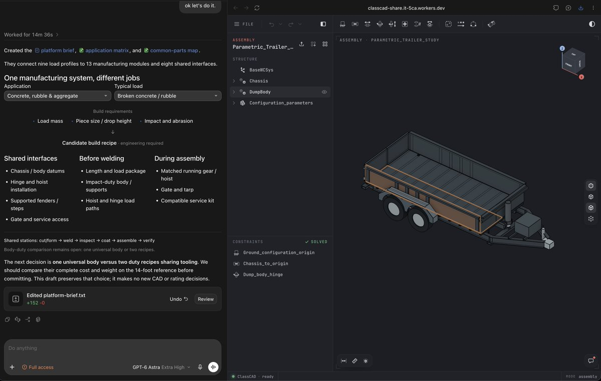

# Prevu3Dが開発するAI Scan-to-CAD：工場の3DスキャンをCADモデルへ
> Source: https://x.com/tokufxug/status/2110177534621196646
> Author: Sadao Tokuyama (@tokufxug)
> Posted: 2026-10-14T01:15:04+00:00
> Captured: 2026-10-15T09:02:28+00:00
> Stats at capture: 13,221 views · 270 likes · 2 replies · 23 reposts · 287 bookmarks · 2 quotes

## Post

Prevu3Dが開発するAI Scan-to-CAD：工場の3DスキャンをCADモデルへ

🔹機械・コンベヤー・安全柵・ロボットなどを3Dジオメトリとして再構成
🔹生成したCADモデルをNVIDIA Omniverseに取り込み
🔹RealityConnectで実際の工場環境データと組み合わせる

情報元はリプ欄。

## Media

[Post media 1](media/video-01.mp4) — Source media: https://video.twimg.com/amplify_video/2110177427293134849/vid/avc1/1138x640/0zQxo7lsCK513LcV.mp4?tag=14
 — Post media 1 thumbnail. Source media: https://pbs.twimg.com/amplify_video_thumb/2110177427293134849/img/4bwJMArRqQydvofa.jpg
[Reply 2110431963710365927 media 1](media/animation-01.mp4) — Source media: https://video.twimg.com/tweet_video/HUnCri_XcAEGKzc.mp4
[Reply 2110486827568070785 media 1](media/video-02.mp4) — Source media: https://video.twimg.com/amplify_video/2110486515188985856/vid/avc1/1920x1080/5BhPf_Ewo8ud4nTz.mp4?tag=29
 — Reply 2110207210575872061 media 1. Source media: https://pbs.twimg.com/media/HUj1LEYX0AAF3Xy.jpg

## Thread

### Sadao Tokuyama ([@tokufxug](https://x.com/tokufxug/status/2110177625134309509)) — 2026-10-14T01:15:25+00:00

情報元ページ
https://t.co/nIwY28dQAH

## Comments

### SubAssemblyAI ([@SubAssemblyAI](https://x.com/SubAssemblyAI/status/2110620875338969259)) — 2026-10-15T06:36:44+00:00

@tokufxug Turning factory scans into CAD saves weeks of manual layout work.

## Other returned timeline records

> The CLI did not expose reply relationships. These records do not start with a reply mention and were authored by someone other than the saved-post author. They may include recommendations or promoted posts; they are retained as source context, not verified replies.

### Cedar ([@cedarbuild](https://x.com/cedarbuild/status/2110431963710365927)) — 2026-10-14T18:06:04+00:00

Your civil engineer is going to love this. 

New In CedarOS: topography layers help you assess grading challenges, anticipate stormwater infrastructure needs, and identify potential slope-related limits on buildable area, all directly in the map view. 

Take a closer look at: https://t.co/OQbdEomyc7
 — Source media: https://video.twimg.com/tweet_video/HUnCri_XcAEGKzc.mp4
### Ringo ([@gonecozycrafts](https://x.com/gonecozycrafts/status/2110369589334773769)) — 2026-10-14T13:58:13+00:00

$699?! Woah!
### RobitOverlord ([@10_X_eng](https://x.com/10_X_eng/status/2110486827568070785)) — 2026-10-14T21:44:05+00:00

Argon is the first model I have seen that on it's own choosing thought it should do a structural simulation of the parts it made without being told to do so. 

Bravo @GoogleDeepMind and the entire team. Argon extremely well calibrated. https://t.co/xlJxbkGdg6
 — Source media: https://video.twimg.com/amplify_video/2110486515188985856/vid/avc1/1920x1080/5BhPf_Ewo8ud4nTz.mp4?tag=29
### Brad Barbin ([@barbinbrad](https://x.com/barbinbrad/status/2110207210575872061)) — 2026-10-14T03:12:59+00:00

free CAD with no API limits that can be embedded in a browser-based configurator. probably nothing https://t.co/7lfbXawzz3
 — Source media: https://pbs.twimg.com/media/HUj1LEYX0AAF3Xy.jpg
