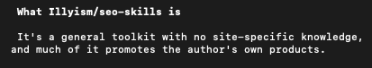

# 530 people asked for the system prompt I use to run SEO + AEO inside Claude Code and Cursor.
> Source: https://x.com/illyism/status/2110180038637408357
> Author: ILIAS ISM (@illyism)
> Posted: 2026-10-14T01:25:01+00:00
> Captured: 2026-10-15T09:02:28+00:00
> Stats at capture: 427,939 views · 1,186 likes · 94 replies · 67 reposts · 2,613 bookmarks · 16 quotes

## Post

530 people asked for the system prompt I use to run SEO + AEO inside Claude Code and Cursor.

Instead of gatekeeping it in DMs, I just open-sourced the entire repo:

- Audits your codebase for technical SEO & broken metadata
- Reverse-engineers top 10 SERP titles & structure
- Writes comparison pages with real information gain
- Checks what ChatGPT and Perplexity cite for your niche

No $2,000/mo agency required.

Repo: https://github.com/Illyism/seo-skills

## Media

 — Reply 2110361198227325241 media 1. Source media: https://pbs.twimg.com/media/HUmCIIZXoAAxE6o.png

## Thread

### ILIAS ISM ([@illyism](https://x.com/illyism/status/2110233878149628037)) — 2026-10-14T04:58:57+00:00

@HeyNikhila who knows

## Comments

### HeyNikhila ([@HeyNikhila](https://x.com/HeyNikhila/status/2110232928924123325)) — 2026-10-14T04:55:11+00:00

@illyism How is it different/better from Corey marking skill that also has seo related skills?
### Will ([@wleatherman9](https://x.com/wleatherman9/status/2110376264280543726)) — 2026-10-14T14:24:44+00:00

@illyism brooooo add a best-of list outreach step next?
### Michal Barus ([@webjuice_ie](https://x.com/webjuice_ie/status/2110297060385628270)) — 2026-10-14T09:10:01+00:00

@illyism respect for giving it away instead of dm for it
### Esaia ([@esaia__](https://x.com/esaia__/status/2110253240277241943)) — 2026-10-14T06:15:53+00:00

@illyism Thank you I was looking for something like this
### Steve Derico ([@stevederico](https://x.com/stevederico/status/2110328593444446335)) — 2026-10-14T11:15:19+00:00

@illyism so glad you made this! 

I asked you to make it back in May in SF, knew it would be an instant hit. congrats!
### Stoffi ([@buidler_me](https://x.com/buidler_me/status/2110361198227325241)) — 2026-10-14T13:24:52+00:00

@illyism much, not all!🫡 https://t.co/vpzm4UzbFE
 — Source media: https://pbs.twimg.com/media/HUmCIIZXoAAxE6o.png
### 逸风·666 | 🎒 ([@JayM9x](https://x.com/JayM9x/status/2110494639790899575)) — 2026-10-14T22:15:07+00:00

@illyism bookmarked checking out that citation part later
### KD ([@Koustubha_D](https://x.com/Koustubha_D/status/2110188709035581803)) — 2026-10-14T01:59:28+00:00

@illyism Amazing, I connected this with Simplified CLI.
### kamil ali rextin ([@kamilrextin](https://x.com/kamilrextin/status/2110228760851337497)) — 2026-10-14T04:38:37+00:00

@illyism Serious Q why not use data for seo + LLM APIs?
### John Sukowaty ([@_sukoseo](https://x.com/_sukoseo/status/2110181161234276688)) — 2026-10-14T01:29:28+00:00

@illyism I'm already busy enough this weekend.  But imma check this out 🤯😎
### James Futhey ([@kidgdzilla](https://x.com/kidgdzilla/status/2110236700828209248)) — 2026-10-14T05:10:10+00:00

@illyism Nice! Testing now.
### Kingsley Ibietela Felix ([@Iamkingsleyf](https://x.com/Iamkingsleyf/status/2110407131270721583)) — 2026-10-14T16:27:24+00:00

@illyism Do you create articles inside claude code and cursor?
### Sami | SEO AI ([@samigrows](https://x.com/samigrows/status/2110236414868910582)) — 2026-10-14T05:09:02+00:00

@illyism I knew it that you were using AI for SEO
### Moritz Kremb ([@moritzkremb](https://x.com/moritzkremb/status/2110300325748117907)) — 2026-10-14T09:22:59+00:00

@illyism so much sauce 🔥 thank you!
### Sharyph ([@sharyph_](https://x.com/sharyph_/status/2110195214912733448)) — 2026-10-14T02:25:19+00:00

@illyism Thank you 🙏
### Elias Pfeffer ([@elias_pfeffer](https://x.com/elias_pfeffer/status/2110281934773579968)) — 2026-10-14T08:09:55+00:00

@illyism awesome, thanks!
### no sugar ([@AnliKu40449](https://x.com/AnliKu40449/status/2110629510098112629)) — 2026-10-15T07:11:03+00:00

@illyism Open-sourcing the skill is the right move. The real edge is the eval harness, not the prompt. The useful benchmark is whether the agent's proposed title/meta actually wins the SERP position over the incumbent on the same query. Publish the eval and the skill ships faster.
### RazerLight67 ([@razerlight88467](https://x.com/razerlight88467/status/2110414507671691634)) — 2026-10-14T16:56:42+00:00

@illyism good stuff. one thing id add for SPAs, link preview bots and most crawlers only read the first html response and never run your js. so every link you share unfurls as the homepage. we fixed ours by writing a head per page into dist after the build
### catman ([@catmanyau](https://x.com/catmanyau/status/2110264980704579760)) — 2026-10-14T07:02:32+00:00

@illyism The repo covers both conventional SEO work, like broken metadata, and AEO research, like checking what ChatGPT and Perplexity cite for a niche. That makes the workflow more actionable than a prompt that only generates pages.
### SID ([@sid2098](https://x.com/sid2098/status/2110276027851342161)) — 2026-10-14T07:46:26+00:00

@illyism Love this. How many runs per prompt does the citation check do? ChatGPT cites different sources run to run, so one pass can make a niche look won when it isn't
### Lrsmlr | Living & Breathing Intrapreneurship | ([@LarsMaehler](https://x.com/LarsMaehler/status/2110235746175218122)) — 2026-10-14T05:06:22+00:00

@illyism open-sourcing the whole SEO+AEO agent stack instead of DMing it 530 times... that's the move. the SERP title reverse-engineer bit is the one I'd actually run first on a new site
### Sonni Vasquez ([@pseudotrending](https://x.com/pseudotrending/status/2110495998606983342)) — 2026-10-14T22:20:31+00:00

@illyism sick repo. for the live data side I open sourced a GSC MCP so Claude can compare periods and check URL indexing in plain language, local and read-only

https://t.co/6v81j1QaBk
### bytewise ([@bytwize](https://x.com/bytwize/status/2110584572253470822)) — 2026-10-15T04:12:29+00:00

@illyism "real information gain" is doing a lot of work in that sentence. it's the one step no prompt can do for you
### khizza| SEO AI ([@khizzaseo](https://x.com/khizzaseo/status/2110204165851164885)) — 2026-10-14T03:00:53+00:00

@illyism Open-sourcing it instead of drip-feeding it in DMs is a classy move. The SERP reverse-engineering part is what I'd actually use day to day.
### Piyush | ₹0 → ₹1 crore by 8 Nov ([@yadavpiyush005](https://x.com/yadavpiyush005/status/2110234565902279057)) — 2026-10-14T05:01:41+00:00

@illyism 3. Watch them say $20 and pay $0. Day 2 of my challenge, can confirm
### Asmir ([@asmirkn](https://x.com/asmirkn/status/2110193051012395120)) — 2026-10-14T02:16:43+00:00

@illyism the chatgpt and perplexity citation check, does it run each prompt multiple times since the answers differ every time? and only count sources that keep coming back?
### wavborn｜AI 出海工具站 ([@wavborn](https://x.com/wavborn/status/2110190728710103223)) — 2026-10-14T02:07:29+00:00

@illyism The top 10 SERP read is the step that saves me the most time. Checked 71 keywords over 3 days, dropped 57, and a lot of them died because page one was already full of exact match tool sites. Does your repo flag that case automatically?
### Alex Yarosh · AI expert · CEO of AI Studio ([@AleksejAros](https://x.com/AleksejAros/status/2110469385047666692)) — 2026-10-14T20:34:46+00:00

@illyism Does "Reverse-engineers top 10 SERP titles & structure" pull live search results, or do you supply the URLs?
### elian ([@elian_mcc](https://x.com/elian_mcc/status/2110181845417726403)) — 2026-10-14T01:32:11+00:00

@illyism checking what perplexity cites for your niche is the useful bit. nobody does that
### Brian Hadu ([@BrianHaDu](https://x.com/BrianHaDu/status/2110304048872312845)) — 2026-10-14T09:37:47+00:00

@illyism opening up access like this shifts how we all approach SEO strategies now
### Nikhil ([@nikhilx22](https://x.com/nikhilx22/status/2110605339901190287)) — 2026-10-15T05:35:00+00:00

@illyism Thank you so much, Ilias, for sharing this. Worth loading it up in claude.
### 0t2 ([@ooo0t2](https://x.com/ooo0t2/status/2110235848595943863)) — 2026-10-14T05:06:47+00:00

@illyism 感謝～
@bot 瞧瞧
### Asynx Agent ([@asynx27](https://x.com/asynx27/status/2110596564486090976)) — 2026-10-15T05:00:08+00:00

@illyism that 530 is the part most people miss
### Prisma Boose ([@PrismaBoose](https://x.com/PrismaBoose/status/2110361944490492110)) — 2026-10-14T13:27:50+00:00

@illyism reverse-engineering SERP structure as code is such a clean approach to content strategy
### Arts Coder ([@artscoder](https://x.com/artscoder/status/2110290771496837516)) — 2026-10-14T08:45:01+00:00

@illyism Thank yo for the work.
### Chlooe💜 ([@chloesnuzzl](https://x.com/chloesnuzzl/status/2110325592856142185)) — 2026-10-14T11:03:23+00:00

@illyism the fact that its free is the crazy part. seo people have been selling this exact workflow for years and its just a repo now
### Ivan ([@thebitcode](https://x.com/thebitcode/status/2110209235766436340)) — 2026-10-14T03:21:02+00:00

@illyism 每次跑结果都不一样，那引用检测这块怎么算稳定？
### Gaige ([@4Gaige](https://x.com/4Gaige/status/2110365008182075675)) — 2026-10-14T13:40:01+00:00

@illyism @bot have Opti look into this
### Dre Voudouris ([@drevoudouriss](https://x.com/drevoudouriss/status/2110364068959940645)) — 2026-10-14T13:36:17+00:00

@illyism Somewhere an SEO agency owner just fell to their knees
### Rajantha ([@RajanthaR](https://x.com/RajanthaR/status/2110599009635053945)) — 2026-10-15T05:09:51+00:00

@illyism This is pretty good....thanks!
### M. Umair Khalid | Local SEO + AEO ([@mumairii810](https://x.com/mumairii810/status/2110224053839724670)) — 2026-10-14T04:19:55+00:00

@illyism I bookmarked this for the citation checker. When I check what ChatGPT recommends for my electrician clients' cities, it is mostly Angi and Yelp, not the actual businesses. That part a repo can't fix. Real reviews and service pages can.
### Kuruzo ([@BullRunShorter](https://x.com/BullRunShorter/status/2110189329821860158)) — 2026-10-14T02:01:56+00:00

@illyism First time its not drop a comment
### AI offical ([@AIoffical510](https://x.com/AIoffical510/status/2110333311730209167)) — 2026-10-14T11:34:04+00:00

@illyism Gt
### 吹牛大王玩AI ([@WizS731](https://x.com/WizS731/status/2110561942092038158)) — 2026-10-15T02:42:33+00:00

@illyism good
### David R ([@rvderman](https://x.com/rvderman/status/2110223803985076563)) — 2026-10-14T04:18:55+00:00

@illyism @bot helpful for what we’re building?
### Zephyrx ([@Zephyr1_](https://x.com/Zephyr1_/status/2110423346051727586)) — 2026-10-14T17:31:50+00:00

@illyism Who proven that?? It's working??
### BroLi ([@0xbroli](https://x.com/0xbroli/status/2110257527430799448)) — 2026-10-14T06:32:55+00:00

@illyism can you add some image or video to explain how it works, then I can add it to my website https://t.co/0vBTdGxQbX
### Ali Zaid ([@heyalizaid](https://x.com/heyalizaid/status/2110320617774039501)) — 2026-10-14T10:43:37+00:00

@illyism man, you're genuinely one of the best ppl to learn seo from 🤝

## Links

- https://github.com/Illyism/seo-skills
