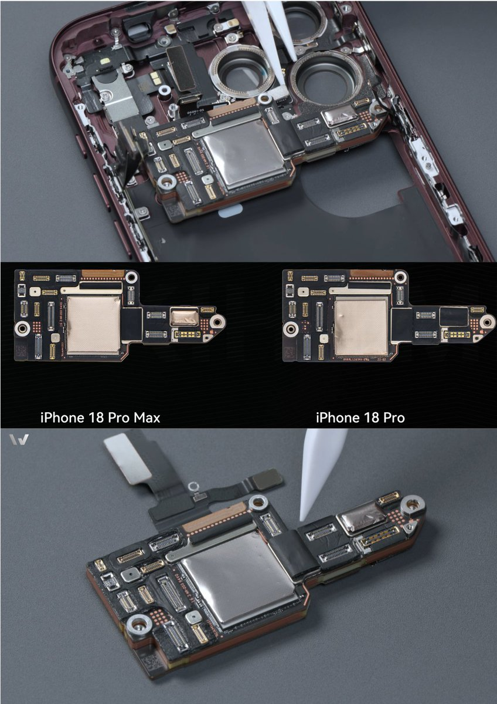
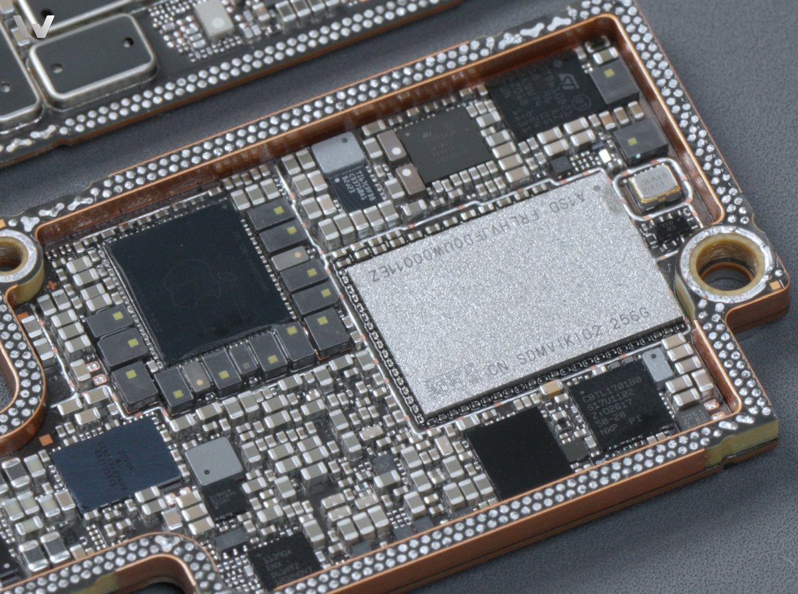
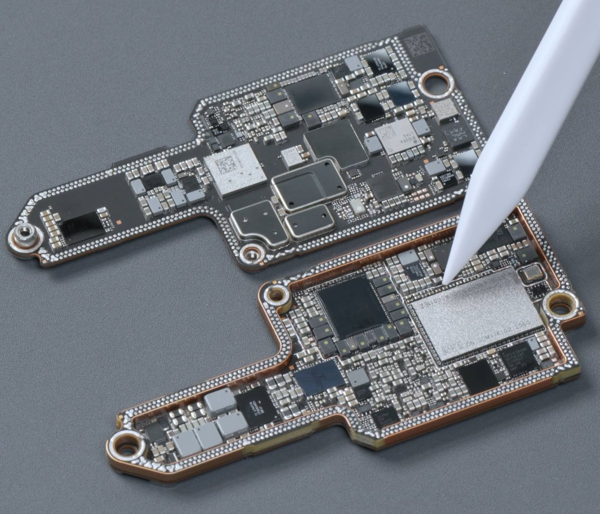
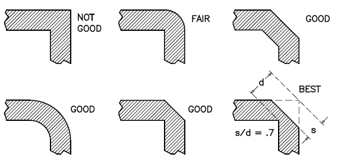

# A few KiCAD <-> LLM PCB layout tips from personal experience.
> Source: https://x.com/0x50484244/status/2110189303418769839
> Author: PHBD (@0x50484244)
> Posted: 2026-10-14T02:01:50+00:00
> Captured: 2026-10-15T09:02:28+00:00
> Stats at capture: 10,147 views · 238 likes · 13 replies · 12 reposts · 366 bookmarks · 3 quotes

## Post

A few KiCAD <-> LLM PCB layout tips from personal experience. 

Prompt it to:
- Use KiCAD 10.99 (Nightly build, adds scripting features) and prompt it to interact with the program via KiPy + computer-use tools. 
- Not use autorouters like Freerouting. 
-  Place components one at a time or in small functional groups.
- Adjusting placement after routing is acceptable
- Route using octolinear traces, organized into busses / parallel equally spaced tracks. Pre-plan fanouts. Minimize any detours or circuitous routing, especially for signal nets. Use tracewidths / pours appropriate to current of the net. Optionally, tell it to write reusable scripts to check these properties and check its work. 

Tons more to add to the above (diff pairs, return currents / ground plane continuity, etc.), but these tend to be highest order bit. This will likely drive run time up to O(hours-tens of horurs) for ~100+ net boards, but can lead to some excellent results.

## Media

 — Reply 2110373004320641173 media 1. Source media: https://pbs.twimg.com/media/HUmLiwRaEAAshvv.jpg
 — Reply 2110373004320641173 media 2. Source media: https://pbs.twimg.com/media/HUmL0V1a4AAR4QK.jpg
 — Reply 2110373004320641173 media 3. Source media: https://pbs.twimg.com/media/HUmL4UiaYAEiFUf.jpg
 — Reply 2110524891447640076 media 1. Source media: https://pbs.twimg.com/media/HUoV2Z8bUAAqrJk.png
[Reply 2110506089720803429 media 1](media/video-01.mp4) — Source media: https://video.twimg.com/amplify_video/2110506004794523648/vid/avc1/1080x1920/8pO27HgZgD9HBxTd.mp4?tag=29
[Reply 2110388352965115918 media 1](media/animation-01.mp4) — Source media: https://video.twimg.com/tweet_video/HUma6NXbcAE2DXb.mp4

## Comments

### anish ([@justmetolife](https://x.com/justmetolife/status/2110473815440404787)) — 2026-10-14T20:52:22+00:00

@0x50484244 telling it to skip freerouting and place parts one at a time is a good tip, autorouters are usually where the mess starts
### James ([@Whos_Ur_Doggy](https://x.com/Whos_Ur_Doggy/status/2110212155698274710)) — 2026-10-14T03:32:38+00:00

@0x50484244 Why use KiCAD with agents? What a mess of prompt and they’ll still bang around trying to figure out a-expressions. Try TSCircuit or Stevecad Studio.
### Matthew Campbell ([@kanwisher](https://x.com/kanwisher/status/2110292357845520642)) — 2026-10-14T08:51:20+00:00

@0x50484244 Freerouter is usually better then the built in ones in kicad
### rostokus ([@rostokus](https://x.com/rostokus/status/2110274837189124570)) — 2026-10-14T07:41:42+00:00

@0x50484244 You don’t use MCP like Konnekt?
### Steven Cheng ([@stevencheng](https://x.com/stevencheng/status/2110359397352509582)) — 2026-10-14T13:17:43+00:00

@0x50484244 ten hours is a long coffee break
### demmon standafer ([@DemmonShadowp](https://x.com/DemmonShadowp/status/2110404818540068943)) — 2026-10-14T16:18:12+00:00

@0x50484244 They should really make this into a harness prompt
### Janek Mann ([@janekm](https://x.com/janekm/status/2110308795281002956)) — 2026-10-14T09:56:39+00:00

@0x50484244 Personally I do have it use a simple autorouter library to handle the between-module connections, but it's true that your approach would lead to cleaner layouts at a cost of more tokens.
### Lathe ([@lathelabs](https://x.com/lathelabs/status/2110433570154315933)) — 2026-10-14T18:12:27+00:00

@0x50484244 kipy plus computer-use on nightly is a clever stack. which placement rule does the llm break most often without freerouting?
### Pratik Sharda ([@pratiksharda2](https://x.com/pratiksharda2/status/2110234314856140903)) — 2026-10-14T05:00:41+00:00

@0x50484244 locking critical nets by hand before letting the llm touch the rest seems like the move. do you freeze power/gnd first or the high-speed pairs?
### erhash ([@kitano_rh](https://x.com/kitano_rh/status/2110381982601642231)) — 2026-10-14T14:47:28+00:00

@0x50484244 it doesnt matter which kicad version to use

## Other returned timeline records

> The CLI did not expose reply relationships. These records do not start with a reply mention and were authored by someone other than the saved-post author. They may include recommendations or promoted posts; they are retained as source context, not verified replies.

### Starlink ([@Starlink](https://x.com/Starlink/status/2068115197718593741)) — 2026-06-19T23:34:21+00:00

Get connected with fast, reliable internet for streaming, video calls, online gaming and more.

Order online in minutes.
### INIYSA ([@lafaiel](https://x.com/lafaiel/status/2110373004320641173)) — 2026-10-14T14:11:47+00:00

iPhone 18 Pro series logic board is comically small, even with WMCM.

Making a board this dense takes pretty much every cutting edge tech in the industry. https://t.co/iVZPZd8N0g
 — Source media: https://pbs.twimg.com/media/HUmLiwRaEAAshvv.jpg
 — Source media: https://pbs.twimg.com/media/HUmL0V1a4AAR4QK.jpg
 — Source media: https://pbs.twimg.com/media/HUmL4UiaYAEiFUf.jpg
### BlindVia ([@blind_via](https://x.com/blind_via/status/2110524891447640076)) — 2026-10-15T00:15:20+00:00

Speaking of avoid 90-degree angle PCB traces, apparently, they are superior if you just cut the tip off. 💀 https://t.co/2p1L2JQGu4
 — Source media: https://pbs.twimg.com/media/HUoV2Z8bUAAqrJk.png
### Seve ([@seveibar](https://x.com/seveibar/status/2110506089720803429)) — 2026-10-14T23:00:37+00:00

ok Micropython was the culprit, dont use micro python for motor controllers!!!! XY stage is super fast and smooth now! https://t.co/WfcJKlTPRY
 — Source media: https://video.twimg.com/amplify_video/2110506004794523648/vid/avc1/1080x1920/8pO27HgZgD9HBxTd.mp4?tag=29
### Cornelius Robinson ([@CorneliusWrites](https://x.com/CorneliusWrites/status/2110388352965115918)) — 2026-10-14T15:12:47+00:00

"Never route 90° corners."

It's one of the oldest rules in PCB design. But how much signal do you actually lose?

At 10 GHz, a 90° bend loses about 0.01 dB or less.

That being said, wider traces and higher frequencies are where it starts to matter. https://t.co/cIfbuN3aaM
 — Source media: https://video.twimg.com/tweet_video/HUma6NXbcAE2DXb.mp4
