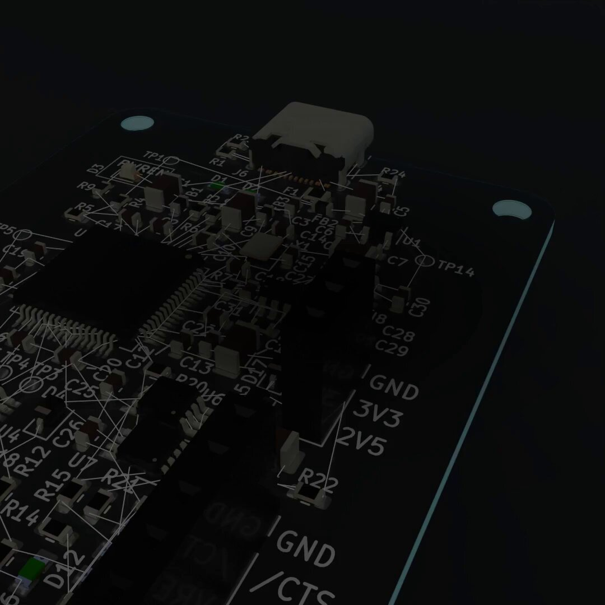
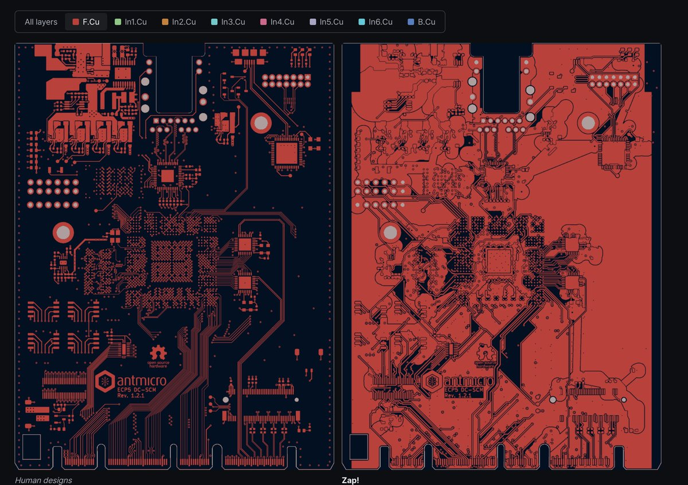
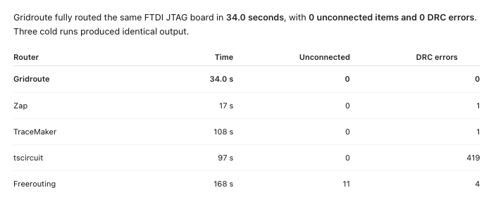

# Introducing Zap!
> Source: https://x.com/mmmutantQ/status/2110339846963355891
> Author: Yejun Jang (@mmmutantQ)
> Posted: 2026-10-14T12:00:02+00:00
> Captured: 2026-10-15T09:02:28+00:00
> Stats at capture: 16,753 views · 508 likes · 27 replies · 29 reposts · 450 bookmarks · 2 quotes

## Post

Introducing Zap!

Zap! is an lightning-fast autorouter built to take down AI PCB dev cycle from days to minutes.

After parting ways with my co-founder @MrPorkchop720 the company was met with a crisis of having to deliver AnchorCam Stereo (our main product) with no hardware engineers.

I searched all over SF, Shenzhen, and Seoul but could not find engineering firms that could deliver production quality egocentric cameras that meets our exact specifications. I was afraid to tell to the customers about this situation - all I could do in the meanwhile was assemble off-the-shelf boards from partnering companies.

But now with Zap! I can iterate on the boards myself without hand-routing - after Zap! is done the AI agents are usually able to fix the remaining issues through finishing touches. I actively use it to get AnchorCam Stereo production ready, and hope it enables many more to aim for larger problems that can only be solved through new hardware.

You can compare Zap!'s performance with other popular routers in the link - it does really well.

I am also working on an automated placer, so stay tuned for the next launch. I'll let you know when AnchorCam Stereo becomes available. To those who ordered and are still waiting, I greatly appreciate your patience and will get back to you as soon as we get our first fully working samples.

Although Alex left the company, we remain good friends - he will be launching something exciting soon too, so shoutout to him @MrPorkchop720 

- Yejun

## Media

[Post media 1](media/video-01.mp4) — Source media: https://video.twimg.com/amplify_video/2110289281503899648/vid/avc1/720x720/3FPrpXZe7lrm4HOf.mp4?tag=29
 — Post media 1 thumbnail. Source media: https://pbs.twimg.com/amplify_video_thumb/2110289281503899648/img/TLWEye3aIRgAkgjT.jpg
 — Reply 2110485342604366083 media 1. Source media: https://pbs.twimg.com/media/HUnzN9Ea4AASFBD.jpg
 — Reply 2110547555918745840 media 1. Source media: https://pbs.twimg.com/media/HUor0HVbMAA15BU.jpg
 — Reply 2110371357254942848 media 1. Source media: https://pbs.twimg.com/media/HUmLeKqXYAAbC5g.png

## Thread

### Yejun Jang ([@mmmutantQ](https://x.com/mmmutantQ/status/2110339847353426385)) — 2026-10-14T12:00:02+00:00

https://t.co/tSOw7wqcrd
### Yejun Jang ([@mmmutantQ](https://x.com/mmmutantQ/status/2110383718510854342)) — 2026-10-14T14:54:22+00:00

@MrPorkchop720 Guys, there were some update to the numbers. For the numbers shown now, all routers were run on single-core and given 60 minutes. Will be coming back with multi-core results + updating the page later! Google log in coming soon, if you need api key for test dm me
### Yejun Jang ([@mmmutantQ](https://x.com/mmmutantQ/status/2110404142430920900)) — 2026-10-14T16:15:31+00:00

@MrPorkchop720 google login is up now
### Yejun Jang ([@mmmutantQ](https://x.com/mmmutantQ/status/2110485342604366083)) — 2026-10-14T21:38:11+00:00

@MrPorkchop720 You can now compare and inspect layers individually https://t.co/DUSDylLT2U
 — Source media: https://pbs.twimg.com/media/HUnzN9Ea4AASFBD.jpg
### Yejun Jang ([@mmmutantQ](https://x.com/mmmutantQ/status/2110347917911597115)) — 2026-10-14T12:32:06+00:00

@MrPorkchop720 working hard on it
### Yejun Jang ([@mmmutantQ](https://x.com/mmmutantQ/status/2110347549764960330)) — 2026-10-14T12:30:38+00:00

@MrPorkchop720 🔥
### Yejun Jang ([@mmmutantQ](https://x.com/mmmutantQ/status/2110371258752028693)) — 2026-10-14T14:04:51+00:00

@Mihai__i @MrPorkchop720 that's really cool! yea let me try it out and get back to you too
### Yejun Jang ([@mmmutantQ](https://x.com/mmmutantQ/status/2110612672102420684)) — 2026-10-15T06:04:08+00:00

@pcbforum @MrPorkchop720 exactly
### Yejun Jang ([@mmmutantQ](https://x.com/mmmutantQ/status/2110474983936024941)) — 2026-10-14T20:57:01+00:00

@JimiBarkway @MrPorkchop720 thanks!!
### Yejun Jang ([@mmmutantQ](https://x.com/mmmutantQ/status/2110435833820201123)) — 2026-10-14T18:21:27+00:00

@RealMarkCai @MrPorkchop720 Routing takes up a lot of time, and it's definitely not what GPT should be hand-drawing. Placement comes second
### Yejun Jang ([@mmmutantQ](https://x.com/mmmutantQ/status/2110364768959975915)) — 2026-10-14T13:39:04+00:00

@Novapitchai @MrPorkchop720 thanks, will put my best effort into AnchorCam Stereo after this
### Yejun Jang ([@mmmutantQ](https://x.com/mmmutantQ/status/2110471386573758748)) — 2026-10-14T20:42:43+00:00

@ChrisSandoval83 @MrPorkchop720 Just increased to 50+ boards. Just use Claude Code with KiCad, make it place the generate schematic, place components and get some routing headstart with Zap!, then iterate. Tell it to review power and signal more
### Yejun Jang ([@mmmutantQ](https://x.com/mmmutantQ/status/2110641820204249434)) — 2026-10-15T07:59:58+00:00

@NasaDadkoush @MrPorkchop720 perhaps
### Yejun Jang ([@mmmutantQ](https://x.com/mmmutantQ/status/2110484286902272172)) — 2026-10-14T21:33:59+00:00

@Cata1ysxt @MrPorkchop720 Yes, for now. I have an auto-placer I use internally that I personally use. Will be launching it soon too
### Yejun Jang ([@mmmutantQ](https://x.com/mmmutantQ/status/2110559131094679787)) — 2026-10-15T02:31:23+00:00

@AnselDias @MrPorkchop720 haha make sense
### Yejun Jang ([@mmmutantQ](https://x.com/mmmutantQ/status/2110376636113924158)) — 2026-10-14T14:26:13+00:00

@gf_hr36313 @MrPorkchop720 I'll dm you the api key for now the google login feature is on its way
### Yejun Jang ([@mmmutantQ](https://x.com/mmmutantQ/status/2110410456842309886)) — 2026-10-14T16:40:37+00:00

@jacintosalz @MrPorkchop720 differentials and power mostly. easiest to get wrong, working on the router so that it handles it better
### Yejun Jang ([@mmmutantQ](https://x.com/mmmutantQ/status/2110352604987605094)) — 2026-10-14T12:50:44+00:00

@Philipnil06 @MrPorkchop720 it's one of the tedious parts...
### Yejun Jang ([@mmmutantQ](https://x.com/mmmutantQ/status/2110368169173086487)) — 2026-10-14T13:52:34+00:00

@abijahkaj @MrPorkchop720 Yes, Zap! has a plain HTTP REST API. https://t.co/qPZnZ0pMqm if you need it! right now the login is under construction so I can provide you api key through dm if you want to test now
### Yejun Jang ([@mmmutantQ](https://x.com/mmmutantQ/status/2110396292145000530)) — 2026-10-14T15:44:19+00:00

@bailout00 @MrPorkchop720 working on it!
### Yejun Jang ([@mmmutantQ](https://x.com/mmmutantQ/status/2110372836200346093)) — 2026-10-14T14:11:07+00:00

@janekm @MrPorkchop720 yours is pretty impressive too. No plans for now, but might open-source later on
### Yejun Jang ([@mmmutantQ](https://x.com/mmmutantQ/status/2110374711922503880)) — 2026-10-14T14:18:34+00:00

@R3PL1C8R @MrPorkchop720 * with the current budget, no
### Yejun Jang ([@mmmutantQ](https://x.com/mmmutantQ/status/2110356339080008120)) — 2026-10-14T13:05:34+00:00

@0xMadMaks @MrPorkchop720 as always thank you so much for all the support!!
### Yejun Jang ([@mmmutantQ](https://x.com/mmmutantQ/status/2110348977325715869)) — 2026-10-14T12:36:19+00:00

@climbingK @MrPorkchop720 thanks for the intro to prof park, could not have done it without him!

## Comments

### Alex ([@MrPorkchop720](https://x.com/MrPorkchop720/status/2110347782775324709)) — 2026-10-14T12:31:34+00:00

@mmmutantQ Still got to work on some accuracy on the signal routing though. Good first version, only gets better from here.
### Alex ([@MrPorkchop720](https://x.com/MrPorkchop720/status/2110347431615623490)) — 2026-10-14T12:30:10+00:00

@mmmutantQ Lfg
### Mihai ([@Mihai__i](https://x.com/Mihai__i/status/2110357720855384215)) — 2026-10-14T13:11:03+00:00

@mmmutantQ @MrPorkchop720 We've built our own router in siliXon that does it in ms! How manufacturing aware is your router?
Have a play around:
https://t.co/JiBQBkTAi6
### pcbforum ([@pcbforum](https://x.com/pcbforum/status/2110610718127264014)) — 2026-10-15T05:56:23+00:00

@mmmutantQ @MrPorkchop720 Integrating an AI-driven autorouter to compress the PCB dev cycle from days to minutes is a major shift. Leveraging machine learning for layout automation significantly optimizes design iteration efficiency.
### Jimi Barkway ([@JimiBarkway](https://x.com/JimiBarkway/status/2110456580357410947)) — 2026-10-14T19:43:53+00:00

@mmmutantQ @MrPorkchop720 Shipping a tool you needed under pressure is the best product test. Zap solves a real bottleneck, and the open benchmark makes progress easy to check.
### Mark C AI | Builder ([@RealMarkCai](https://x.com/RealMarkCai/status/2110434034220409241)) — 2026-10-14T18:14:18+00:00

@mmmutantQ @MrPorkchop720 Shipping hardware alone after a cofounder exit is hard mode. Respect. What's the one thing you'd hand to an agent first if you could?
### NovaPitch ([@Novapitchai](https://x.com/Novapitchai/status/2110363760166842733)) — 2026-10-14T13:35:03+00:00

@mmmutantQ @MrPorkchop720 Turning a co-founder split into a product is a tough but impressive move. Good luck getting the cameras out to customers.
### Chris Sandoval ([@ChrisSandoval83](https://x.com/ChrisSandoval83/status/2110469752850133241)) — 2026-10-14T20:36:14+00:00

@mmmutantQ @MrPorkchop720 I’m looking for a software to design my own PCB board. I tried https://t.co/A5ZnoCt2Vy and ran out of credits after spending 100 bucks. What’s the next best solution? This website is not mature
### Nasa Dadkoush ([@NasaDadkoush](https://x.com/NasaDadkoush/status/2110638246187122803)) — 2026-10-15T07:45:46+00:00

@mmmutantQ @MrPorkchop720 hardware engineers about to feel what web devs felt in 2024
### Catalyst ([@Cata1ysxt](https://x.com/Cata1ysxt/status/2110482889888636986)) — 2026-10-14T21:28:26+00:00

@mmmutantQ @MrPorkchop720 You still need to position components manually though
### Ansel Dias ([@AnselDias](https://x.com/AnselDias/status/2110547555918745840)) — 2026-10-15T01:45:24+00:00

@mmmutantQ @MrPorkchop720 I come from a time when it was funny to have this on a tshirt

No one's laughing now https://t.co/xM5dLhWIOa
 — Source media: https://pbs.twimg.com/media/HUor0HVbMAA15BU.jpg
### GF HR ([@gf_hr36313](https://x.com/gf_hr36313/status/2110376379883946035)) — 2026-10-14T14:25:12+00:00

@mmmutantQ @MrPorkchop720 I need it!
### papi_jaci ([@jacintosalz](https://x.com/jacintosalz/status/2110408514615259631)) — 2026-10-14T16:32:54+00:00

@mmmutantQ @MrPorkchop720 curious what issues still need a human check after the agent finishes routing
### Philip ([@Philipnil06](https://x.com/Philipnil06/status/2110350490030719305)) — 2026-10-14T12:42:19+00:00

@mmmutantQ @MrPorkchop720 Even the ratsnest is getting outsourced
### Abijah Kajabika ([@abijahkaj](https://x.com/abijahkaj/status/2110362343662358986)) — 2026-10-14T13:29:26+00:00

@mmmutantQ @MrPorkchop720 nice results! would love to benchmark it too against my routing system. do you offer API besides the MCP?
### bailout00 ([@bailout00](https://x.com/bailout00/status/2110395875516190997)) — 2026-10-14T15:42:40+00:00

@mmmutantQ @MrPorkchop720 Placement is way more complicated than routing honestly. A combo is the winning game. Less vias, signal consistency, etc
### Janek Mann ([@janekm](https://x.com/janekm/status/2110371357254942848)) — 2026-10-14T14:05:15+00:00

@mmmutantQ @MrPorkchop720 Nice! You beat my own efforts by 2x! Are you planning to open source though? https://t.co/mUP5lWbFYa
 — Source media: https://pbs.twimg.com/media/HUmLeKqXYAAbC5g.png
### R3PL1C8R Drones ([@R3PL1C8R](https://x.com/R3PL1C8R/status/2110372942328594764)) — 2026-10-14T14:11:32+00:00

@mmmutantQ @MrPorkchop720 Good luck making hardware without any hardware engineers for guidance or troubleshooting.

> I searched all over SF, Shenzhen, and Seoul but could not find engineering firms that could deliver production quality egocentric cameras that meets our exact specifications.

Really?
### MadMaKs - 雷王力 🏯 ([@0xMadMaks](https://x.com/0xMadMaks/status/2110354027577851999)) — 2026-10-14T12:56:23+00:00

@mmmutantQ @MrPorkchop720 Congrats and good luck to both of you for what comes next!!
### Kay Woo ([@climbingK](https://x.com/climbingK/status/2110348649289146555)) — 2026-10-14T12:35:01+00:00

@mmmutantQ @MrPorkchop720 Coooool!!! Keep pushing!!
### Johan Romero ([@Johan149](https://x.com/Johan149/status/2110491591852916766)) — 2026-10-14T22:03:01+00:00

@mmmutantQ @MrPorkchop720 @seveibar
### Caleb Kennedy ([@calebkennedyi](https://x.com/calebkennedyi/status/2110529189564584381)) — 2026-10-15T00:32:25+00:00

@mmmutantQ @MrPorkchop720 @MainframeAgent

## Other returned timeline records

> The CLI did not expose reply relationships. These records do not start with a reply mention and were authored by someone other than the saved-post author. They may include recommendations or promoted posts; they are retained as source context, not verified replies.

### Occupy Wall Street ([@OccupyWallSt](https://x.com/OccupyWallSt/status/2091679500094275968)) — 2026-08-24T00:10:29+00:00

We believe Jewish Lives Matter.
### Starlink ([@Starlink](https://x.com/Starlink/status/2098108930002194658)) — 2026-09-10T17:58:44+00:00

Starlink offers fast, reliable internet in the most rural and remote locations. Portable and easy to set up, Starlink works wherever you are.

Order online in minutes.
### Starlink ([@Starlink](https://x.com/Starlink/status/2098481322268504487)) — 2026-09-11T18:38:29+00:00

Get fast, reliable home internet for seamless streaming, working from home, gaming, and more across multiple devices.

Order online in minutes.
