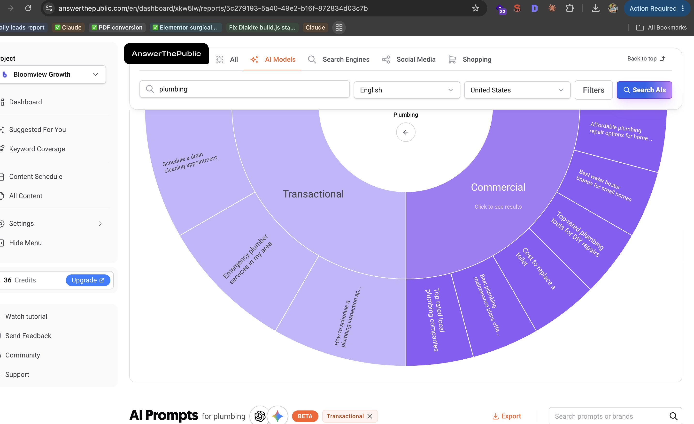
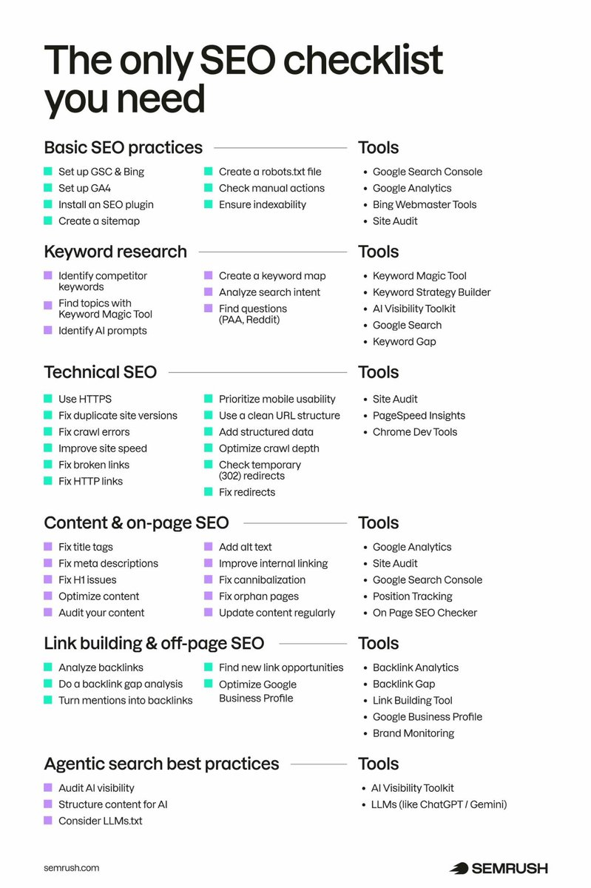

# If you're a business owner trying to rank on the first page of Google, do this. (Bookmark this)

> Source: https://x.com/DylanOlivaGrows/status/2110361649911919063
> Author: Dylan Oliva (@DylanOlivaGrows)
> Posted: Wed Oct 14 13:26:40 +0000 2026
> Captured: 2026-10-15T10:47:16.007333+00:00

## Post

If you're a business owner trying to rank on the first page of Google, do this. (Bookmark this)

First things first, whatever you sell. Let's say it's plumbing services.

Next, type in answerthepublic(dot)com. Then you should see something like this.

Click AI Models. And you'll see all the questions people are searching up right now with AI.

Then scroll down to Transactional, because we only want people ready to buy.

Copy one of the prompts. Paste it into Google.

Then find the People Also Ask section. And see what's currently being cited.

Then go to your website and make separate pages for all of these questions.

Next, on those pages, you want to make sure your title and your header one are the same.

And if they're quoting things like pricing, you also want to add pricing to that page. Or if it's a vendor site like this, you want to get listed on that site.

Then lastly, make sure your content is human written, and that you have specific geographic content like landmarks or highways.

Send this to whoever runs your website.

And follow for more SEO tips if you want to rank higher on Google.

## Media

> Original media URL: https://pbs.twimg.com/media/HUmBcfwaQAA1Ubg.jpg?name=orig

> Original media URL: https://pbs.twimg.com/media/HUlZnmDWYAAf-MK.jpg

## Thread

### Dylan Oliva (@DylanOlivaGrows) — https://x.com/DylanOlivaGrows/status/2110361779834704254

If you'd like a free Google audit and strategy call
Schedule a time with me here: https://bloomviewgrowth.com/?x=1

## Comments

### steve (@STucker92) — https://x.com/STucker92/status/2110582744962982267

@DylanOlivaGrows making a page for every question gonna turn that site into a mess

### Matt | Fitness & Bizness (@BodyRecompExprt) — https://x.com/BodyRecompExprt/status/2110468625274376361

@DylanOlivaGrows @bot create me a to do project based on this and remind me to do it next week. List out the steps and action items and what you can/will do for me

### dctrades22 (@dctrades22) — https://x.com/dctrades22/status/2110629459564933282

@DylanOlivaGrows The separate pages part is where I’d be careful. Wouldn’t it make more sense to build out a few genuinely useful pages instead of making one for every question?

### Vivek Girotra (@vivekgirotra) — https://x.com/vivekgirotra/status/2110615893369827464

@DylanOlivaGrows These are generated suggestions, not a feed of actual questions people are asking ChatGPT. 🤦🏾‍♂️

## Other returned timeline records

> Reply relationships were not exposed by the CLI. These non-addressed foreign-author records may include recommendations or promoted content.

### ILIAS ISM (@illyism) — https://x.com/illyism/status/2110404997112606975

every week someone tells me they’re going to vibe-code their own https://t.co/fiqqEJPROE over the weekend with an @ahrefs  API key and an @InstantlyAI subscription

wishing them the best, here’s the backlog of things to make sure to include:

> 1.27M domains indexed with live DR, organic traffic, and spam signals
> 80,000+ publisher price quotes already negotiated and mapped by niche
> 210,000+ creators and authors matched to the exact domains they write for
> unwrapping Google SERP redirect hops (`https://t.co/yqRFa0VvBb…`) so your scraper doesn't index Google as the ranking domain
> visiting and caching the live HTML of every target page because Ahrefs and GSC can’t tell the difference between an unbranded text mention and an actual `<a href>` backlink
> filtering out pages that already mention your client so you don’t email an author asking to be added to an article you’re already in
> finding the domains linking to 2+ of a customer’s direct competitors (link-intersect) automatically on onboarding
> separating real editorial sites from the 40,000 Indian link-farm PBNs that fake DR 60 with 301 redirects
> finding the actual writer’s personal work email instead of blasting `info@` or `editor@` contact forms that go to a dead inbox
> warming 50+ sending domains and inboxes on a schedule so your outreach doesn't land in spam on day 3
> classifying every publisher reply: "yes send anchor", "here is our media kit ($800)", "we only do link swaps", "remove me from your list", and OOO auto-replies
> negotiating down a blogger who asks for $650 when you know from 4 previous orders their real floor is $140
> detecting when a "publisher" is actually a middleman reselling the same site on Fiverr or BlackHatWorld for a 3x markup
> enforcing relevance and rival gates so you never accidentally place a customer on a page next to their competitor’s hit piece
> preventing reciprocal A↔B link swaps that trigger Google’s link-scheme penalty
> drafting contextual link insertions that read like the original author wrote them, so the editor approves on the first pass
> writing full niche guest posts with custom illustrations that match the host blog's style
> checking that the link is actually `dofollow`, indexed in Google, not blocked by `robots.txt`, and not hidden behind a `noindex` meta tag before releasing payment
> catching shady webmasters who take your $200 PayPal transfer and silently flip the link to `nofollow` or delete it 14 days later
> a weekly live-link crawler that re-verifies every placed link across every customer order and alerts when an article 404s or drops the anchor
> automatic replacement workflow when a link rots 4 months later
> an MCP server so Claude, Cursor, and Grok can research SERPs, inspect competitor backlinks, and place link orders from the terminal
> Stripe checkout, prepaid credit balances, per-link escrow, and automatic refunds when a target publisher ghosts

oh, and besides having to manage 1,000+ flaky bloggers in your inbox forever… your vibe-coded script will still require paying for:

> backlink index data (Ahrefs Enterprise / DataForSEO)
> SERP scraping at scale (DataForSEO / BrightData)
> stealth headless browser fleet (Puppeteer + residential proxies)
> email finding + verification (Hunter, MillionVerifier, OrbiSearch)
> cold email warmup + sending fleet (20+ domains, workspaces, inboxes)
> LLM classification + drafting across millions of cached pages

…but at least you saved $160 not buying a link from @linkdr.com anymore 🫡

### Edward Sturm (@edwardeachday) — https://x.com/edwardeachday/status/2110493198573273514

bof seo is one of the most legit moats im telling you

soooooooo few companies know how to do it properly and your pages just sit there unchallenged and get you customers for years

and it compounds

### The SEO Guy (@theseoguy_) — https://x.com/theseoguy_/status/2110233963558248836

I genuinely think Google’s algorithm is 50% how good of an SEO guy you have and 50% reviews 

you can have the best SEO guy in the world but if you’re not in spitting distance of your competitors review count

you’re cooked

### Semrush (@semrush) — https://x.com/semrush/status/2110316440527974857

SEO is no longer just about ranking in Google. In 2026, it also means being visible in AI-driven search surfaces like Google’s AI Overviews and ChatGPT.

This SEO checklist covers tasks that can help you gain visibility no matter where your audience is searching 👇 

https://t.co/HlNJ8AwgGe.

## Links

- https://bloomviewgrowth.com/?x=1
- https://linkdr.com
