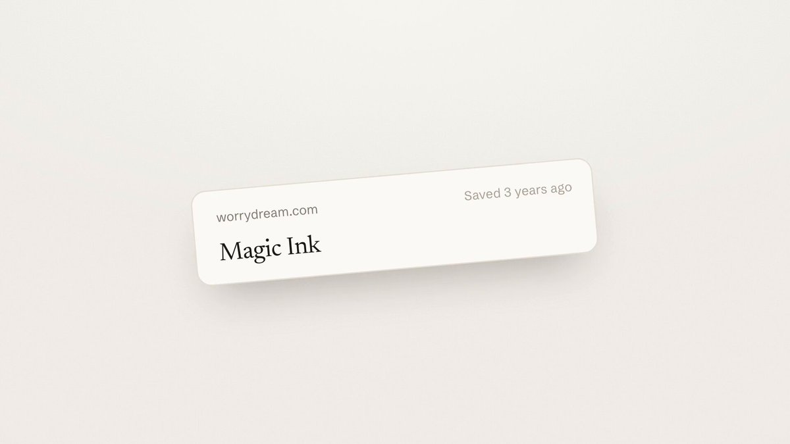

# Introducing Gloss!
> Source: https://x.com/nutlope/status/2110385721391366263
> Author: Hassan (@nutlope)
> Posted: 2026-10-14T15:02:19+00:00
> Captured: 2026-10-15T09:02:28+00:00
> Stats at capture: 53,091 views · 1,297 likes · 54 replies · 75 reposts · 1,499 bookmarks · 16 quotes

## Post

Introducing Gloss!

A beautiful new way to save, read, and interact with articles.

→ Save articles, PDFs, and X bookmarks
→ Highlight and get instant answers with AI
→ Build a personal library you'll actually use

Free and open source!

## Media

[Post media 1](media/video-01.mp4) — Source media: https://video.twimg.com/amplify_video/2110385606014480384/vid/avc1/1280x720/jN8GLQrx4gqjBJtO.mp4?tag=29
 — Post media 1 thumbnail. Source media: https://pbs.twimg.com/amplify_video_thumb/2110385606014480384/img/Izsh3-4wJEFdJjBI.jpg
 — Reply 2110396530133799394 media 1. Source media: https://pbs.twimg.com/media/HUmich0WcAAw-sw.jpg

## Thread

### Hassan ([@nutlope](https://x.com/nutlope/status/2110385724059246968)) — 2026-10-14T15:02:20+00:00

Try Gloss today!

Powered by fast inference on @togethercompute. The repo & full tech stack are below too.

https://t.co/zLBq9FjO8b
### Hassan ([@nutlope](https://x.com/nutlope/status/2110385726680670319)) — 2026-10-14T15:02:20+00:00

Tech Stack & code:

◆ @togethercompute for AI answers (DeepSeek V4.1)
◆ @ExaAILabs for fast web search
◆ @llama_index (LiteParse) for PDFs
◆ @nextjs for the frontend/backend
◆ @neondatabase for the database
◆ @clerk for authentication

https://t.co/hrllTQbPB4
### Hassan ([@nutlope](https://x.com/nutlope/status/2110550361979126223)) — 2026-10-15T01:56:33+00:00

@zackmilles you're the third person to ask! will add to my roadmap
### Hassan ([@nutlope](https://x.com/nutlope/status/2110398338528899439)) — 2026-10-14T15:52:27+00:00

@CelestinEiffel Very fair feedback! It is open source so you can fork it and ask your agent to make PDF uploads work with local models for example if you really want to.

The cloud version is meant to have a generous free tier limit such that as many people as possible can try it out.
### Hassan ([@nutlope](https://x.com/nutlope/status/2110403684823679245)) — 2026-10-14T16:13:42+00:00

@transitive_bs code is OSS so feel free to remix the two :)
### Hassan ([@nutlope](https://x.com/nutlope/status/2110397355480457576)) — 2026-10-14T15:48:33+00:00

@SheikAlthafDev Nice, feel free to remix my code in there too if helpful!
### Hassan ([@nutlope](https://x.com/nutlope/status/2110594633252409396)) — 2026-10-15T04:52:28+00:00

@0xniccomi please lmk if you have any feedback if you end up trying it!
### Hassan ([@nutlope](https://x.com/nutlope/status/2110550598861127835)) — 2026-10-15T01:57:29+00:00

@BladeLock07 nope, just a web app for now!
### Hassan ([@nutlope](https://x.com/nutlope/status/2110398052897087826)) — 2026-10-14T15:51:19+00:00

@Jordan_Connell_ @heyderekj Yessir! One more cool thing I've been doing is have my personal agent (whether you use grokbot or muse or instrinct) remind me to read one article a day
### Hassan ([@nutlope](https://x.com/nutlope/status/2110452360342302960)) — 2026-10-14T19:27:07+00:00

@Perfi_X I’m working on Gloss Print!
### Hassan ([@nutlope](https://x.com/nutlope/status/2110392027187679595)) — 2026-10-14T15:27:23+00:00

@nikitabase @neondatabase Of course! And thank you for a great DB platform
### Hassan ([@nutlope](https://x.com/nutlope/status/2110550401061896424)) — 2026-10-15T01:56:42+00:00

@_namita_r thanks!
### Hassan ([@nutlope](https://x.com/nutlope/status/2110452561027486050)) — 2026-10-14T19:27:55+00:00

@rblalock Thanks Rick!
### Hassan ([@nutlope](https://x.com/nutlope/status/2110389136347857039)) — 2026-10-14T15:15:53+00:00

@YoussefUiUx awesome work on v1 my man
### Hassan ([@nutlope](https://x.com/nutlope/status/2110392296202248249)) — 2026-10-14T15:28:27+00:00

@FullStackNate Thanks Nathan!
### Hassan ([@nutlope](https://x.com/nutlope/status/2110392203054883281)) — 2026-10-14T15:28:05+00:00

@toomanytrips1 thanks man! lmk if you end up trying it out and have any feedback!

## Comments

### Zack Milles ([@zackmilles](https://x.com/zackmilles/status/2110535961620684939)) — 2026-10-15T00:59:19+00:00

@nutlope Love this. Could you add youtube support? I have yet to find a good tool that can help with youtube videos (highlights + frame snips).
### Travis Fischer ([@transitive_bs](https://x.com/transitive_bs/status/2110400159473705105)) — 2026-10-14T15:59:42+00:00

@nutlope hmmmm this looks so calming :)

currently have some local automations set up to track my X bookmarks, classify them, and add them to the most relevant notion page which i use as a second brain, but this looks sexy...
### Sheik Althaf ([@SheikAlthafDev](https://x.com/SheikAlthafDev/status/2110394624607146337)) — 2026-10-14T15:37:42+00:00

@nutlope This awesome man 🚀, I’m also working on something but focused only related PDFs. Congratulations on your launch 🥳
### niccomi 🧙‍♂️ ([@0xniccomi](https://x.com/0xniccomi/status/2110578921993601297)) — 2026-10-15T03:50:02+00:00

@nutlope oh my I been wanting to vibe code something like this but this is even better! thank you
### N!h!l!ty007 ([@BladeLock07](https://x.com/BladeLock07/status/2110463428121006465)) — 2026-10-14T20:11:06+00:00

@nutlope hey is there a mac app?
### Jordan Connell ([@Jordan_Connell_](https://x.com/Jordan_Connell_/status/2110396572626481372)) — 2026-10-14T15:45:26+00:00

@nutlope @heyderekj Now I just need to remember to go back to my bookmarks later today to set this up.

This one’s gonna be great!
### Kashif Ansari 🇮🇳 کاشف انصاری ([@Perfi_X](https://x.com/Perfi_X/status/2110451416833921430)) — 2026-10-14T19:23:22+00:00

@nutlope So awesome!
When are you coming up with the full book feature for a topic with each bookmark acting as a chapter/sub-chapter.
### Nikita | Scaling Lakebase Postgres ([@nikitabase](https://x.com/nikitabase/status/2110390414717124961)) — 2026-10-14T15:20:58+00:00

@nutlope This is really nice - thanks for sharing that it's built on @neondatabase
### Namita ([@_namita_r](https://x.com/_namita_r/status/2110535431951708226)) — 2026-10-15T00:57:13+00:00

@nutlope amazing!
### Rick Blalock ([@rblalock](https://x.com/rblalock/status/2110406641250410940)) — 2026-10-14T16:25:27+00:00

@nutlope beautiful
### Youssef ([@YoussefUiUx](https://x.com/YoussefUiUx/status/2110388616476438906)) — 2026-10-14T15:13:49+00:00

@nutlope 🚀🚀
### Nathan ([@FullStackNate](https://x.com/FullStackNate/status/2110391068524949865)) — 2026-10-14T15:23:34+00:00

@nutlope This is really cool!
### trips ([@toomanytrips1](https://x.com/toomanytrips1/status/2110390790321287491)) — 2026-10-14T15:22:28+00:00

@nutlope so cool
### 赛博闲人 ([@CyberIdleoq](https://x.com/CyberIdleoq/status/2110530217429365075)) — 2026-10-15T00:36:30+00:00

@nutlope Can highlights be exported with the source URL and surrounding paragraph? That's the difference between a useful reference library and a folder of quotes I can't place six months later.
### Cooper McKay ([@c00per_mckay](https://x.com/c00per_mckay/status/2110398102003953869)) — 2026-10-14T15:51:31+00:00

@nutlope This is super cool excited to use it so awesome that you can just solve problems with tech!
### Daniel Priscu ([@daniel_priscu](https://x.com/daniel_priscu/status/2110415003224359213)) — 2026-10-14T16:58:41+00:00

@nutlope the bookmarks import alone sells it, that folder is a graveyard for most people
### Abdul Wasey ([@iabdul_wasey](https://x.com/iabdul_wasey/status/2110393912397598838)) — 2026-10-14T15:34:52+00:00

@nutlope I'd label answers that pull in sources outside my saved article.
### Q ([@onlyQ__](https://x.com/onlyQ__/status/2110555747805450550)) — 2026-10-15T02:17:57+00:00

@nutlope This is beautiful. Thank you
### Médico Aumentado ([@medicoaumentado](https://x.com/medicoaumentado/status/2110416133358530872)) — 2026-10-14T17:03:10+00:00

@nutlope Tiene app para celular?
### Veyra | AI & Tech ([@VeyraWithAI](https://x.com/VeyraWithAI/status/2110629702163681744)) — 2026-10-15T07:11:49+00:00

@nutlope A reading library that actually answers back
### Zara Tech & Tools ([@AskZaratech](https://x.com/AskZaratech/status/2110458962663637385)) — 2026-10-14T19:53:21+00:00

@nutlope Lovely concept for building a useful reading library
### 吒老斯 ([@zachzhao1984](https://x.com/zachzhao1984/status/2110627635135189403)) — 2026-10-15T07:03:36+00:00

@nutlope X Article is quite complex to render beautifully
### Mirza ([@b1rkh0ff](https://x.com/b1rkh0ff/status/2110393716821414248)) — 2026-10-14T15:34:05+00:00

@nutlope Beautiful. I was thinking of building it myself, but I simply don’t have the time or tokens. 😄

I guess it’s time to cancel the Reader.
### ju8aka ([@ju8aka](https://x.com/ju8aka/status/2110469242776617046)) — 2026-10-14T20:34:12+00:00

@nutlope Truly awesome, thank you for this gift🙏
### Aaliya ([@aaliya_va](https://x.com/aaliya_va/status/2110450373890904174)) — 2026-10-14T19:19:14+00:00

@nutlope I like that it's free and open source.
### Serg ([@serglotz](https://x.com/serglotz/status/2110389992388219223)) — 2026-10-14T15:19:17+00:00

@nutlope @vanschneider so wdyt where is the moat when folks OSS software like this one easily with ai.
### Fenil Modi  (YC 26) rejected ([@Fenil_TW](https://x.com/Fenil_TW/status/2110576136409514452)) — 2026-10-15T03:38:58+00:00

@nutlope what did you used for creating this marketing video
### William Wolf ([@willium](https://x.com/willium/status/2110508768366916067)) — 2026-10-14T23:11:16+00:00

@nutlope beautiful!

## Other returned timeline records

> The CLI did not expose reply relationships. These records do not start with a reply mention and were authored by someone other than the saved-post author. They may include recommendations or promoted posts; they are retained as source context, not verified replies.

### Celestin Eiffel ([@CelestinEiffel](https://x.com/CelestinEiffel/status/2110396530133799394)) — 2026-10-14T15:45:16+00:00

Looks terrific! Tried adding a PDF.. together AI is where I get stuck, because I don't understand its offering and it's not clear to me what it'll cost. Plus, it forces me to use yet another AI provider! I'd very much prefer to use the API key for a model I've already subscribed to (e.g. Gemini) or that I've already installed (e.g. glm-5.3-flash:cloud via Ollama).
 — Source media: https://pbs.twimg.com/media/HUmich0WcAAw-sw.jpg
### Starlink ([@Starlink](https://x.com/Starlink/status/2068115197718593741)) — 2026-06-19T23:34:21+00:00

Get connected with fast, reliable internet for streaming, video calls, online gaming and more.

Order online in minutes.
### Starlink ([@Starlink](https://x.com/Starlink/status/2098481322268504487)) — 2026-09-11T18:38:29+00:00

Get fast, reliable home internet for seamless streaming, working from home, gaming, and more across multiple devices.

Order online in minutes.
### Range ([@range_org](https://x.com/range_org/status/2107881893010297037)) — 2026-10-07T17:13:00+00:00

Range and @aiprise are now partners.

Every company moving money across stablecoins and fiat answers two questions:

1) Who is on the other side?

2) Should this transaction go through?

AiPrise answers the first with KYB and KYC across 200+ countries. Range answers the second with controls that run on every transaction before it executes.

Companies using either one now get a direct introduction to the other.

The announcement 👇

https://t.co/riiaqvEcNx
### Fin ([@fin_ai](https://x.com/fin_ai/status/2107910517134086599)) — 2026-10-07T19:06:45+00:00

Fin 4 is here. A major step toward a fully agentic customer experience.

Fin 4 brings major upgrades to every part of the system. A more capable Customer Agent, a more powerful Operator, and new ways for Fin to work with your team.

Learn more about Fin 4 here: https://t.co/Rx82jKspiD
