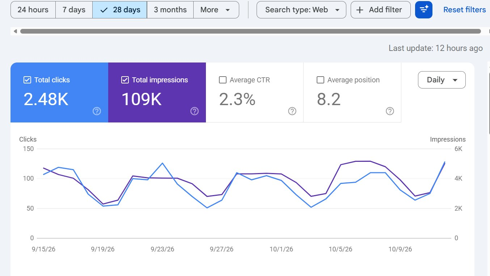

# Almost 2,500 Google clicks in the last 28 days.

> Source: https://x.com/2whazzuup/status/2110595028015808766
> Author: Grant O (@2whazzuup)
> Posted: Thu Oct 15 04:54:02 +0000 2026
> Captured: 2026-10-15T10:47:16.007333+00:00

## Post

Almost 2,500 Google clicks in the last 28 days.

This is from a local directory website I launched a few months ago.

I wanted to share the backlink strategy I've been using to help grow it.

1. PRLog

When I first launched, I published a press release through PRLog announcing the directory.

This was one of the first things I did to establish an online presence and get the brand mentioned outside of my own website. 

I think I paid $99 for 300, but only ended up seeing around 200.

2. Foundational directory links

I submitted the website to relevant business directories, local directories, and industry-specific listing sites.

I prioritized directories that were actually relevant to the website rather than submitting to everything I could find.

3. Paid PR

I've also used paid press release distribution to announce the directory and get additional exposure.

Most syndicated press release links aren't going to pass meaningful SEO value, but they can help get your brand in front of publishers and potentially lead to additional coverage.

4. Babylove Growth

I've been using Babylove Growth as another way to build backlinks.

It's part of my overall link-building efforts, alongside the other methods here. 

People say it's spammy and Google will punish me, but  I'm not putting all my eggs in that basket. 

5. Badge placements

This is one of the more interesting things I've implemented.

I work with businesses listed in my directory and offer them an enhanced listing in exchange for placing a badge on their website.

The badge links back to my directory.

They get additional exposure and features, while I get a relevant link and potential referral traffic.

This works particularly well because the businesses already have a reason to be involved with the directory.

Since it's an exchange of value, these links should be appropriately qualified rather than treated as organic editorial endorsements.

6. Informational content around laws and guidelines

I've been publishing articles that explain laws, regulations, eligibility requirements, and government guidelines relevant to my niche.

These are subjects that businesses, organizations, and other publishers frequently need to reference.

I focus on making complicated information easier to understand, using official sources and keeping the content updated when things change.

The goal is to create resources that other websites naturally want to cite.

I think this has the most long-term potential of anything on the list.

A few takeaways:

I started building links almost immediately after launching the directory.

I also try to make link building part of the website's normal operations rather than treating it as a completely separate SEO task.

The badge placements create ongoing opportunities as more businesses join.

The informational articles can continue attracting links as they get discovered.

And the foundational links and PR helped establish the website early on.

Obviously, backlinks aren't the only reason the directory is getting traffic. Content, search intent, and the niche itself all play a role.

But I've been happy with the progress so far.

I'll keep sharing what works as it grows.

## Media

> Original media URL: https://pbs.twimg.com/media/HUpWDiCbwAAKScR.jpg?name=orig

## Thread

### Grant O (@2whazzuup) — https://x.com/2whazzuup/status/2110494048054378950

Everyone wants to rank for 'best credit cards.'  

Nobody wants to build a boring website about replacement parts for garage doors.  

That's why boring niches keep winning.

## Comments

### khizza| SEO AI (@khizzaseo) — https://x.com/khizzaseo/status/2110658467589456290

@2whazzuup The badge placement idea is clever since it gives the listed business a real reason to link.

### Tim (@timmyships) — https://x.com/timmyships/status/2110600563977236501

@2whazzuup Have you got a gut feeling on which ones are having the most impact? Like if you only had to pick 1-2 of those tactics?

### Brjan | AI Builder (@MrBrjan) — https://x.com/MrBrjan/status/2110652119338586619

@2whazzuup if those clicks keep climbing, your backlink strategy might need scaling too

### AI Directories 🤖 (@ai_directories) — https://x.com/ai_directories/status/2110679634526564625

@2whazzuup 2,500 clicks from a directory site is the best proof directories still work 💪

### Block By Block Solutions (@BlockByBlockHQ) — https://x.com/BlockByBlockHQ/status/2110680281766359351

@2whazzuup Solid SEO foundation
