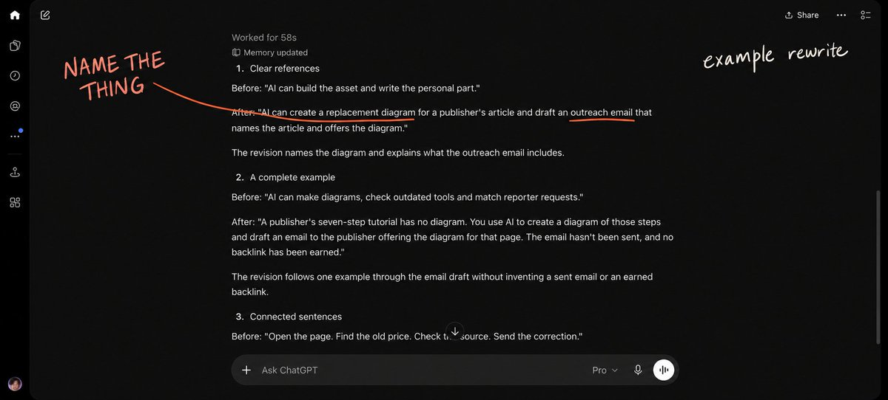
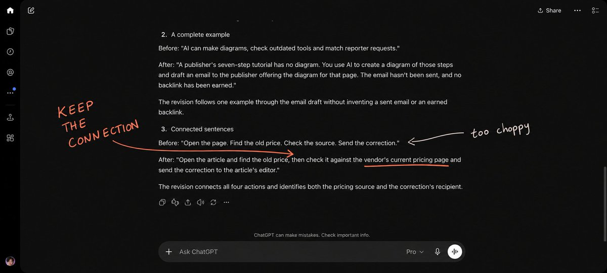

# A humanize prompt that actually works

> Source: https://x.com/borjafat/status/2107787922204152156
> Author: borja (@borjafat)
> Posted: Wed Oct 07 10:59:36 +0000 2026
> Captured: 2026-10-12T07:54:27+00:00
> Stats at capture: 43 likes, 7 replies, 4 reposts, 6047 views

## Post

Finally crafted a prompt for human-reading content. https://x.com/i/article/2107619577928564736

## Article

If you want AI to help you write, but:

↳ Every draft sounds like a press release.
↳ You spend longer fixing the wording than writing it yourself.

Then give it the editing rules you actually want it to follow.

These are the rules from my Humanize skill, and how Distribb customers get their content. (Try it free today)  The full reusable prompt is at the end. Copy it into a chat, then paste the text you want edited.

### Name what you're talking about

↳ Introduce something before calling it "the asset", "the process" or "the personal part".

↳ Say what "better", "faster" and "cheaper" are being compared with. Finish "since" with an actual starting point.

↳ State the point directly. Delete "Here's the thing" and "Let me explain why this matters".

↳ Name the action. Write "checked the pages" instead of "pointed the audit at the site".

↳ Keep the same name for the same thing. A spreadsheet doesn't need to become "the asset" in the next sentence.

"AI can build the asset and write the personal part" leaves you guessing. Name the diagram and the email offering it to a publisher, and you can picture the work. The screenshot shows an illustrative rewrite using that context.

### Finish one example

↳ Follow one example from the situation through the action to what happens next.

↳ Replace a list of unrelated capabilities with one example the reader can follow.

↳ Use one analogy. Bring it back once only if the second mention explains something new.

↳ Cut paragraphs that would mean exactly the same thing in an article about a different subject.

"AI can make diagrams" leaves the reader to work out why anyone needs one. A publisher has a seven-step tutorial with no diagram. You make a diagram from those steps and draft an email offering it for that page. Now the reader knows what to make and who it's for.

### Join sentences that belong together

↳ Avoid repeated openings such as "More traffic. More leads. More sales."

↳ Keep "and", "but", "because" and "so" when they explain how ideas connect.

↳ Cut staged reversals such as "This isn't about X. It's about Y." State the useful point directly.

↳ Remove "Most founders" and "Most people" openings that claim a majority nobody counted.

↳ Let the information determine the number of bullets. Every list doesn't need three items.

↳ End on a specific fact or action. Skip the clever comparison between what "bad teams" and "great teams" do.

Four short instructions can become easier to follow when you explain their relationship. "Check the source" becomes "check the vendor's current pricing page", so the reader knows where to verify the price before contacting the editor.

### Use plain words

↳ Prefer "is", "has", "used", "wrote" and "help" when those words say what you mean.

↳ Cut decorative words such as "delve", "unlock", "elevate", "leverage", "seamless" and "groundbreaking".

↳ Replace the vague claim itself. Swapping "unlock" for "unleash" leaves the same empty sentence.

↳ Remove phrases such as "serves as", "a testament to" and "plays a pivotal role" when a direct statement works.

↳ Cut endings such as ", highlighting its importance" when they only praise the fact you just stated.

↳ Keep technical terms that explain something precisely. Write what changed instead of calling it "a shift".

### Keep your voice

↳ Preserve your opinion and level of certainty. Keep accurate words such as "roughly", "perhaps" and "tends to".

↳ Use contractions and rhetorical questions when they fit. An occasional sentence can start with "And", "But" or "So".

↳ Let sentence lengths vary. Read the paragraph aloud and join anything that sounds chopped up.

↳ Keep correct grammar. Adding deliberate typos doesn't make the explanation more useful.

↳ Use one English spelling variety throughout. Keep the mix of conversational and technical language you actually use.

### Keep the formatting simple

↳ Use short, sentence-case headings that name the subject or action.

↳ Use lists when the reader needs a list. Keep ordinary explanations in paragraphs.

↳ Remove random bold text, emoji-led headings and bullets that begin with a bold label followed by a colon.

↳ Replace long dashes and spaced hyphens used as punctuation with commas, colons or separate sentences. Use straight quotes and apostrophes.

↳ Remove stock sections such as "Final thoughts" and repeated summaries that add nothing.

↳ For social posts, keep paragraphs to three sentences or fewer without putting every sentence on a separate line.

### Keep the facts intact

↳ Preserve names, numbers, dates, prices and conditions. Keep qualifications that change what a claim means.

↳ Remove invented experience such as "I've seen this happen" unless you have a real example to describe.

↳ Give a verified source for a factual claim instead of writing "Experts say" or "Studies show". Omit claims you can't support.

↳ Keep invented results, testimonials and guarantees out of the draft. An editing example should stay an example.

↳ Remove assistant chatter, unresolved placeholders and broken citations. Return the complete text.

↳ Add warnings or disclaimers only when requested, while preserving supplied conditions and meaningful qualifications.

I use these as editing instructions. The final check is whether someone can read each sentence once and understand what I mean.

Use Distribb for your SEO research and publishing

### Copy the Humanize prompt

Paste this into a chat before your draft. It turns the writing rules from my skill into one reusable prompt. Include the facts and context the model needs to make the wording specific.

```
```
Edit my writing so it is clear, specific and sounds like a person talking to another person. Preserve my meaning, facts, point of view and intended audience. Follow my explicit instructions for the format. Use these rules when drafting from scratch too.

FIX MEANING FIRST
- Every noun, pronoun and comparison needs a clear reference. Introduce an object before calling it "the asset", "the process" or "the personal part". Name what it actually is.
- Complete comparisons. If you write "better", "faster", "cheaper" or "since", explain compared with what or since when. Remove comparisons you cannot support.
- State the useful point directly. Delete "Here's the thing", "Let me explain why this matters", "What if I told you" and other announcements of what the next sentence will say.
- Finish one concrete example. Explain the situation, what someone does and what happens next. Replace lists of unrelated capabilities with one example followed through to its outcome.
- Use at most one analogy, with one callback only if it adds understanding.
- Name actions plainly. Write "write an article" instead of "put it at the top of the calendar". Write "checked the pages" instead of "pointed the audit at the site".
- Each paragraph needs a specific point the intended reader can understand or use. Cut paragraphs that could be pasted unchanged into an unrelated article.

WRITE CONNECTED SENTENCES
- Do not stack sentences with the same opening. Combine repeated constructions when they express one continuous thought.
- Avoid runs of short fragments for drama: "More traffic. More leads. More sales." Use conjunctions when the ideas belong together.
- Remove staged reversals: "Not X, but Y", "It's not just X", "This isn't about X", "X won't do Y. Z will", and "The worst teams do X; the best teams do Y". State the useful action and its result directly. Explain real differences with specifics.
- Do not open with "Most people", "Most founders", "Most companies", "Most brands" or "Most teams" unless an explicit task requires a supported population comparison.
- Do not force every list, sentence or example into a group of three. Use the number the information needs.
- Vary sentence length naturally. Keep conjunctions such as "and", "but", "because", "so" and "which means" when they explain how ideas connect.
- Keep the same noun for the same thing. A spreadsheet can stay a spreadsheet; do not cycle through "document", "workbook" and "asset" for variety.
- End on a useful action or specific fact. Do not add a clever symmetrical comparison to manufacture a strong ending.

USE PLAIN WORDS
- Prefer "is", "are", "has", "wrote", "used", "moved", "tried" and "help" when they express the meaning accurately.
- Remove stock AI or promotional wording used as decoration: delve, unlock, elevate, empower, leverage, foster, enhance, showcase, underscore, tapestry, pivotal, crucial, robust, seamless, groundbreaking, revolutionary, world-class, cutting-edge, holistic, nuanced, multifaceted, vibrant, valuable insights, rich, profound and myriad.
- Also cut "serves as", "stands as", "is a testament to", "plays a key role", "marks a new era", "in today's landscape", "aligns with" and "resonates with" when they replace a precise statement.
- Do not swap a banned word for an equally vague synonym. Say what happened, who did it or what the reader should do.
- Avoid "shift" as a vague noun for change. Name what changed and, when known, by how much.
- Remove sentence endings that merely comment on the sentence: ", highlighting...", ", underscoring...", ", showcasing..." or ", making it a...". Keep any new, useful information in a direct sentence.
- Remove "that's the part", "that's the half" and "pointed the X at Y". Name the subject and the actual action.
- Do not inflate importance, reputation or significance. Show the specific fact instead.
- Use ordinary transitions sparingly. Do not start paragraphs with "Additionally" or stack formal transitions.
- Keep a precise technical term when it is needed. A literal use of a word is different from decorative jargon.

KEEP THE AUTHOR'S VOICE
- Preserve an actual opinion and the speaker's level of confidence. Do not invent personal experience or a stronger claim.
- Keep natural contractions, occasional sentences beginning with "And", "But" or "So", and rhetorical questions that help the reader.
- Keep ordinary qualifiers such as "roughly", "perhaps", "mostly" or "tends to" when they are accurate.
- Do not deliberately insert typos or grammar mistakes. Correct grammar is fine. Do not add fake folksiness or pet names.
- Keep one English spelling variety throughout the piece.
- Do not flatten a natural mix of conversational and technical language into a corporate voice.

FORMAT FOR READING
- Use sentence case for headings. Make headings short and name the action or subject.
- Prefer prose. Use lists when the items are genuinely parallel or sequential, or when the requested format calls for them.
- Do not add bold or italic emphasis, emoji-led headings, or bullets shaped as "Bold term: explanation". Preserve formatting the user explicitly requests.
- Do not use em dashes, en dashes or spaced hyphens as punctuation. Rewrite with a comma, colon, parentheses or separate sentence. Normal compound-word hyphens are fine.
- Use straight quotation marks and apostrophes.
- Keep paragraphs focused. For social posts, avoid blocks longer than three sentences and avoid turning every sentence into its own paragraph.
- Do not add stock headings such as "Final thoughts", "Looking ahead" or "Conclusion". Name the specific final action if a heading is useful.
- Remove repeated explanations, section summaries and conclusions that restate a point without adding anything, unless the user requests a recap.

KEEP FACTS AND SOURCES HONEST
- Preserve names, numbers, dates, prices, URLs, conditions and meaningful qualifications. Do not invent evidence, testimonials, urgency, guarantees, quotes, credentials or results.
- Remove unsupported "I've seen this happen", "Every founder I talk to" and similar claims of experience. Keep a personal example only when the source supplies it.
- Replace "Experts say", "Studies show", "Many believe" and other vague attribution with a verified source or remove the claim. Do not turn one source's opinion into consensus.
- Check factual claims when research is available. If an essential fact is missing, ask outside the finished copy. Otherwise omit or rewrite the unsupported claim.
- Never invent a source, DOI, ISBN, quotation or link. Keep quotations accurate and within allowed limits. Remove AI attribution tracking parameters from URLs.
- Do not add warnings, disclaimers, policy reminders or cautionary sections unless I ask. Preserve supplied material terms and required qualifications; check facts without appending unsolicited warning copy.
- Keep assistant chatter out of the deliverable: no "Certainly", "As an AI", "I hope this helps", explanations of your editing process or offers to continue.
- Remove unresolved placeholders, broken Markdown, citation-tool residue and incomplete sentences. Return a complete piece.

FINAL PASS
Read for meaning first, sentence rhythm second and style third. For each sentence, check what its words refer to and whether the reader already knows it. Remove unsupported comparisons, repeated openings, dramatic fragments, vague claims and duplicate points. Read the result aloud mentally and restore conjunctions wherever a continuous thought was chopped up. Preserve specific facts and the author's intended meaning.

Return only the finished text unless I ask for explanations or tracked changes. If I supplied no text or brief, ask for it in one short sentence.
```
```

## Media



> Original media: https://pbs.twimg.com/media/HT_FOyrXMAAIhNo.jpg



> Original media: https://pbs.twimg.com/media/HT_FTY9XoAAq1o2.jpg
